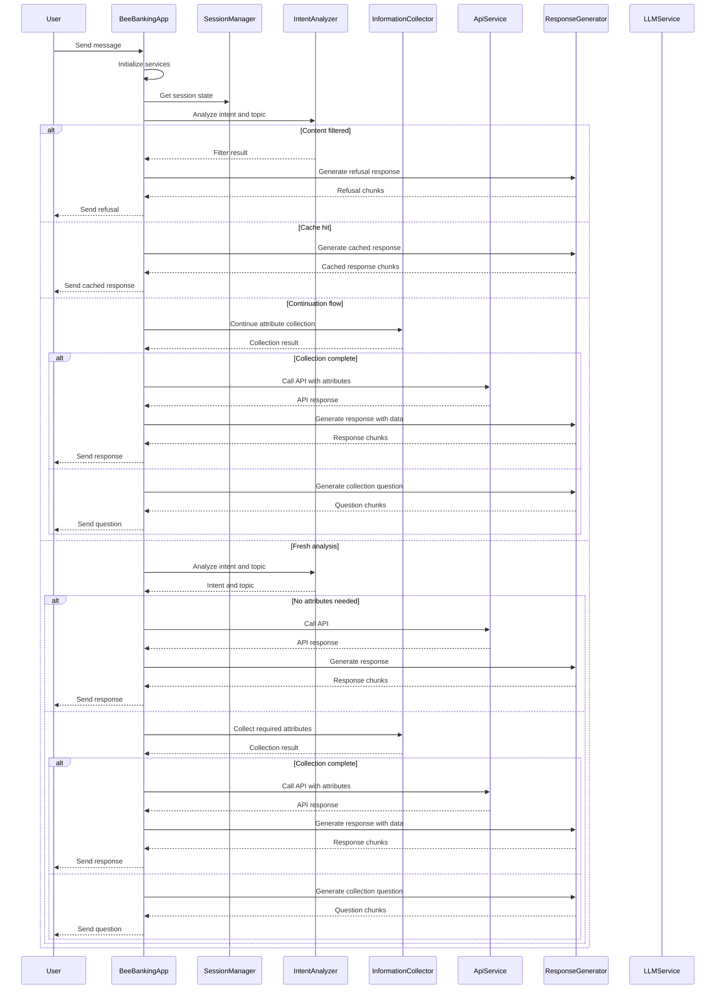

# Sequence Diagram: BeeBankingApp Business Flow

## Flow Description

The BeeBankingApp processes user requests through a sophisticated orchestration of services:

1. **Initialization**: The app initializes core services including LLM, content filter, document service, and session manager.

2. **Preprocessing**: In parallel, it processes user profile and preloads session context.

3. **Content Filtering**: The message is checked for inappropriate content. If filtered, a refusal response is generated.

4. **Cache Check**: The system checks if the query has a cached response. If found, it returns the cached answer.

5. **Flow Decision**: Based on conversation context, the system determines if this is:
   - A continuation of an existing collection flow
   - A fresh analysis for a new request
   - An intent switch

6. **Attribute Collection**: For intents requiring additional information (like account number, date range), the system collects these attributes through conversation.

7. **API Integration**: Once all required attributes are collected, the app calls the appropriate API service.

8. **Response Generation**: The response generator creates a natural language response using the API data and returns it to the user.

The architecture uses a unified services pattern to eliminate code duplication and provide a consistent experience across all banking domains including deposits, cards, balance retrieval, and loan management.