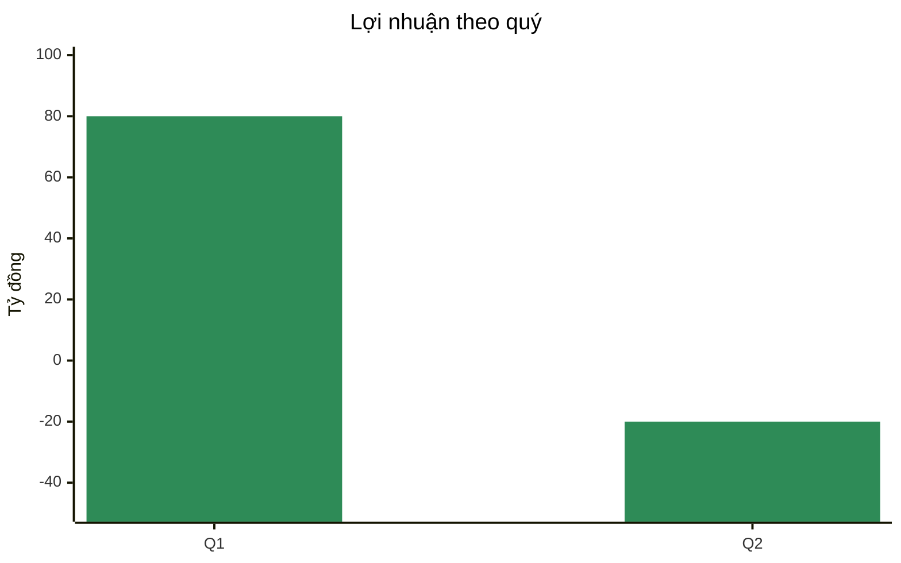
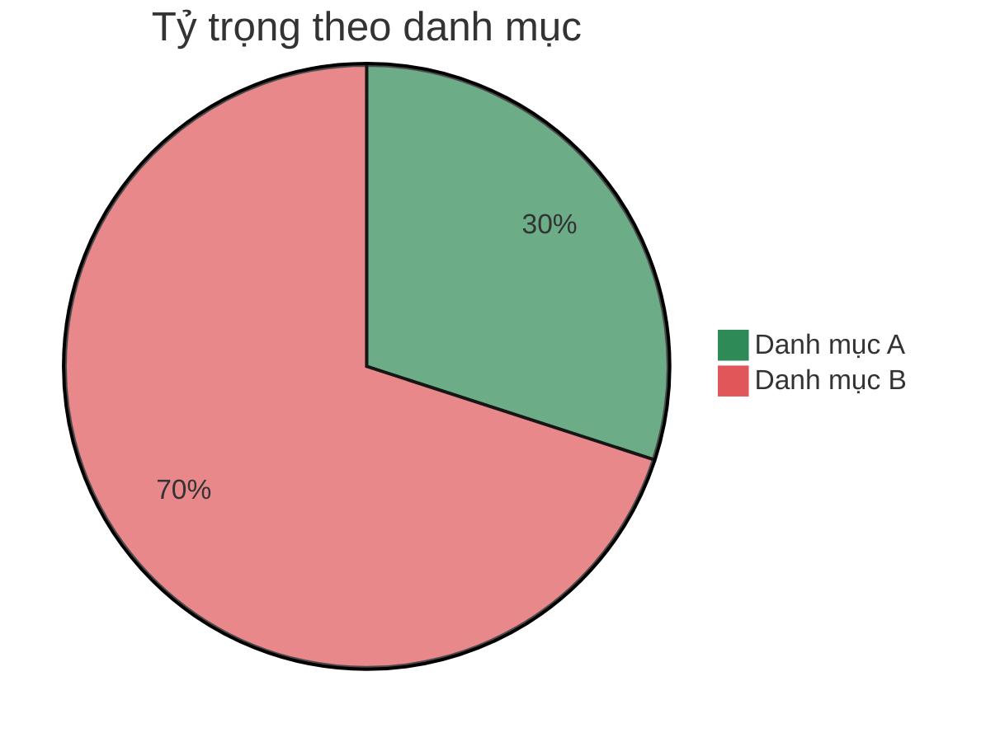

# Tạo biểu đồ Mermaid

Chỉ dùng label, đơn vị và số có trong raw result đã xác minh hoặc bảng người dùng
cung cấp. Không tự tạo số, không cộng gộp, không đổi label hoặc đơn vị. Có thể
làm tròn phần thập phân quá dài để biểu đồ dễ đọc nhưng không được làm sai ý nghĩa.
Chỉ vẽ khi có ít nhất hai điểm số hợp lệ; nếu không phù hợp, trả về chuỗi rỗng `""`.

## 1. Phân tích dữ liệu và chọn loại biểu đồ

- `bar` (`xychart-beta`): so sánh giữa các category hoặc top-N.
- `line` (`xychart-beta`): dữ liệu theo thời gian/ngày/tháng/năm.
- `pie`: tỷ lệ phần trăm hoặc các phần của cùng một tổng thể (tổng thường là 100%).
- Nếu dữ liệu phức tạp hoặc có bất kỳ giá trị âm nào, BẮT BUỘC dùng `line`.

Tiêu đề và label PHẢI bằng tiếng Việt, chính xác và không nhầm đơn vị.

## 2. Xử lý null/N/A

Mermaid không hỗ trợ `null`, `None`, `-`, `N/A` hoặc giá trị trống.

- Giữ nguyên giá trị số `0`.
- Các giá trị được coi là thiếu: `null`, `None`, `-`, `N/A`, `""` và chuỗi chỉ có
  khoảng trắng.
- BẮT BUỘC loại bỏ cả category/label x-axis và điểm dữ liệu có giá trị thiếu.
- Với nhiều series, phải loại bỏ đồng bộ cùng vị trí ở TẤT CẢ series và x-axis.
- Sau xử lý, số label và số điểm của từng series PHẢI khớp nhau.

Ví dụ: `labels=["T1", "T2", "T3"]`, `values=[null, 0, 1.55]` phải thành
`labels=["T2", "T3"]`, `values=[0, 1.55]`.

## 3. Định dạng số

- Tất cả số phải viết liền, không có dấu phân cách `_` hoặc `,`.
- ĐÚNG: `6500000000000`, `1.55`, `-500`.
- SAI: `6_500_000_000_000`, `6,500,000,000,000`.
- Quy tắc này áp dụng cho y-axis, bar/line data và pie values.

## 4. Màu sắc

Tự chọn `plotColorPalette` phù hợp với ngữ cảnh:

- Tránh màu quá nhạt hoặc quá sáng trên nền trắng.
- Dữ liệu tích cực/tiêu cực nên dùng màu ngữ nghĩa như xanh/đỏ hoặc xanh/cam.
- So sánh nhiều category phải dùng màu tương phản cao, chuyên nghiệp.

## 5. Cú pháp xychart-beta bắt buộc

Code block phải bắt đầu bằng ` ```mermaid `, sau đó là frontmatter YAML. `plotColorPalette`
PHẢI là STRING, không phải YAML array.



- `plotColorPalette: "#2E8B57, #E15759"` là đúng.
- `plotColorPalette: ["#2E8B57", "#E15759"]` là sai.
- Trục Y PHẢI tự tính `min` và `max`: dữ liệu toàn dương dùng min `0`; có số âm
  thì min phải nhỏ hơn số âm nhỏ nhất để biểu đồ không mất chân cột.
- Tất cả x-axis label PHẢI là string trong dấu nháy kép, ví dụ
  `["Hà Nội", "TP HCM", "Cần Thơ"]`, `["T1/2025", "Q2"]`.
- Nếu label quá dài, được rút gọn nhưng phải giữ nguyên ý nghĩa.
- Dùng `bar [...]` cho bar chart và `line [...]` cho line chart.

## 6. Cú pháp pie bắt buộc



## 7. Output và kiểm tra

- Chỉ trả về code Mermaid có markdown fence ` ```mermaid ... ``` `, không thêm giải thích
  bên ngoài code block trong output của tool vẽ.
- Với xychart, sau dòng mở fence phải bắt đầu bằng `---`; với pie phải bắt đầu bằng `%%{`.
- Gọi `check_mermaid_syntax` trước khi trả code cho frontend. Nếu lỗi, sửa và kiểm tra lại.
- Nếu dữ liệu rỗng, chỉ có một số, toàn text hoặc không thể sửa thành Mermaid hợp lệ,
  trả về chuỗi rỗng `""` thay vì code lỗi.
- Escape label có dấu nháy đơn bằng backslash, ví dụ `O\'Reilly`; tránh ký tự đặc biệt
  không cần thiết trong label.
