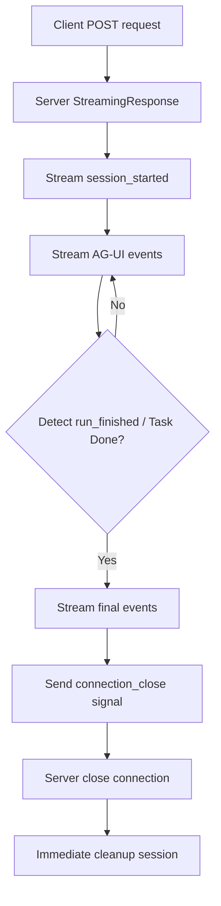

# AG-UI Streaming Implementation Guide

## 📋 Tổng quan

Hướng dẫn này mô tả cách implement một **single-endpoint streaming API** tuân thủ **AG-UI Protocol** với FastAPI, sử dụng các thành phần streaming có sẵn trong thư mục `streaming/`. Thiết kế này cho phép client chỉ cần 1 HTTP POST request để nhận streaming events real-time, thay vì phải gọi 2 endpoints riêng biệt.

## 🏗️ Kiến trúc tổng thể

### Thiết kế Single Endpoint
```
POST /chat/completion → StreamingResponse
├── Session metadata (first event)
├── AG-UI events (streaming)  
├── Completion signal (last event)
└── Auto cleanup
```

### Phân tách Layer
Các thành phần streaming được tổ chức trong thư thư mục `streaming/` như sau:

```
📁 streaming/
├── manager.py          # Quản lý session, queue events, SSE generator
├── context.py          # Quản lý ContextVars cho session, thread, run
├── emitters.py         # Phát ra các AG-UI event
├── decorators.py       # Decorator để tự động emit step events
├── bridge.py           # Chuyển đổi chunk stream từ LLM thành AG-UI events
└── __init__.py
```

## 📊 Sequence Diagram

```mermaid
sequenceDiagram
    participant C as Client
    participant API as FastAPI Endpoint
    participant SM as EventStreamManager
    participant BS as Business Service
    participant EM as EventEmitter
    participant GEB as GeneratorEventBridge
    participant S as EventSink

    C->>API: POST /chat/completion
    Note over C,API: Single HTTP request

    API->>SM: create_session(session_id)
    API->>C: StreamingResponse headers
    Note over API,C: X-Session-ID, X-Thread-ID, X-Run-ID

    API->>C: data: {"type":"session_started",...}
    Note over API,C: First event với session info

    par Background Processing
        API->>BS: process_message(content)
        BS->>EM: emit_run_started()
        EM->>SM/S: queue AG-UI event
        
        BS->>BS: business logic processing (có thể gọi LLM)
        BS->>GEB: run(llm_chunk_generator)
        GEB->>EM: emit_text_message_start()
        loop LLM Chunks
            GEB->>EM: emit_text_message_content(delta)
            EM->>SM/S: queue AG-UI event
        end
        GEB->>EM: emit_text_message_end()
        
        BS->>EM: emit_step_started("step1")
        EM->>SM/S: queue AG-UI event
        
        BS->>EM: emit_custom_event("progress", data)
        EM->>SM/S: queue AG-UI event
        
        BS->>EM: emit_run_finished(result)
        EM->>SM/S: queue AG-UI event
        Note over BS,SM/S: Processing completed
    and Event Streaming
        loop Stream Events
            SM/S->>API: get next event
            API->>C: data: {...AG-UI event...}
            Note over API,C: Real-time event streaming
            
            alt Event is run_finished
                API->>API: Detect completion
                break Exit streaming loop
            end
        end
    end

    API->>C: data: {"type":"session_completed",...}
    Note over API,C: Final completion event (nếu cần)

    API->>C: data: {"type":"connection_close",...}
    Note over API,C: Server-initiated close signal

    API->>SM/S: close_session(session_id) / close()
    Note over API,SM/S: Immediate cleanup
```

## 🔧 Core Components trong `streaming/`

### 1. `streaming/manager.py`: Event Stream Manager

```python
class EventStreamManager:
    """Core event streaming manager - quản lý sessions và queues"""
    
    def __init__(self):
        self._sessions: Dict[str, asyncio.Queue] = {}
        self._active_sessions: Dict[str, bool] = {}
        self._session_metadata: Dict[str, dict] = {}
    
    def create_session(self, session_id: str, metadata: dict = None) -> str:
        """Tạo session mới với queue và metadata"""
        
    async def emit_event(self, session_id: str, event: Event) -> bool:
        """Emit AG-UI event đến session queue"""
        
    async def stream_events(self, session_id: str, timeout: int = 30) -> AsyncGenerator[str, None]:
        """Generator cho Server-Sent Events, bao gồm heartbeat"""
        
    def close_session(self, session_id: str) -> bool:
        """Đóng session và dọn dẹp queue"""
        
    def is_session_active(self, session_id: str) -> bool:
        """Kiểm tra session có active"""
```

**Trách nhiệm:**
- ✅ Quản lý lifecycle của các streaming session.
- ✅ Quản lý queue cho các event.
- ✅ Cung cấp generator để stream events dưới dạng Server-Sent Events (SSE).
- ✅ Tự động gửi heartbeat event khi không có event nào trong một khoảng thời gian nhất định.
- ✅ Theo dõi metadata và số lượng event của mỗi session.
- ❌ KHÔNG chứa business logic.

### 2. `streaming/context.py`: Context Management

```python
# Context variables cho AG-UI
current_session_id: ContextVar[Optional[str]] = ContextVar('current_session_id', default=None)
current_thread_id: ContextVar[Optional[str]] = ContextVar('current_thread_id', default=None) 
current_run_id: ContextVar[Optional[str]] = ContextVar('current_run_id', default=None)
current_sink: ContextVar[Optional[EventSink]] = ContextVar('current_sink', default=None)

@asynccontextmanager
async def streaming_context(
    session_id: str,
    thread_id: Optional[str] = None,
    run_id: Optional[str] = None
):
    """Context manager để truyền session info qua call stack"""
```

**Trách nhiệm:**
- ✅ Context propagation: Truyền `session_id`, `thread_id`, `run_id` qua toàn bộ call stack.
- ✅ Quản lý ID: Tự động tạo `thread_id` và `run_id` nếu không được cung cấp.
- ✅ Context cleanup: Đảm bảo các ContextVar được reset sau khi thoát context.

### 3. `streaming/emitters.py`: Event Emitters

```python
class EventEmitter:
    """Core event emitter - chỉ emit events, không chứa business logic"""
    
    @staticmethod
    async def _emit_to_sink_or_manager(session_id: str, event: Event) -> bool:
        """Internal method để gửi event đến sink hoặc manager"""

    @staticmethod
    async def emit_run_started() -> bool: ...
    @staticmethod
    async def emit_run_finished(result: Any = None) -> bool: ...
    @staticmethod
    async def emit_run_error(message: str, code: Optional[str] = None) -> bool: ...
    @staticmethod
    async def emit_step_started(step_name: str) -> bool: ...
    @staticmethod
    async def emit_step_finished(step_name: str) -> bool: ...
    @staticmethod
    async def emit_text_message_start(message_id: str) -> bool: ...
    @staticmethod
    async def emit_text_message_content(message_id: str, delta: str) -> bool: ...
    @staticmethod
    async def emit_text_message_end(message_id: str) -> bool: ...
    @staticmethod
    async def emit_tool_call_start(tool_call_id: str, tool_name: str, parent_message_id: Optional[str] = None) -> bool: ...
    @staticmethod
    async def emit_tool_call_args(tool_call_id: str, delta: str) -> bool: ...
    @staticmethod
    async def emit_tool_call_end(tool_call_id: str) -> bool: ...
    @staticmethod
    async def emit_tool_call_result(message_id: str, tool_call_id: str, content: str) -> bool: ...
    @staticmethod
    async def emit_custom_event(name: str, value: Any) -> bool: ...

# Global emitter instance
emitter = EventEmitter()
```

**Trách nhiệm:**
- ✅ Tạo các AG-UI compliant event.
- ✅ Cung cấp các hàm helper để emit event một cách an toàn và dễ dàng.
- ✅ Định tuyến event đến `stream_manager`.
- ❌ KHÔNG chứa business logic.

### 4. `streaming/decorators.py`: Decorators

```python
def emit_step(
    step_name: str,
    emit_start: bool = True,
    emit_finish: bool = True,
    custom_event_name: Optional[str] = None,
    extract_result: Optional[Callable[[Any], Any]] = None
):
    """
    Decorator để tự động emit step events cho cả coroutine và async generator functions.
    """
```

**Trách nhiệm:**
- ✅ Tự động emit `step_started` và `step_finished` events khi một hàm được gọi.
- ✅ Hỗ trợ emit custom events (`custom_event_name_start`, `custom_event_name`, `custom_event_name_error`) để theo dõi tiến độ hoặc lỗi.
- ✅ Hoạt động với cả hàm `async` thông thường và `async generator`.

### 5. `streaming/bridge.py`: Generator Event Bridge

```python
class GeneratorEventBridge:
    """
    Bridge một async chunk stream (ví dụ: tokens từ LLM)
    thành các AG-UI-compliant events thông qua EventEmitter.
    """
    def __init__(self, *, message_id_factory=lambda: None, chunk_to_text=..., chunk_to_custom=..., heartbeat_interval: float = 15.0) -> None: ...
    async def run(self, agen: AsyncIterable[Chunk]) -> None:
        """
        Đọc một async iterable của chunks và emit AG-UI events.
        """
```

**Trách nhiệm:**
- ✅ Chuyển đổi các chunk từ LLM (chuỗi hoặc dict) thành các AG-UI event (`text_message_content` hoặc `custom_event`).
- ✅ Đảm bảo `text_message_start` và `text_message_end` được emit bao quanh nội dung tin nhắn.
- ✅ Emit `run_finished` khi stream hoàn tất bình thường.
- ✅ Hỗ trợ heartbeat để giữ kết nối.
- ✅ Xử lý hủy bỏ (`asyncio.CancelledError`) và lỗi, emit các custom event tương ứng.

## 💼 Business Layer (Ví dụ)

### Business Services

```python
# Ví dụ: business/services/chat_service.py
from streaming.emitters import emitter
from streaming.decorators import emit_step
from streaming.bridge import GeneratorEventBridge

class ChatService:
    """Business logic service - tách biệt khỏi streaming"""
    
    @emit_step("chat_processing", custom_event_name="chat_progress")
    async def process_message(self, content: str) -> str:
        """Main chat processing - decorator tự động emit events"""
        
        await emitter.emit_custom_event("chat_started", {
            "content": content,
            "length": len(content)
        })
        
        # Giả định _llm_stream_response là một async generator trả về chunks
        llm_chunk_generator = self._llm_stream_response(content)
        
        # Sử dụng GeneratorEventBridge để chuyển đổi LLM chunks thành AG-UI events
        bridge = GeneratorEventBridge()
        await bridge.run(llm_chunk_generator)
        
        # Your business logic here
        result = await self._complex_processing(content)
        
        await emitter.emit_custom_event("chat_completed", {
            "result": result
        })
        
        return result

    async def _llm_stream_response(self, content: str):
        """Hàm giả lập LLM trả về từng chunk"""
        for word in content.split():
            yield word + " "
            await asyncio.sleep(0.05)
        yield {"final": True, "tokens": len(content.split())} # Ví dụ về chunk dạng dict
```

**Nguyên tắc:**
- ✅ Tập trung vào business logic cốt lõi.
- ✅ Sử dụng `emitter` để phát ra các event liên quan đến tiến trình.
- ✅ Sử dụng `emit_step` decorator để tự động quản lý `step_started`/`step_finished`.
- ✅ Sử dụng `GeneratorEventBridge` để tích hợp các stream từ LLM hoặc nguồn khác.
- ✅ Có thể test độc lập.

## 🌐 API Layer (Ví dụ)

### Single Combined Endpoint (Sử dụng `EventStreamManager`)

```python
# Ví dụ: entrypoints/api/routes/chat.py
import uuid
import json
import asyncio
from fastapi import APIRouter, Request
from fastapi.responses import StreamingResponse
from pydantic import BaseModel

from streaming.manager import stream_manager
from streaming.context import streaming_context
from streaming.emitters import emitter
from business.services.chat_service import ChatService # Giả định đường dẫn

router = APIRouter()
chat_service = ChatService() # Khởi tạo service

class ChatRequest(BaseModel):
    content: str
    thread_id: Optional[str] = None

@router.post("/completion")
async def chat_completion(request: ChatRequest):
    """
    Endpoint kết hợp: Bắt đầu chat + Stream events
    """
    
    session_id = str(uuid.uuid4())
    thread_id = request.thread_id or str(uuid.uuid4())
    run_id = str(uuid.uuid4())
    
    # Tạo session trong EventStreamManager
    stream_manager.create_session(session_id)
    
    async def combined_stream_generator():
        # 1. Gửi thông tin session ban đầu
        session_info = {
            "type": "session_started",
            "session_id": session_id,
            "thread_id": thread_id,
            "run_id": run_id,
            "timestamp": datetime.now().isoformat()
        }
        yield f"data: {json.dumps(session_info)}\n\n"
        
        # 2. Bắt đầu xử lý nền và streaming
        processing_task = None
        try:
            async with streaming_context(session_id, thread_id, run_id):
                # Khởi tạo task xử lý business logic
                processing_task = asyncio.create_task(
                    chat_service.process_message(request.content)
                )
                
                run_finished_received = False
                async for event_data in stream_manager.stream_events(session_id):
                    yield event_data
                    
                    # Parse event để detect run_finished
                    if event_data.startswith("data: "):
                        try:
                            event = json.loads(event_data[6:])
                            if event.get("type") == "run_finished":
                                run_finished_received = True
                                # Đợi một chút để các event cuối cùng được gửi đi
                                await asyncio.sleep(0.1) 
                                break
                        except json.JSONDecodeError:
                            pass
                    
                    # Fallback: kiểm tra nếu task xử lý đã hoàn thành nhưng chưa nhận được run_finished
                    if processing_task.done() and not run_finished_received:
                        await asyncio.sleep(0.2) # Đợi thêm event cuối
                        break
                
                # 3. Gửi tín hiệu hoàn thành nếu chưa có run_finished (trường hợp lỗi hoặc ngoại lệ)
                if not run_finished_received:
                    completion_info = {
                        "type": "session_completed",
                        "session_id": session_id,
                        "message": "Processing completed (no run_finished event detected)"
                    }
                    yield f"data: {json.dumps(completion_info)}\n\n"
                
                # 4. Tín hiệu đóng kết nối do server khởi tạo
                close_signal = {
                    "type": "connection_close",
                    "reason": "run_completed",
                    "session_id": session_id
                }
                yield f"data: {json.dumps(close_signal)}\n\n"
        finally:
            # 5. Dọn dẹp ngay lập tức (không delay)
            stream_manager.close_session(session_id)
            if processing_task and not processing_task.done():
                processing_task.cancel()
                try:
                    await processing_task
                except asyncio.CancelledError:
                    pass # Task đã bị hủy
    
    return StreamingResponse(
        combined_stream_generator(),
        media_type="text/event-stream",
        headers={
            "X-Session-ID": session_id,
            "X-Thread-ID": thread_id, 
            "X-Run-ID": run_id,
            "X-AG-UI-Protocol": "1.0"
        }
    )
```


## 🔄 Connection Lifecycle & Server-Initiated Close

Server sẽ **proactive close connection** sau khi detect `run_finished` event (hoặc khi task xử lý hoàn tất) thay vì đợi client.



### Implementation Chi Tiết

Trong cả hai ví dụ API trên, logic để phát hiện `run_finished` và gửi `connection_close` được xử lý trong `combined_stream_generator`.

```python
async def combined_stream_generator():
    run_finished_received = False
    
    # ... (logic stream events từ manager) ...
    async for event_data in stream_manager.stream_events(session_id):
        yield event_data
        
        # Detect run_finished event
        if event_data.startswith("data: "):
            try:
                event = json.loads(event_data[6:])
                if event.get("type") == "run_finished":
                    run_finished_received = True
                    await asyncio.sleep(0.1)  # Cho phép các event cuối cùng được gửi đi
                    break
            except json.JSONDecodeError:
                pass
    
    # Server-initiated close
    close_signal = {
        "type": "connection_close", 
        "reason": "run_completed",
        "session_id": session_id
    }
    yield f"data: {json.dumps(close_signal)}\n\n"
    
    # Immediate cleanup
    stream_manager.close_session(session_id)
```

### Event Types Mapping

| Business Action | AG-UI Event | Description | Connection Status |
|---|---|---|---|
| Start processing | `RUN_STARTED` | Bắt đầu một quá trình xử lý (run) | Active |
| Lỗi trong quá trình | `RUN_ERROR` | Xảy ra lỗi trong quá trình xử lý | Active |
| Bắt đầu một bước | `STEP_STARTED` | Bắt đầu một bước cụ thể trong run | Active |  
| Cập nhật tiến độ | `CUSTOM_EVENT` | Cập nhật tiến độ hoặc thông tin tùy chỉnh | Active |
| Bắt đầu tin nhắn text | `TEXT_MESSAGE_START` | Bắt đầu một tin nhắn dạng văn bản | Active |
| Stream nội dung text | `TEXT_MESSAGE_CONTENT` | Gửi từng phần nội dung văn bản | Active |
| Kết thúc tin nhắn text | `TEXT_MESSAGE_END` | Kết thúc một tin nhắn dạng văn bản | Active |
| Bắt đầu gọi tool | `TOOL_CALL_START` | Bắt đầu một lời gọi tool | Active |
| Gửi arguments của tool | `TOOL_CALL_ARGS` | Gửi các đối số của lời gọi tool | Active |
| Kết thúc gọi tool | `TOOL_CALL_END` | Kết thúc một lời gọi tool | Active |
| Kết quả của tool | `TOOOL_CALL_RESULT` | Kết quả trả về từ lời gọi tool | Active |
| Kết thúc một bước | `STEP_FINISHED` | Hoàn thành một bước cụ thể | Active |
| Hoàn thành run | `RUN_FINISHED` | Hoàn thành toàn bộ quá trình xử lý | **Closing** |
| Tín hiệu heartbeat | `CUSTOM_EVENT` (name="heartbeat") | Tín hiệu giữ kết nối (từ manager hoặc bridge) | Active |
| Tín hiệu đóng kết nối | `CLOSE_CONNECTION` | Server gửi tín hiệu đóng kết nối | **Closed** |
