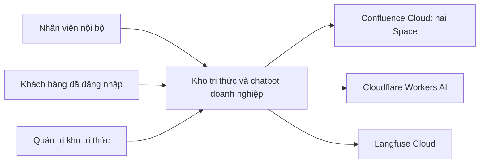
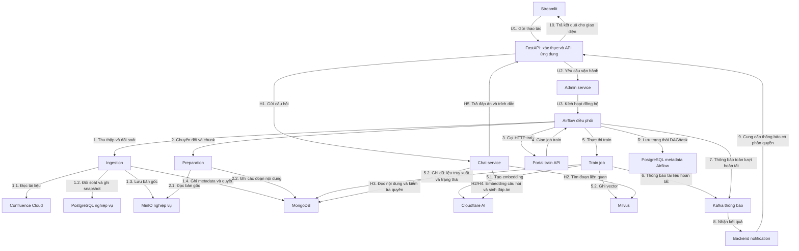
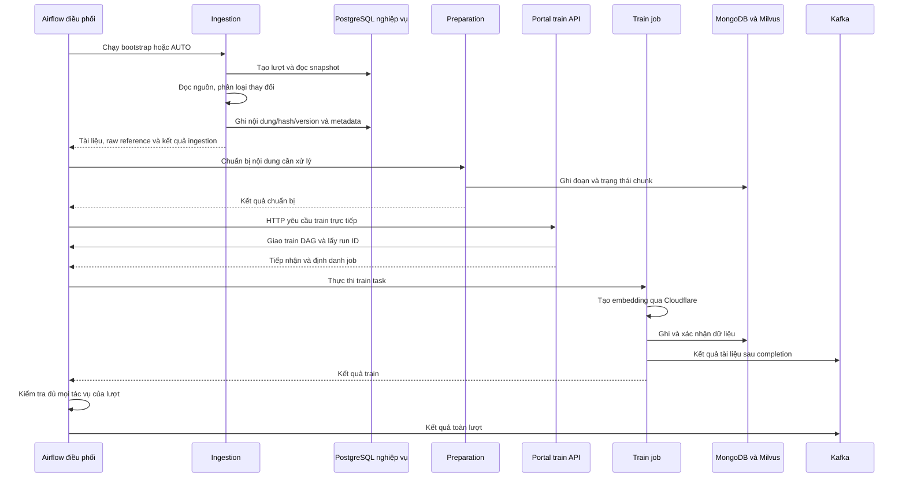
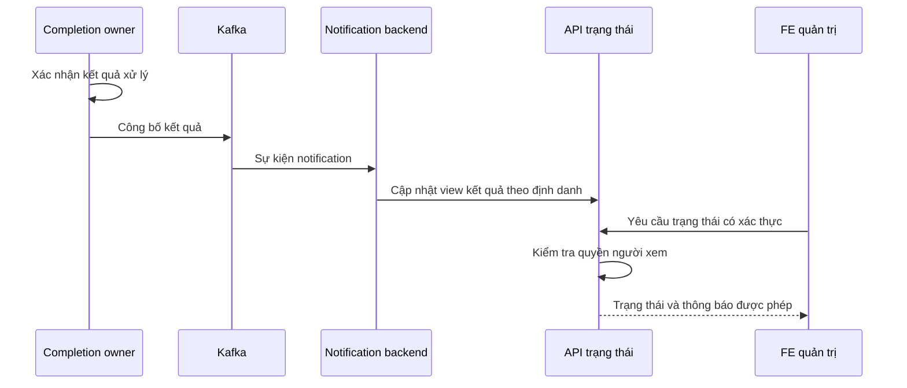
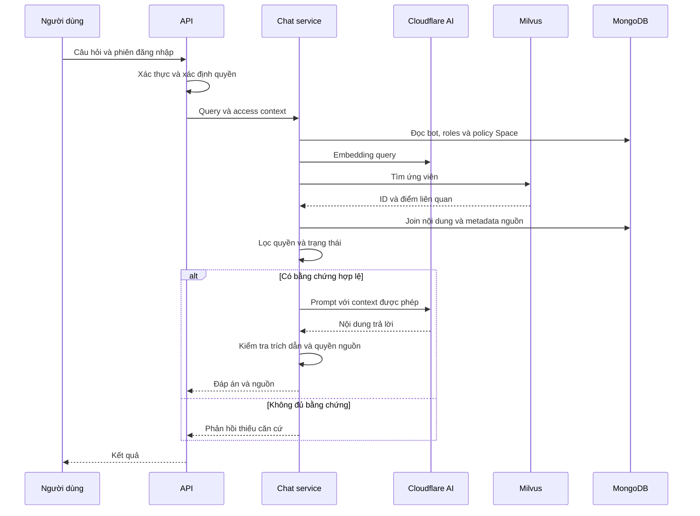
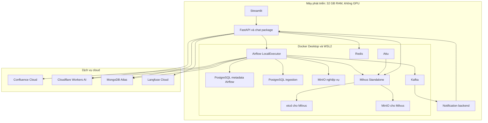

# Tài liệu thiết kế chung

| Thông tin | Nội dung |
| --- | --- |
| Đề tài | Nghiên cứu và xây dựng hệ thống kho tri thức doanh nghiệp thông minh từ Confluence |
| Học viên | Đặng Nam Cường |
| Loại tài liệu | Thiết kế kiến trúc mức cao — High-Level Design (HLD) |
| Phiên bản | 2.0 |
| Ngày cập nhật | 10/11/2026 |
| Trạng thái | Dự thảo để thẩm định |
| Căn cứ | [Đặc tả yêu cầu](requirements.md): FR01–FR15, NFR01–NFR13, AC01–AC21, AS01–AS03 |
| Tài liệu triển khai | [Thiết kế chi tiết](detailed-design.md) |

- **Mục đích:** xác định cấu trúc hệ thống, trách nhiệm module, quyền sở hữu dữ liệu và tương tác giữa các thành phần.
- **Mức mô tả:** kiến trúc logic, luồng dữ liệu, tổ chức runtime và ràng buộc triển khai.
- **Chi tiết vật lý:** schema, endpoint, payload và thuật toán được mô tả tại thiết kế chi tiết.
- **Bằng chứng triển khai:** theo [báo cáo tiến độ](progress/README.md); sơ đồ kiến trúc không tự chứng minh hệ thống đã tích hợp hoàn chỉnh.

## Mục lục

1. [Mục tiêu và yếu tố chi phối kiến trúc](#1-mục-tiêu-và-yếu-tố-chi-phối-kiến-trúc)
2. [Bối cảnh và ranh giới hệ thống](#2-bối-cảnh-và-ranh-giới-hệ-thống)
3. [Phong cách kiến trúc và phân lớp](#3-phong-cách-kiến-trúc-và-phân-lớp)
4. [Kiến trúc thành phần](#4-kiến-trúc-thành-phần)
6. [Kiến trúc dữ liệu và quyền sở hữu](#6-kiến-trúc-dữ-liệu-và-quyền-sở-hữu)
7. [Luồng đồng bộ và lập chỉ mục](#7-luồng-đồng-bộ-và-lập-chỉ-mục)
8. [Luồng thông báo kết quả](#8-luồng-thông-báo-kết-quả)
9. [Luồng tìm kiếm và hỏi đáp RAG](#9-luồng-tìm-kiếm-và-hỏi-đáp-rag)
10. [Xác thực và phân quyền](#10-xác-thực-và-phân-quyền)
11. [Trạng thái và giả định nhất quán](#11-trạng-thái-và-giả-định-nhất-quán)
12. [Triển khai local và cloud](#12-triển-khai-local-và-cloud)
13. [Cấu hình và quản lý tài nguyên](#13-cấu-hình-và-quản-lý-tài-nguyên)
14. [Quan sát, chất lượng và quota AI](#14-quan-sát-chất-lượng-và-quota-ai)

<!--
15. [Quyết định và đánh đổi kiến trúc](#15-quyết-định-và-đánh-đổi-kiến-trúc)
16. [Truy vết và kiểm chứng](#16-truy-vết-và-kiểm-chứng)
-->

17. [Đầu vào cho thiết kế chi tiết](#17-đầu-vào-cho-thiết-kế-chi-tiết)
18. [Thuật ngữ và tài liệu tham chiếu](#18-thuật-ngữ-và-tài-liệu-tham-chiếu)

## 1. Mục tiêu và yếu tố chi phối kiến trúc

### 1.1. Mục tiêu

- Duy trì kho tri thức theo thay đổi của hai Space Confluence.
- Giảm công sức tra cứu chính sách và khuyến mãi bằng tìm kiếm/hỏi đáp tiếng Việt.
- Cung cấp câu trả lời có bằng chứng và nguồn kiểm chứng.
- Áp dụng quyền đọc tài liệu xuyên suốt retrieval, context AI và nguồn.
- Cho quản trị theo dõi tiến độ và nhận kết quả sau khi xử lý hoàn tất.

### 1.2. Yếu tố chi phối kiến trúc

| Mã | Yếu tố | Hệ quả kiến trúc |
| --- | --- | --- |
| AD01 | Tổng 100–300 trang, HTML đơn giản, tiếng Việt | Pipeline module hóa, batch nhỏ, dễ kiểm chứng |
| AD02 | Một bot, hai Space, hai quyền đọc | Kho chung; quyền được kiểm tra theo tài liệu và tài khoản |
| AD03 | Đồng bộ mỗi 60 phút | Airflow lập lịch; PostgreSQL giữ snapshot đối soát |
| AD04 | Gọi API train trực tiếp sau chunk | Tách tiếp nhận HTTP khỏi thực thi job và xác nhận kết quả |
| AD05 | Kafka thông báo sau hoàn tất | Publisher chỉ công bố khi các bước ghi dữ liệu bắt buộc đã thành công |
| AD06 | Quota miễn phí, không GPU | Inference trên Cloudflare; giới hạn tải và tránh embedding không cần thiết |
| AD07 | Một máy 32 GB RAM, Docker Compose | Kiểm soát concurrency và tổng tài nguyên; chưa triển khai HA nhiều máy |
| AD08 | Code tham khảo có nhiều nhánh | Chọn package/entrypoint theo contract có căn cứ |
| AD09 | Giả định vận hành AS01–AS03 | Luồng tuần tự; không yêu cầu phục hồi phân tán nâng cao |

## 2. Bối cảnh và ranh giới hệ thống

### 2.1. Sơ đồ bối cảnh

- Mũi tên thể hiện quan hệ sử dụng/kết nối, không biểu diễn thứ tự xử lý.
- Ma trận chức năng và sơ đồ Use Case nằm tại [SRS, mục 4–7](requirements.md#4-người-sử-dụng-và-phân-quyền).

### 2.2. Ranh giới logic và vật lý

| Nhóm | Thành phần | Vai trò |
| --- | --- | --- |
| Ứng dụng | Streamlit, FastAPI, ingestion, preparation, train, chat, notification | Thực hiện chức năng của hệ thống |
| Hạ tầng ứng dụng | Airflow, Kafka, PostgreSQL, MongoDB, MinIO, Milvus, Redis | Điều phối và lưu trữ theo trách nhiệm |
| Dịch vụ ngoài | Confluence Cloud, Cloudflare Workers AI, Langfuse Cloud | Nguồn tri thức, inference và quan sát |
| Danh tính | Identity adapter và nhà cung cấp xác thực được chọn | Xác thực tài khoản ứng dụng |

- MongoDB Atlas thuộc kiến trúc dữ liệu logic của ứng dụng, đặt ở cloud về vật lý.
- Tài khoản dịch vụ Confluence không đại diện quyền người dùng cuối.
- Chatbot không kiểm soát việc người dùng truy cập trực tiếp Confluence ngoài ứng dụng.

## 3. Phong cách kiến trúc và phân lớp

### 3.1. Tổ chức ứng dụng

- Kiến trúc ứng dụng module hóa theo lớp.
- Pipeline cập nhật được điều phối bằng Airflow và API trực tiếp.
- Kafka mang sự kiện kết quả sau xử lý.
- RAG phục vụ truy vấn online theo request/response.
- Công việc embedding/lập chỉ mục chạy ngoài vòng đời HTTP tiếp nhận.

| Lớp | Thành phần | Trách nhiệm |
| --- | --- | --- |
| Presentation | Streamlit | Nhập câu hỏi, hiển thị kết quả/nguồn và chức năng quản trị |
| Interface | FastAPI, DTO, identity boundary | Xác thực, authorization, validation và response |
| Application | Ingestion, preparation, train, chat, notification | Điều phối nghiệp vụ và kiểm tra điều kiện xử lý |
| Policy | Quyền Space, eligibility, completion | Xác định dữ liệu được sử dụng và thời điểm công bố kết quả |
| Workflow | Airflow, Beeflow | Điều phối task và graph xử lý |
| Infrastructure | ResourceHub và adapters | Kết nối lưu trữ, broker, AI và quan sát |

### 3.2. Phân cấp điều phối

| Cấp | Chủ sở hữu | Đơn vị thực thi | Nguồn trạng thái |
| --- | --- | --- | --- |
| Lịch/runtime | Airflow | Lượt đồng bộ, DAG/task và job train | Metadata Airflow |
| Nghiệp vụ dữ liệu | Application services | Trang, tài liệu, nội dung chuẩn bị và kết quả train | PostgreSQL nghiệp vụ, MongoDB |
| Graph xử lý | Beeflow | Node và ánh xạ input/output trong một tác vụ | State graph trong RAM |

- State graph không phải checkpoint nghiệp vụ bền vững.
- Airflow task thành công chỉ xác nhận phạm vi task đó.
- HTTP thành công tiếp nhận không xác nhận embedding/index đã hoàn tất.

### 3.3. Runtime train — phương án đề xuất

1. Pipeline hoàn tất preparation.
2. Pipeline gọi Portal train API trực tiếp.
3. Portal giao job qua Airflow và trả định danh run.
4. Train task xử lý embedding và ghi dữ liệu.
5. Bộ điều phối theo dõi kết quả thực tế của job.

- Phương án kế thừa cách giao DAG trong code Portal; chưa phải xác nhận đã nối đầy đủ với pipeline.
- Nếu dùng DAG cha/con, bước chờ phải nhường task slot để DAG con chạy.
- Không giữ HTTP request hoặc task slot vô hạn trong khi chờ AI.
- Cơ chế chờ và capacity được cụ thể hóa tại thiết kế chi tiết.

## 4. Kiến trúc thành phần

### 4.1. Sơ đồ tổng thể

- **1–10:** luồng cập nhật kho và thông báo kết quả; số thập phân chỉ các thao tác trong cùng bước.
- **U1–U3:** thao tác người dùng/quản trị; đồng bộ định kỳ do lịch Airflow kích hoạt.
- **H1–H5:** luồng hỏi đáp; H2 gồm tạo embedding câu hỏi và tìm kiếm vector, H4 sinh câu trả lời từ nội dung đã kiểm tra quyền.
- **R:** lưu trạng thái điều phối, không phải bước xử lý tài liệu.
- Node thể hiện thành phần logic; không bắt buộc mỗi node là một process.
- Airflow → train API → Airflow là quan hệ giao job, không phải gọi đệ quy pipeline.
- Redis/Langfuse hỗ trợ runtime/quan sát theo cấu hình, không là kho nghiệp vụ chính.

### 4.2. Đầu vào và đầu ra thành phần

| Thành phần | Đầu vào | Đầu ra |
| --- | --- | --- |
| Ingestion | Cấu hình nguồn/Space và snapshot | Phân loại thay đổi, snapshot, raw reference và metadata/quyền |
| Preparation | HTML gốc và ngữ cảnh nguồn | Markdown, đoạn nội dung và kết quả chuẩn bị |
| Train API | Tài liệu đủ điều kiện và service principal | Kết quả tiếp nhận và định danh job |
| Train job | Đoạn nội dung, metadata và profile AI | Dữ liệu retrieval, vector và kết quả train |
| Publisher | Kết quả đã xác nhận | Sự kiện Kafka theo tài liệu/toàn lượt |
| Notification backend | Sự kiện kết quả và quyền người nhận | View trạng thái/thông báo cho quản trị |
| Chat service | Truy vấn và quyền server-side | Đáp án hoặc phản hồi giới hạn, kèm trích dẫn hợp lệ |
| Source service | Tham chiếu nguồn và principal | Đoạn nguồn/phiên bản được phép xem |

### 4.3. Ranh giới xử lý

| Thành phần | Phạm vi trách nhiệm |
| --- | --- |
| Ingestion | Xác định nguồn và thay đổi; không quyết định quyền từ câu hỏi |
| Converter/chunker | Chuẩn bị nội dung; không tự cấp role hoặc thông báo train thành công |
| Train job | Ghi kết quả và xác nhận điều kiện hoàn tất dữ liệu |
| Publisher | Công bố kết quả; không thay đổi dữ liệu đã hoàn tất chỉ vì lỗi gửi thông báo |
| Consumer thông báo | Cập nhật view kết quả; không phát lệnh train |
| UI | Trình bày; không truy cập trực tiếp database/broker để bỏ qua backend |

## 6. Kiến trúc dữ liệu và quyền sở hữu

### 6.1. Vai trò kho dữ liệu

| Kho | Dữ liệu chính | Trách nhiệm |
| --- | --- | --- |
| PostgreSQL nghiệp vụ | `knowledge_base.documents`, `knowledge_base.sync_jobs` | Snapshot nội dung/hash/version/metadata và lần chạy ingestion |
| MongoDB | Bot/Space/roles, tài liệu, đoạn, node, trạng thái chunk/train | Dữ liệu ứng dụng và truy xuất |
| MinIO nghiệp vụ | Raw theo phiên bản và artifact được chọn | Lưu bản gốc có nguồn gốc kiểm chứng |
| Milvus | Vector chunk/node và ID liên kết | Tìm ứng viên ngữ nghĩa |
| Kafka | Sự kiện kết quả | Truyền thông báo tới backend |
| PostgreSQL Airflow | DAG/task/run metadata | Điều phối runtime |

- Snapshot PostgreSQL không tự chứa lịch sử đầy đủ mọi phiên bản.
- MinIO giữ phiên bản đã thực tế thu thập, không mọi chỉnh sửa giữa hai kỳ.
- Score vector và sự kiện Kafka không quyết định quyền đọc tài liệu.
- Schema và index chi tiết: [Database và lưu trữ](detailed-design/01-data-storage.md).

### 6.2. Định danh và truy vết nguồn

| Định danh | Phạm vi |
| --- | --- |
| Bot | Namespace cấu hình/kho chung, không đại diện vai trò người dùng |
| Confluence page | Liên hệ snapshot SQL với tài liệu Mongo |
| Document | Identity nội bộ ổn định qua cập nhật |
| Version nguồn | Phiên bản gắn với nội dung đã thu thập/đối soát |
| Chunk/node | Liên kết vector với nội dung và tài liệu nguồn |
| Lượt ingestion | Định danh nghiệp vụ của lần thu thập |
| Airflow run/request | Định danh thực thi và giao tiếp |

- SQL row ID không tự bằng document UUID Mongo.
- Correlation phải liên hệ được ingestion, preparation, train và thông báo.
- Cách lưu pointer/run correlation dùng các kho/trường hiện có được quy định ở LLD.
- Không thêm bảng theo dõi nghiệp vụ chỉ để biểu diễn một tên định danh khác.

## 7. Luồng đồng bộ và lập chỉ mục

### 7.1. Điều kiện và kết quả

| Thuộc tính | Quy định |
| --- | --- |
| Kích hoạt | Lịch 60 phút hoặc quản trị yêu cầu thủ công |
| Tiền điều kiện | Nguồn/Space/quyền hợp lệ; dịch vụ đáp ứng AS01 |
| Đầu vào | Inventory Confluence và snapshot đã lưu |
| Kết quả | Nguồn/metadata/ACL cập nhật; nội dung thay đổi được xử lý; trạng thái và thông báo có định danh |
| Chạy chồng | Một lượt cùng nguồn tại một thời điểm |

- Bootstrap thực hiện trước vận hành AUTO định kỳ.
- Inventory phải phủ đúng hai Space; chọn một root page không tự chứng minh đủ phạm vi.

### 7.2. Các bước xử lý

| Bước | Thành phần | Xử lý | Kết quả |
| --- | --- | --- | --- |
| 1 | Airflow | Kiểm tra điều kiện, khởi tạo lượt | Định danh ingestion/runtime |
| 2 | Ingestion | Đọc Confluence và snapshot SQL | Inventory đủ căn cứ đối soát |
| 3 | Ingestion | So nội dung/hash và metadata/quyền | Tập trang theo loại thay đổi |
| 4 | Ingestion | Ghi snapshot, raw và metadata/ACL | Đầu vào chuẩn bị có nguồn/version |
| 5 | Preparation | HTML → Markdown → chunk | Đoạn hợp lệ và trạng thái sẵn sàng train |
| 6 | Bộ điều phối | Gọi train API trực tiếp | Job/run ID và trạng thái tiếp nhận |
| 7 | Train job | Embedding và ghi MongoDB/Milvus | Kết quả dữ liệu đã xác nhận |
| 8 | Completion publisher | Phát kết quả tài liệu | Sự kiện Kafka |
| 9 | Bộ điều phối | Tổng hợp mọi tác vụ thuộc lượt | Kết quả toàn lượt và sự kiện tương ứng |

### 7.3. Tương tác thực thi — phương án Airflow train runtime

- Raw MinIO và metadata/quyền Mongo thuộc bước ingestion; các kết nối này được thể hiện ở sơ đồ thành phần.
- Bước chờ job phải có timeout và không làm thiếu slot cho train runtime.

### 7.4. Hành vi theo thay đổi

| Loại thay đổi | Thao tác dữ liệu | Train |
| --- | --- | --- |
| Trang mới | Tạo identity, snapshot, raw và metadata/quyền | Có |
| Body/hash đổi | Ghi phiên bản và chuẩn bị nội dung mới | Có |
| Chỉ tiêu đề/link/parent | Cập nhật metadata liên quan | Không nếu nội dung biểu diễn không đổi |
| Chỉ Space/quyền | Áp policy và cập nhật ACL | Không chỉ vì ACL đổi |
| Không đổi | Ghi nhận đối soát | Không |
| Xóa/mất quyền/ra ngoài phạm vi đã xác minh | Chặn phục vụ rồi cleanup dẫn xuất | Không dùng train cho thao tác xóa |

- So hash trên cùng biểu diễn nội dung nguồn; wrapper HTML không được tạo thay đổi giả.
- Fetch thiếu hoặc lỗi phân trang không đủ căn cứ kết luận xóa hàng loạt.
- Chỉ metadata đổi không được làm tài liệu chưa xử lý trở thành sẵn sàng giả.

### 7.5. Chuẩn hóa và embedding

| Giai đoạn | Đầu ra bắt buộc | Ràng buộc |
| --- | --- | --- |
| HTML → Markdown | Văn bản có cấu trúc sử dụng được | Giữ tham chiếu ảnh; không OCR/AI ảnh |
| Chunking | Các đoạn theo thứ tự/ngữ cảnh, truy ngược nguồn | Không tự thay đổi quyền |
| Embedding | Vector đúng thứ tự/profile | Count/dimension/giá trị phải hợp lệ |
| Ghi retrieval | Nội dung Mongo và vector Milvus liên kết đúng ID | Ghi cần thiết thành công trước completion |

- Profile indexing và query phải thống nhất model/dimension và tiền xử lý.
- Đổi model/dimension có thể yêu cầu lập chỉ mục lại; không chỉ đổi tên resource.
- Node/tree được sử dụng khi profile chọn truy xuất phân cấp.
- Node optional rỗng khác lỗi tạo node của profile yêu cầu node.
- Full evidence được đọc từ Mongo; không coi keywords trong Milvus là toàn văn nguồn.
- Hybrid/rerank không phải điều kiện bắt buộc của SRS.

## 8. Luồng thông báo kết quả

### 8.1. Phạm vi thông báo

| Mức | Điều kiện | Nội dung chính |
| --- | --- | --- |
| Tài liệu | Job train xác nhận ghi dữ liệu thành công | Tham chiếu tài liệu/job, phiên bản và thời điểm |
| Toàn lượt | Mọi tác vụ train/metadata/quyền/xóa thuộc lượt đã xong | Tham chiếu lượt và kết quả tổng hợp |
| Không có nội dung cần train | Đối soát và các tác vụ liên quan hoàn tất | Kết quả đúng ngữ nghĩa, không giả lập embedding |

- Publisher thuộc thành phần biết chắc điều kiện hoàn tất đã đạt.
- HTTP handler vừa tiếp nhận không tự công bố train thành công.
- Không dùng số message nhận được làm bộ đếm nghiệp vụ nếu chưa đối soát theo định danh.

### 8.2. Tương tác thông báo

### 8.3. Kênh backend → FE — phương án đề xuất

- Streamlit refresh/poll API trạng thái có xác thực.
- Notification consumer chạy trong backend, tách khỏi HTTP handler.
- View thông báo trong RAM có thể dùng cho pilot một process.
- Trạng thái nghiệp vụ vẫn đọc từ PostgreSQL/MongoDB/Airflow.
- SSE/WebSocket là lựa chọn cần kiểm chứng nếu được chọn thay polling.
- Không đồng nhất kênh trạng thái với streaming token của câu trả lời.

### 8.4. Bảo mật và giới hạn

| Nội dung | Quy định |
| --- | --- |
| Người nhận | Quản trị có quyền vận hành |
| Payload | Metadata cần thiết; không toàn văn tài liệu hoặc secret |
| Frontend | Không kết nối broker trực tiếp |
| Consumer | Validate sự kiện, cập nhật view; không trigger train |
| Trạng thái dữ liệu | Lỗi gửi thông báo không tự biến dữ liệu đã hoàn tất thành chưa embedding |
| Giao nhận qua sự cố | Theo giới hạn AS02; không yêu cầu replay/exactly-once |

- Topic, group và schema sự kiện: [API và Kafka](detailed-design/02-api-events.md).

## 9. Luồng tìm kiếm và hỏi đáp RAG

### 9.1. Điều kiện và đầu ra

| Thuộc tính | Quy định |
| --- | --- |
| Đầu vào | Query/câu hỏi tiếng Việt và principal đã xác thực |
| Nguồn khai thác | Dữ liệu đủ điều kiện phục vụ trong Milvus/MongoDB |
| Quyền | Theo tài khoản, tài liệu và policy Space hiện hành |
| Đầu ra | Kết quả tìm kiếm hoặc đáp án có trích dẫn; phản hồi thiếu căn cứ/lỗi khi phù hợp |

### 9.2. Các bước xử lý

| Bước | Thành phần | Xử lý |
| --- | --- | --- |
| 1 | API/identity | Xác thực, kiểm tra quyền chức năng |
| 2 | Policy | Xây access context từ nguồn tin cậy phía server |
| 3 | Retrieval | Embedding query và tìm ứng viên Milvus |
| 4 | Retrieval/policy | Join nội dung về Mongo, lọc quyền/Space/trạng thái |
| 5 | Chat service | Chọn bằng chứng trong context budget |
| 6 | LLM adapter | Sinh đáp án từ bằng chứng được phép |
| 7 | Source/policy | Kiểm tra nguồn và dựng trích dẫn |
| 8 | API/UI | Trả kết quả tiếng Việt |

### 9.3. Tương tác RAG

### 9.4. Retrieval và nguồn

- Chunk path: vector ID → nội dung chunk → tài liệu nguồn.
- Node path: vector node → nội dung node → tài liệu nguồn.
- Node con, đoạn liền kề và tool đọc tài liệu phải áp cùng quyền.
- Thiếu kết quả sau lọc: lấy thêm ứng viên trong giới hạn hoặc trả thiếu căn cứ; không nới quyền.
- Rerank cloud, nếu dùng, chỉ nhận nội dung đã được phép đọc.
- PostgreSQL snapshot không trực tiếp là context trong đường RAG chính.
- Luồng tìm kiếm độc lập dừng ở kết quả/nguồn; không bắt buộc gọi LLM sinh đáp án.

### 9.5. Generation và trích dẫn

| Nội dung | Quy định |
| --- | --- |
| Context | Chỉ bằng chứng được phép, có liên hệ tài liệu/phiên bản |
| Prompt | Yêu cầu trả lời từ nguồn, không suy diễn điều kiện ngân hàng ngoài dữ liệu |
| Trích dẫn | Backend dựng từ metadata đã kiểm tra; LLM không tự cấp quyền hoặc phát minh URL |
| Thiếu bằng chứng | Trả giới hạn phù hợp, không bịa câu trả lời |
| Lỗi AI/truy xuất/quota | Phản hồi chưa thể xử lý, phân biệt với không có dữ liệu |
| Xem nguồn | Kiểm tra quyền lại; khách hàng xem đoạn khuyến mãi trong ứng dụng |

- Câu hỏi không thay đổi trạng thái train của tài liệu.
- Không bổ sung lịch sử chat/ghi nhớ nhiều lượt theo mặc định.
- Query và index dùng cùng profile biểu diễn đã được kiểm chứng.

## 10. Xác thực và phân quyền

### 10.1. Hai lớp quyền

| Lớp | Trách nhiệm | Căn cứ |
| --- | --- | --- |
| Quyền chức năng | Cho phép search/chat/config/sync/status/retry | Vai trò ứng dụng đã xác thực |
| Quyền dữ liệu | Cho phép đọc tài liệu/đoạn/nguồn | Quyền tài khoản giao với ACL tài liệu và policy Space |

| Vai trò | Quyền đọc | Vận hành |
| --- | --- | --- |
| Nhân viên | INTERNAL: cả hai Space | Không |
| Khách hàng | CUSTOMER: khuyến mãi | Không |
| Quản trị | Cả kho theo quyền được cấp | Có, trong phạm vi SRS |

- Quyền đọc INTERNAL không tự cấp chức năng vận hành.
- Tài khoản dịch vụ pipeline chỉ có operation scope phù hợp.
- Cơ chế IdP/session cụ thể còn cần lựa chọn.

### 10.2. Kế thừa quyền Space

1. Quản trị xác định mapping Space → tập quyền đọc.
2. Ingestion xác định Space thực của trang.
3. Tài liệu nhận quyền tương ứng.
4. Preparation/train bảo toàn quyền.
5. Retrieval/source kiểm tra chính sách hiện hành khi sử dụng.

- Space chính sách: INTERNAL.
- Space khuyến mãi: INTERNAL và CUSTOMER.
- Đổi Space/quyền phải cập nhật ACL dù body không đổi.
- Thiếu mapping/quyền hoặc không xác minh được policy: không cho đọc.
- Việc tạo Space trên Confluence không tự tạo quyền trong ứng dụng.
- Cơ chế cache phải có invalidation hoặc kiểm tra lại quyền trước trả nội dung.

### 10.3. Ranh giới tin cậy

| Ranh giới | Kiểm soát |
| --- | --- |
| UI → API | Phiên hợp lệ, validation, authorization và giới hạn request |
| Pipeline → train API | Service identity và bot/tài liệu hợp lệ |
| Backend → database/nguồn/AI | Secret phía server, endpoint và phạm vi dữ liệu theo cấu hình |
| Kafka → notification backend | Validate payload/correlation; kiểm tra người nhận |
| Tài liệu/câu hỏi → LLM | Dữ liệu không tin cậy; không được thay system policy |

- Role/Space do client gửi không là căn cứ cấp quyền.
- Middleware kiểm tra client ID chưa đủ chứng minh có quyền ba tác nhân.
- Chi tiết predicate và source policy: [ACL và RAG](detailed-design/06-space-access-control.md).

## 11. Trạng thái và giả định nhất quán

### 11.1. Phân biệt phạm vi trạng thái

| Phạm vi | Nội dung theo dõi | Giới hạn ý nghĩa |
| --- | --- | --- |
| Snapshot nguồn | Nội dung/hash/version và kết quả đối soát | Chưa chứng minh vector đã được cập nhật |
| Lượt ingestion | Thu thập, số lượng, thời điểm và lỗi | Chưa tự là trạng thái toàn pipeline |
| Preparation | Chuyển đổi/chunk và kết quả ghi đoạn | Chưa chứng minh train hoàn tất |
| Train | Embedding, ghi retrieval/vector và kết quả xác nhận | Tách với giao nhận thông báo |
| Airflow runtime | DAG/task/run | Phải liên hệ đúng giai đoạn nghiệp vụ |
| Notification | Kết quả backend đã nhận/hiển thị | Không là nguồn chân lý của dữ liệu |

- Tên field/enum vật lý và projection: [Trạng thái và completion](detailed-design/04-state-transitions.md).

### 11.2. Điều kiện hoàn tất

| Mức | Điều kiện |
| --- | --- |
| Tài liệu | Nguồn/quyền hợp lệ; preparation xong; embedding và dữ liệu bắt buộc đã ghi thành công; kết quả train được xác nhận |
| Toàn lượt | Mọi tài liệu và tác vụ metadata/quyền/xóa thuộc lượt đã hoàn tất |
| Thông báo | Sự kiện được phát sau completion; backend nhận và cập nhật UI theo AS02 |

- HTTP tiếp nhận khác hoàn tất job.
- Kết thúc ingestion khác kết thúc toàn lượt cập nhật.
- Một tài liệu hoàn tất khác mọi tài liệu hoàn tất.
- Tài liệu đang xử lý không được dùng như dữ liệu sẵn sàng.

### 11.3. Giả định và xử lý lỗi

| Nội dung | Phạm vi thiết kế |
| --- | --- |
| Luồng chính | Tuần tự, đủ điều kiện dịch vụ/quota theo AS01–AS03 |
| Lỗi được trả về | Ghi nhận đúng giai đoạn, không thông báo thành công giả |
| Thao tác lại | Quản trị yêu cầu theo UC09 khi đầu vào/quyền hợp lệ |
| Lỗi notification sau ghi dữ liệu | Giữ kết quả dữ liệu, phản ánh lỗi delivery riêng |
| Tính nguyên tử nhiều kho | Không cam kết distributed transaction hoặc thay index nguyên tử |
| Phục hồi nâng cao | Ngoài phạm vi: outbox, exactly-once, tự khôi phục crash/partial write |

- Không cam kết luôn phục vụ phiên bản trước trong lúc thay chỉ mục.
- Không thêm bảng theo dõi hoặc cơ chế phục hồi ngoài phạm vi SRS.

## 12. Triển khai local và cloud

### 12.1. Topology mục tiêu

- API/Streamlit/notification backend trên host Conda là phương án phát triển đề xuất.
- Task Linux cần code/dependency trong image/runtime tương ứng.
- Sơ đồ thể hiện topology mục tiêu, không xác nhận mọi kết nối đã được cấu hình.

### 12.2. Endpoint và cấu hình triển khai

| Thành phần | Endpoint từ Windows theo cấu hình | Căn cứ |
| --- | --- | --- |
| PostgreSQL ingestion | `127.0.0.1:5432`, database `ingestion` | [Hướng dẫn PostgreSQL](../infra/postgres/README.md) |
| Airflow | `127.0.0.1:8080` | [Hướng dẫn Airflow](../infra/airflow/README.md) |
| PostgreSQL Airflow | Mạng Docker riêng, không publish ra host | Compose Airflow |
| Kafka | `127.0.0.1:9092` | [Compose Kafka](../infra/kafka/compose.yaml) |
| MinIO nghiệp vụ | `127.0.0.1:9000`, console `9001` | [Compose MinIO](../infra/minio/compose.yaml) |
| Milvus/Attu | `127.0.0.1:19530` / `127.0.0.1:8000` | [Compose Milvus](../infra/milvus/compose.yaml) |
| API/Streamlit | Đề xuất `8001` / `8501` | Tránh xung đột cổng Attu; cần cấu hình khi triển khai |
| MongoDB/AI/Langfuse | Theo resource/secret môi trường | Không đưa credentials vào tài liệu |

- Danh sách endpoint không chứng minh dịch vụ đang chạy.
- Redis sử dụng profile đã cấu hình và chỉ tham gia đường runtime cần nó.

### 12.3. Networking

- Tách profile endpoint host và container.
- `localhost` trong container không trỏ tới dịch vụ trên host/container khác.
- Compose project không tự chia sẻ DNS/network.
- Airflow có external network `doan-backend` trong cấu hình; các dịch vụ cần kết nối phải được kiểm tra alias/mạng tương ứng.
- Kafka bootstrap và advertised listener phải phù hợp vị trí client.
- Pipeline gọi API host cần interface truy cập được từ container và service authentication.
- Không sử dụng PostgreSQL Airflow hoặc MinIO nội bộ Milvus thay kho nghiệp vụ.

### 12.4. Persistence

| Dữ liệu | Nơi lưu bền vững |
| --- | --- |
| Snapshot/job ingestion | Volume PostgreSQL nghiệp vụ |
| DAG/task/log | Volume PostgreSQL và log riêng Airflow |
| Raw/artifact | Volume MinIO nghiệp vụ |
| Vector và phụ thuộc Milvus | Volume Milvus/etcd/MinIO tương ứng |
| Kafka log | Volume Kafka |
| MongoDB | Atlas theo cấu hình và chính sách dịch vụ |

- Volume bảo toàn dữ liệu qua restart; không thay backup hoặc cơ chế HA.
- Không dùng `down -v` khi cần giữ dữ liệu.
- Secret, schema và cấu hình phải được quản lý cùng kế hoạch khôi phục thủ công.

### 12.5. Thứ tự khởi động và readiness

1. Khởi động kho dữ liệu, broker và các dependency.
2. Kiểm tra health, schema, bucket và network.
3. Kiểm tra resource profile và credential của runtime.
4. Khởi động API/notification backend và task runtime.
5. Kiểm tra DAG/contract tích hợp.
6. Mở UI theo quyền.

- Container healthy không thay test API train hoặc RAG end-to-end.
- Readiness phải kiểm tra dependency cần thiết cho capability được công bố.

## 13. Cấu hình và quản lý tài nguyên

| Nhóm | Nội dung | Nguyên tắc |
| --- | --- | --- |
| Bootstrap | Registry Mongo, loader và secret khởi động | Đường dẫn đúng runtime; không chứa bí mật trong Git/log |
| Resource | SQL/Mongo/S3/Milvus/Kafka/AI/Redis/Langfuse | Endpoint host/container tách rõ |
| Domain | Một bot, hai Space, quyền và phạm vi nguồn | Validate trước sử dụng |
| Pipeline | Converter, chunker, embedding/LLM profile | Tương thích schema và quota |
| Runtime | Concurrency, batch, timeout, network/port | Theo tài nguyên thực tế và số đo pilot |

- ResourceHub quản lý adapter kỹ thuật; không cấp quyền người dùng.
- Caller ingestion dùng SQL key `anapp`; phải kiểm tra resource thực tế trước chạy.
- PostgreSQL container sẵn sàng không chứng minh SQLNode đã được nối đúng.
- `authen_source` của loader phải được phân biệt với MongoDB `authSource`.
- Không ghi đè resource có sẵn hoặc tự chuyển provider trả phí.
- Danh sách resource và cấu hình setup: [resource keys](resource-keys.md).

## 14. Quan sát, chất lượng và quota AI

### 14.1. Truy vết và số đo

| Luồng | Dữ liệu quan sát |
| --- | --- |
| Ingestion | Lượt/page/document/version, kết quả đối soát và thời gian nguồn |
| Preparation/train | Run ID, số đoạn/node, latency chuyển đổi/embedding/ghi và kết quả |
| Notification | Thời gian completion → publish → backend → UI |
| RAG | Request, phạm vi quyền, số bằng chứng hợp lệ, latency và nguồn sử dụng |

- Log có cấu trúc, đủ định danh và giai đoạn.
- Không ghi toàn văn nội dung/câu hỏi nhạy cảm mặc định.
- Langfuse chỉ nhận dữ liệu được phép; trace không chứng minh đáp án đúng.

### 14.2. Quota và capacity

- Không embedding lại body không đổi.
- Giới hạn batch, context, kích thước đoạn và concurrency theo profile.
- Chỉ sử dụng node summary/rerank khi profile và số đo hỗ trợ lựa chọn đó.
- Tính tổng tài nguyên gồm Windows/WSL2, hai PostgreSQL, Kafka và bộ Milvus.
- Tải pilot đề xuất: 1–3 người hỏi đồng thời.
- Đo capacity Airflow để tránh task cha chờ trong khi task con thiếu slot.
- Ngưỡng RAM/latency/chất lượng cần được chốt theo [SRS, mục 11.3](requirements.md#113-đánh-giá-chất-lượng-và-hiệu-quả--đề-xuất).

### 14.3. Chất lượng RAG

| Hạng mục | Cách đánh giá |
| --- | --- |
| Retrieval | Có bằng chứng đúng và đúng quyền trong kết quả |
| Đáp án | Đúng/đủ điều kiện trọng yếu theo nguồn |
| Grounding | Khẳng định được evidence hỗ trợ |
| Citation | Tham chiếu đúng tài liệu/đoạn/phiên bản |
| Thiếu dữ liệu | Từ chối hoặc nêu giới hạn phù hợp |

- Cố định bộ câu hỏi, quyền, snapshot và bằng chứng chuẩn.
- Phân biệt dữ liệu pilot với tập đánh giá độc lập.
- Không dùng HTTP 200 hoặc LLM tự chấm làm bằng chứng duy nhất.

<!--
## 15. Quyết định và đánh đổi kiến trúc

### 15.1. Quyết định xác định

| Mã | Quyết định | Hệ quả |
| --- | --- | --- |
| ADR01 | Một bot, hai Space | Kho chung; kiểm tra ACL trên mọi đường đọc |
| ADR02 | INTERNAL/CUSTOMER kế thừa theo Space | Không thực hiện đầy đủ ACL từng trang Confluence |
| ADR03 | PostgreSQL đối soát và job ingestion | Snapshot không tự là lịch sử mọi version |
| ADR04 | Preparation trước API train | Đầu vào train phải chunk-ready |
| ADR05 | API trực tiếp kích hoạt train | Cần theo dõi kết quả job thực tế |
| ADR07 | Kafka thông báo sau completion | Backend kiểm tra người nhận và phạm vi kết quả |
| ADR09 | Kho dữ liệu có trách nhiệm riêng | Giữ lineage và liên kết định danh giữa các kho |
| ADR10 | Cloudflare AI, quota miễn phí | Profile phải tương thích index/query và giới hạn tải |
| ADR11 | Local Compose, không GPU | Giới hạn theo một máy; không HA nhiều node |
| ADR12 | AS01–AS03 | Không yêu cầu phục hồi phân tán nâng cao |

### 15.2. Phương án triển khai đề xuất

| Mã | Phương án | Điều kiện lựa chọn |
| --- | --- | --- |
| ADR06 | Airflow thực thi train job sau Portal API | Contract local, dependency và slot chờ được kiểm chứng |
| ADR08 | Streamlit refresh/poll API trạng thái | Đáp ứng latency và quyền người nhận trong tải pilot |

### 15.3. Điểm kỹ thuật cần xác định

| Nội dung | Nơi cụ thể hóa |
| --- | --- |
| Public preparation entrypoint | Thiết kế module và contract |
| Theo dõi train job/correlation | Thiết kế API và task graph |
| Identity provider/session | Thiết kế xác thực |
| Model/dimension/chunk budget | Profile AI và kết quả pilot |
| Topic/payload/group và UI channel | Hợp đồng thông báo |
| Schema mapping và resource profiles | Thiết kế dữ liệu/cấu hình |

- Chi tiết đã có phương án ở LLD phải được đọc theo nhãn đề xuất và kiểm chứng tương ứng.
- Việc lựa chọn tuân phạm vi và các quyết định xác định ở trên.

## 16. Truy vết và kiểm chứng

### 16.1. Ma trận yêu cầu — kiến trúc — nghiệm thu

| Yêu cầu | Thành phần/luồng | Minh chứng |
| --- | --- | --- |
| FR01, FR14 | Config, policy, Space/roles và source | AC03, AC09, AC16, AC17 |
| FR02, FR03 | Bootstrap/AUTO và lịch Airflow | AC10 |
| FR04 | Snapshot PostgreSQL và đối soát | AC11, AC20 |
| FR05 | Raw version và source lineage | AC07, AC11, AC19 |
| FR06 | Preparation → API → train runtime | AC12, AC14 |
| FR07 | Converter/chunker/embedding/index | AC11, AC13, AC14 |
| FR08 | Chặn phục vụ/cleanup | AC16, AC20 |
| FR09, FR10 | RAG/source và phản hồi giới hạn/lỗi | AC04–AC08, AC13 |
| FR11 | Trạng thái và thao tác lại thủ công | AC18, AC21 |
| FR12 | Correlation và quan sát | AC14, AC15, AC18, AC21; SRS 11.3 |
| FR13 | Identity/session boundary | AC01, AC02 |
| FR15 | Publisher, Kafka, notification backend/UI | AC03, AC14, AC15, AC21 |
| NFR01–NFR05 | Trạng thái, completion và persistence | AC10–AC14, AC18–AC21 |
| NFR06–NFR13 | Capacity, quota, bảo mật và chất lượng | Các ca quyền/quota; bộ pilot và đánh giá SRS |

### 16.2. Kiểm chứng kiến trúc

| Đối tượng | Điều kiện cần chứng minh |
| --- | --- |
| Kết nối | Runtime truy cập đúng endpoint/schema/bucket theo profile |
| Preparation | Có đoạn hợp lệ, nguồn/version/quyền bảo toàn |
| Train | Nhận đầu vào đủ điều kiện; profile/vector đúng; ghi dữ liệu thành công |
| Completion | Không công bố từ ACK hoặc trạng thái ingestion đơn lẻ |
| Notification | Sau completion, đúng định danh và chỉ quản trị nhận |
| RAG/source | CUSTOMER không truy xuất nội bộ qua chunk/node/tool/nguồn |
| Persistence | Dữ liệu đã xác nhận còn sau restart có volume |

- Contract/unit/integration tests nằm tại [kế hoạch kiểm chứng](detailed-design/05-runtime-validation.md).
- Kết quả giả lập và dịch vụ thật phải được ghi riêng.
- Thiết lập thành công một container không thay kiểm chứng chức năng end-to-end.

-->

## 17. Đầu vào cho thiết kế chi tiết

| Nhóm | Nội dung cần cụ thể hóa | Tài liệu chính |
| --- | --- | --- |
| Dữ liệu | Schema/index, identity, version và raw references | [01 — Database](detailed-design/01-data-storage.md) |
| API | Auth, input/output, state conflict và theo dõi job | [02 — API/Kafka](detailed-design/02-api-events.md) |
| Thông báo | Completion owner, event tài liệu/toàn lượt và consumer | [02 — API/Kafka](detailed-design/02-api-events.md) |
| Module | Preparation contract, job/task boundary và adapters | [03 — Module](detailed-design/03-modules-code-mapping.md) |
| Trạng thái | Transition, completion predicate, lỗi và xử lý lại | [04 — Trạng thái](detailed-design/04-state-transitions.md) |
| Runtime | Network, resource, secrets, rollout và test | [05 — Runtime](detailed-design/05-runtime-validation.md) |
| Quyền/RAG | Policy, eligibility, evidence và citation | [06 — ACL/RAG](detailed-design/06-space-access-control.md) |

- Tên trường, API và contract phải dựa code hoặc được ghi nhãn đề xuất.
- Không tự bổ sung bảng, chức năng hoặc cơ chế phục hồi ngoài phạm vi.

## 18. Thuật ngữ và tài liệu tham chiếu

### 18.1. Thuật ngữ

| Thuật ngữ | Ý nghĩa |
| --- | --- |
| Offline indexing | Chuẩn bị và lập chỉ mục trước khi phục vụ truy vấn |
| Online serving | Đường xử lý tìm kiếm/hỏi đáp của người dùng |
| Snapshot | Nội dung/metadata đã lưu để đối soát |
| Content hash | Giá trị băm nội dung để phát hiện thay đổi chuỗi |
| Completion gate | Điều kiện xác nhận xử lý bắt buộc đã hoàn tất |
| Source lineage | Liên hệ từ kết quả/đoạn/vector về nguồn và phiên bản |
| Principal | Chủ thể đã xác thực: người dùng hoặc dịch vụ |
| Access context | Quyền của principal do backend xác định từ nguồn tin cậy |
| Notification | Thông báo kết quả xử lý |
| ResourceHub | Registry/adapters kỹ thuật của runtime |

### 18.2. Tài liệu tham chiếu

- [Đặc tả yêu cầu](requirements.md).
- [Thiết kế chi tiết](detailed-design.md).
- [Báo cáo tiến độ](progress/README.md).
- [Resource keys](resource-keys.md).
- [Hướng dẫn PostgreSQL nghiệp vụ](../infra/postgres/README.md).
