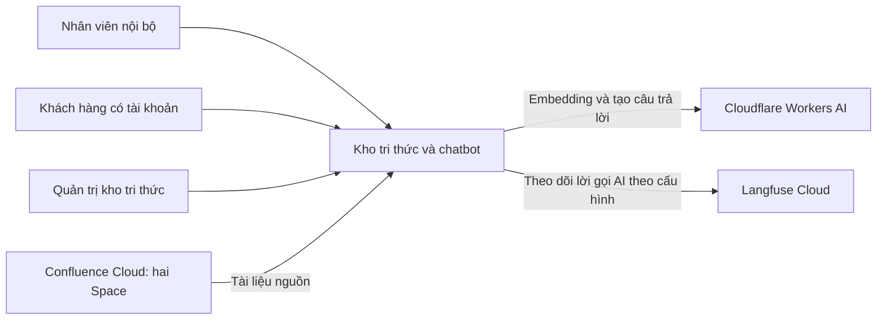
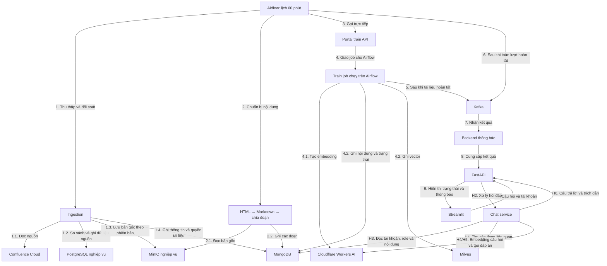
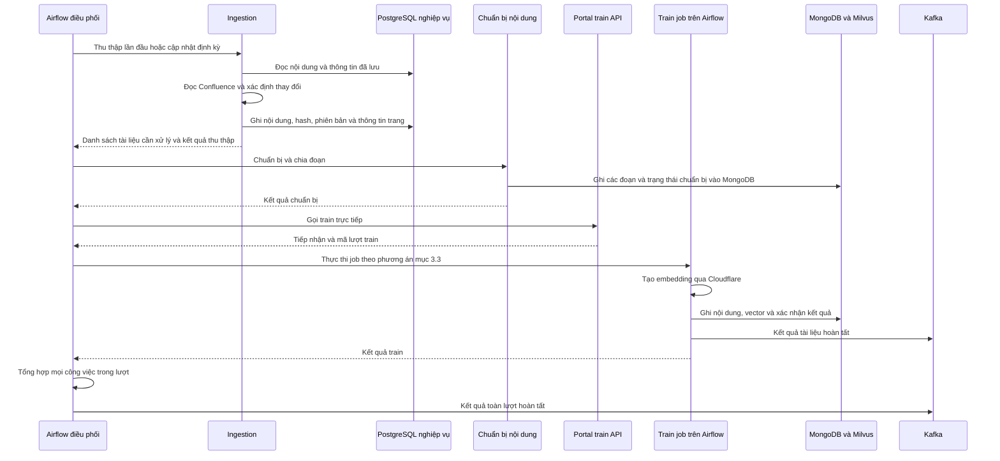
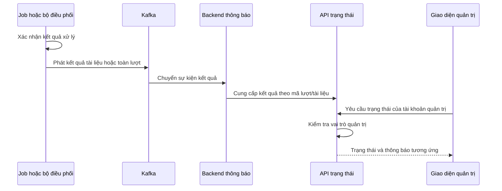
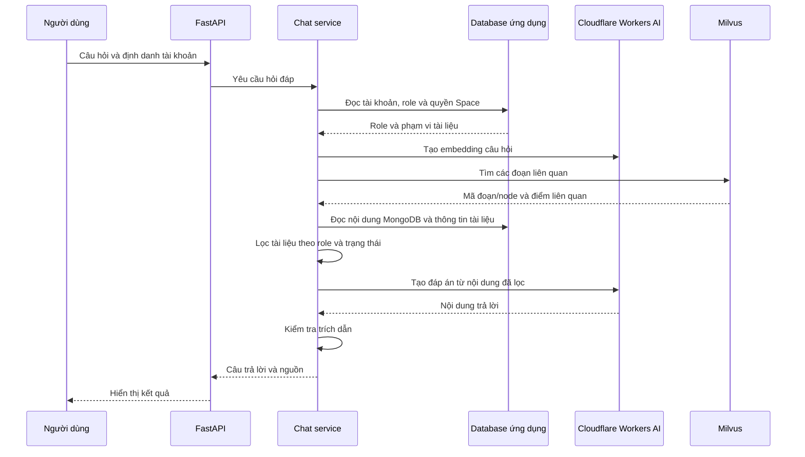
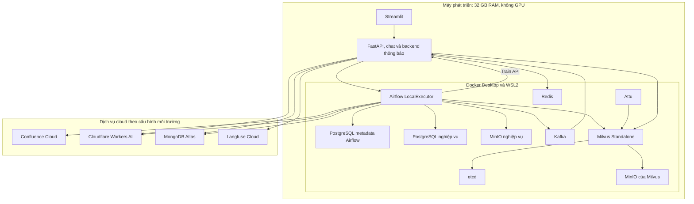

# Tài liệu thiết kế chung

| Thông tin | Nội dung |
| --- | --- |
| Đề tài | Nghiên cứu và xây dựng hệ thống kho tri thức doanh nghiệp thông minh từ Confluence |
| Học viên | Đặng Nam Cường |
| Loại tài liệu | Thiết kế chung — High-Level Design (HLD) |
| Phiên bản | 2.0 |
| Ngày cập nhật | 17/11/2026 |
| Trạng thái | Dự thảo để thẩm định |
| Căn cứ | [Đặc tả yêu cầu](requirements.md) |
| Tài liệu triển khai | [Thiết kế chi tiết](detailed-design.md) |

- **Mục đích:** mô tả các thành phần, cách kết nối, luồng dữ liệu và cách triển khai hệ thống.
- Kiến trúc phục vụ 5 Use Case trong đặc tả: hỏi đáp chính sách, hỏi đáp khuyến mãi, xem nguồn, cấu hình nguồn và theo dõi trạng thái.
- Đây là thiết kế để triển khai. Kết quả đã chạy và kiểm chứng được ghi tại [báo cáo tiến độ](progress/README.md).
- Tên trường, cấu trúc bảng, API và nội dung sự kiện Kafka được mô tả trong thiết kế chi tiết.

## Mục lục

1. [Mục tiêu và yêu cầu chi phối](#1-mục-tiêu-và-yêu-cầu-chi-phối)
2. [Bối cảnh hệ thống](#2-bối-cảnh-hệ-thống)
3. [Cách tổ chức hệ thống](#3-cách-tổ-chức-hệ-thống)
4. [Kiến trúc thành phần](#4-kiến-trúc-thành-phần)
6. [Tổ chức dữ liệu](#6-tổ-chức-dữ-liệu)
7. [Luồng cập nhật tự động](#7-luồng-cập-nhật-tự-động)
8. [Luồng thông báo và theo dõi trạng thái](#8-luồng-thông-báo-và-theo-dõi-trạng-thái)
9. [Luồng hỏi đáp và xem nguồn](#9-luồng-hỏi-đáp-và-xem-nguồn)
10. [Tài khoản và phân quyền theo role](#10-tài-khoản-và-phân-quyền-theo-role)
11. [Trạng thái xử lý](#11-trạng-thái-xử-lý)
12. [Triển khai local và cloud](#12-triển-khai-local-và-cloud)
13. [Cấu hình kết nối](#13-cấu-hình-kết-nối)
14. [Theo dõi hoạt động và sử dụng AI](#14-theo-dõi-hoạt-động-và-sử-dụng-ai)

<!--
15. [Quyết định kiến trúc](#15-quyết-định-kiến-trúc)
16. [Đối chiếu yêu cầu và kiểm chứng](#16-đối-chiếu-yêu-cầu-và-kiểm-chứng)
-->

17. [Nội dung cần cụ thể hóa trong thiết kế chi tiết](#17-nội-dung-cần-cụ-thể-hóa-trong-thiết-kế-chi-tiết)
18. [Thuật ngữ và tài liệu tham khảo](#18-thuật-ngữ-và-tài-liệu-tham-khảo)

## 1. Mục tiêu và yêu cầu chi phối

| Nội dung đã xác định | Cách đáp ứng trong kiến trúc |
| --- | --- |
| Một chatbot, hai Space, tổng 100–300 trang tiếng Việt | Dùng chung kho tri thức; lọc tài liệu theo role của tài khoản |
| Tài khoản lưu trong database, kèm role | Đọc role từ database khi xử lý câu hỏi; không thiết kế đăng nhập hoặc quản lý phiên chatbot |
| Cập nhật mỗi 60 phút | Airflow lập lịch; PostgreSQL giữ dữ liệu để so sánh với nguồn |
| HTML đơn giản, giữ tham chiếu ảnh | Chuyển sang Markdown và chia đoạn; không trích xuất nội dung ảnh |
| API train trực tiếp sau khi chia đoạn | Bộ điều phối gọi API và theo dõi kết quả xử lý |
| Thông báo sau khi dữ liệu đã ghi thành công | Gửi sự kiện Kafka qua backend tới giao diện quản trị |
| Máy 32 GB RAM, không GPU | Hạ tầng chạy bằng Docker Compose; embedding và LLM dùng Cloudflare Workers AI |
| Hạn mức AI miễn phí | Giới hạn lượng xử lý; không tạo lại embedding khi nội dung không đổi nếu không cần thiết |

## 2. Bối cảnh hệ thống

### 2.1. Sơ đồ bối cảnh

### 2.2. Các nhóm thành phần

| Nhóm | Thành phần | Vai trò |
| --- | --- | --- |
| Giao diện | Streamlit | Gửi câu hỏi, đọc câu trả lời/nguồn, cấu hình và xem trạng thái |
| Ứng dụng | FastAPI, xử lý tài liệu, luồng chat và nhận thông báo | Thực hiện chức năng và kết nối các thành phần |
| Điều phối | Airflow, thư viện Beeflow | Lập lịch và thực hiện các bước xử lý |
| Lưu trữ và truyền sự kiện | PostgreSQL, MongoDB, MinIO, Milvus, Kafka | Lưu dữ liệu theo từng mục đích và chuyển thông báo |
| Dịch vụ cloud | Confluence Cloud, Cloudflare Workers AI, Langfuse Cloud | Nguồn tài liệu, dịch vụ AI và theo dõi hoạt động AI |

- Quyền đọc tài liệu trong chatbot lấy từ role tài khoản và quyền Space đã cấu hình.
- Tài khoản kết nối Confluence phục vụ thu thập nguồn, không thay cho tài khoản đang hỏi chatbot.

## 3. Cách tổ chức hệ thống

### 3.1. Hai luồng xử lý chính

| Luồng | Khi thực hiện | Các bước chính |
| --- | --- | --- |
| Cập nhật kho tri thức | Thu thập lần đầu và theo lịch 60 phút | Đọc nguồn → so sánh → chuẩn bị/chia đoạn → API train → ghi dữ liệu → thông báo |
| Hỏi đáp | Khi tài khoản gửi câu hỏi | Lấy role → retrieve → đọc nội dung đúng quyền → LLM → câu trả lời và trích dẫn |

### 3.2. Vai trò điều phối

| Thành phần | Công việc |
| --- | --- |
| Airflow | Lập lịch, chạy task/DAG và lưu trạng thái thực thi |
| Beeflow | Kết nối các node xử lý và adapter trong từng tác vụ |
| FastAPI | Nhận yêu cầu hỏi đáp/cấu hình/trạng thái và cung cấp API train cho pipeline |
| Kafka | Truyền kết quả đã xử lý xong tới backend thông báo |

### 3.3. Thực thi train — phương án triển khai đề xuất

1. Airflow hoàn tất bước chuẩn bị và chia đoạn.
2. Airflow gọi Portal train API trực tiếp.
3. Portal giao job train cho Airflow và trả mã lượt thực thi.
4. Job tạo embedding, ghi MongoDB/Milvus và xác nhận kết quả.
5. Bộ điều phối đọc kết quả thực tế trước khi kết luận hoàn tất.

- Việc API tiếp nhận yêu cầu chưa có nghĩa job đã chạy xong.
- Nếu sử dụng DAG cha/con, bước chờ phải nhường chỗ cho task train chạy và có thời gian chờ giới hạn.
- Chi tiết task và API được xác định tại thiết kế chi tiết; phương án này không tự chứng minh đã tích hợp xong.

## 4. Kiến trúc thành phần

### 4.1. Sơ đồ tổng thể

- **1–9:** luồng cập nhật và thông báo; số thập phân biểu diễn các thao tác trong cùng bước.
- **H1–H6:** luồng hỏi đáp; chỉ nội dung đã lọc theo role được dùng để tạo đáp án.
- Sơ đồ thể hiện kết nối giữa thành phần; một thành phần có thể thực hiện nhiều thao tác.
- Cấu hình nguồn và xem trạng thái đi từ Streamlit qua FastAPI. Việc cập nhật định kỳ do Airflow kích hoạt.

### 4.2. Đầu vào và đầu ra thành phần

| Thành phần | Đầu vào | Đầu ra |
| --- | --- | --- |
| Ingestion | Cấu hình hai Space và dữ liệu nguồn đã lưu | Kết quả so sánh, bản gốc và thông tin/quyền tài liệu |
| Chuẩn bị nội dung | HTML gốc và thông tin tài liệu | Markdown, các đoạn có thứ tự và trạng thái chuẩn bị |
| Train API | Tài liệu đã chuẩn bị xong | Thông tin tiếp nhận và mã job |
| Train job | Các đoạn nội dung và cấu hình embedding | Nội dung phục vụ retrieve, vector và kết quả xử lý |
| Backend thông báo | Sự kiện kết quả Kafka | Thông tin kết quả để hiển thị cho quản trị |
| Chat service | Câu hỏi và tài khoản | Câu trả lời có trích dẫn hoặc thông báo chưa đủ căn cứ/chưa thể xử lý |
| Xem nguồn | Tài liệu được trích dẫn và role tài khoản | Đoạn nguồn, phiên bản và thông tin được phép đọc |

## 6. Tổ chức dữ liệu

### 6.1. Vai trò kho dữ liệu

| Kho | Dữ liệu lưu | Mục đích |
| --- | --- | --- |
| PostgreSQL nghiệp vụ | Nội dung, hash, phiên bản, thông tin trang và lượt thu thập | So sánh tài liệu Confluence với dữ liệu đã lưu |
| MongoDB | Dữ liệu ứng dụng: cấu hình bot/Space, role, tài liệu, đoạn nội dung và trạng thái xử lý | Phục vụ ứng dụng và lấy nội dung cho câu trả lời |
| MinIO nghiệp vụ | Bản gốc theo phiên bản thực tế thu thập | Lưu và đối chiếu nguồn |
| Milvus | Vector của đoạn/node và mã liên kết | Tìm các nội dung gần với câu hỏi |
| Kafka | Sự kiện kết quả xử lý | Chuyển kết quả tới backend |
| PostgreSQL Airflow | Trạng thái DAG/task và lượt chạy | Phục vụ hoạt động của Airflow, tách dữ liệu nghiệp vụ |

- Tài khoản ứng dụng và role được lưu trong database. Schema tài khoản và cách liên kết role cần cụ thể hóa tại thiết kế chi tiết, không mặc định một collection mới đã có trong code.
- Redis hỗ trợ luồng truyền dữ liệu của thư viện khi nhánh triển khai sử dụng; không thay PostgreSQL, MongoDB hoặc Milvus.
- MinIO lưu các phiên bản hệ thống đã lấy được, không phải mọi lần chỉnh sửa trên Confluence.

### 6.2. Liên kết dữ liệu

- Mã trang Confluence liên hệ dữ liệu đối soát PostgreSQL với tài liệu MongoDB.
- Mã tài liệu nội bộ giữ ổn định khi cập nhật cùng một trang.
- Mỗi đoạn/node liên hệ được với tài liệu nguồn; mã vector liên hệ với nội dung trong MongoDB.
- Phiên bản gắn với nội dung thực tế thu thập.
- Mã lượt thu thập và mã job giúp theo dõi qua các bước xử lý/thông báo.
- Tên trường, bảng và chỉ mục: [Database và lưu trữ](detailed-design/01-data-storage.md).

## 7. Luồng cập nhật tự động

### 7.1. Điều kiện, đầu vào và đầu ra

| Nội dung | Thiết kế |
| --- | --- |
| Kích hoạt | Thu thập lần đầu và lịch cập nhật mỗi 60 phút |
| Điều kiện | Đã có cấu hình nguồn/hai Space/quyền hợp lệ; các dịch vụ cần thiết sẵn sàng |
| Đầu vào | Tài liệu Confluence và nội dung/thông tin đã lưu trong PostgreSQL |
| Đầu ra | Dữ liệu nguồn và quyền được cập nhật; nội dung cần thiết đã xử lý; trạng thái và thông báo có mã theo dõi |
| Lượt chạy | Không chạy chồng hai lượt cùng nguồn |

### 7.2. Các bước xử lý

| Bước | Thành phần | Công việc |
| --- | --- | --- |
| 1 | Airflow | Mở lượt xử lý; thu thập lần đầu hoặc cập nhật theo lịch |
| 2 | Ingestion | Đọc đủ các trang trong hai Space và dữ liệu PostgreSQL để so sánh |
| 3 | Ingestion | So nội dung/hash, thông tin trang và quyền; phân loại thay đổi |
| 4 | Ingestion | Ghi dữ liệu đối soát vào PostgreSQL, bản gốc vào MinIO, thông tin/quyền vào MongoDB |
| 5 | Chuẩn bị nội dung | Chuyển HTML thành Markdown, chia đoạn và ghi nội dung chuẩn bị |
| 6 | Bộ điều phối | Gọi API train trực tiếp cho các tài liệu đã chuẩn bị xong |
| 7 | Train job | Tạo embedding, ghi nội dung MongoDB và vector Milvus; xác nhận kết quả |
| 8 | Train job | Phát sự kiện tài liệu hoàn tất qua Kafka sau khi ghi thành công |
| 9 | Bộ điều phối | Kiểm tra mọi công việc trong lượt đã xong và phát kết quả toàn lượt |

### 7.3. Tương tác thực thi

- Ingestion lưu bản gốc MinIO và thông tin/quyền MongoDB ở bước 4; các kết nối này nằm trong sơ đồ thành phần.

### 7.4. Xử lý theo loại thay đổi

| Loại thay đổi | Xử lý | Tạo embedding |
| --- | --- | --- |
| Trang mới | Lưu nguồn, phiên bản, thông tin và quyền; chuẩn bị nội dung | Có |
| Nội dung đổi | Ghi dữ liệu mới; chuyển đổi, chia đoạn và cập nhật kho hỏi đáp | Có |
| Chỉ tiêu đề, liên kết hoặc trang cha đổi | Cập nhật thông tin liên quan | Không khi nội dung không đổi |
| Chỉ Space hoặc quyền đổi | Cập nhật Space và quyền tài liệu | Không chỉ vì quyền đổi |
| Không đổi | Ghi nhận đã kiểm tra | Không |
| Trang xóa hoặc ra ngoài nguồn đã xác minh | Ngừng sử dụng tài liệu, sau đó dọn dữ liệu dẫn xuất | Không |

- Hash được tính trên cùng dạng nội dung nguồn để tránh nhận nhầm thay đổi do cách đóng gói HTML.
- Lỗi đọc nguồn hoặc thiếu trang do phân trang chưa xong không được coi là tài liệu đã bị xóa.
- Chuyển đổi giữ tham chiếu ảnh, không đọc nội dung ảnh.
- Embedding lúc lập chỉ mục và lúc hỏi phải dùng cùng model, kích thước vector và cách chuẩn bị văn bản.
- Nội dung đầy đủ được đọc từ MongoDB; vector/keywords Milvus không thay cho đoạn tài liệu gốc.

## 8. Luồng thông báo và theo dõi trạng thái

### 8.1. Khi nào phát thông báo

| Kết quả | Điều kiện |
| --- | --- |
| Tài liệu hoàn tất | Embedding và các dữ liệu MongoDB/Milvus bắt buộc đã ghi thành công |
| Toàn lượt hoàn tất | Mọi tác vụ nội dung, thông tin/quyền và xóa trong lượt đã xong |
| Không cần xử lý nội dung | Đã so sánh và hoàn tất những cập nhật cần thiết; hiển thị đúng kết quả kiểm tra |

### 8.2. Tương tác thông báo

### 8.3. Hiển thị trên giao diện — phương án đề xuất

- Backend nhận sự kiện Kafka; trình duyệt không kết nối trực tiếp với Kafka.
- Streamlit gọi lại API để cập nhật trạng thái và hiển thị kết quả cho quản trị.
- Trạng thái được đối chiếu từ PostgreSQL nghiệp vụ, MongoDB và Airflow; không suy ra toàn lượt xong chỉ từ số thông báo nhận được.
- View thông báo tạm trong RAM được đề xuất cho một backend process; không cam kết lưu lịch sử thông báo sau restart.
- Thông báo chỉ chứa thông tin cần thiết về lượt/tài liệu, thời điểm và kết quả; không chứa nội dung tài liệu hoặc thông tin kết nối bí mật.
- Lỗi gửi thông báo không làm mất kết quả nội dung đã xử lý thành công.
- Topic và cấu trúc sự kiện: [API và Kafka](detailed-design/02-api-events.md).

## 9. Luồng hỏi đáp và xem nguồn

### 9.1. Điều kiện, đầu vào và đầu ra

| Nội dung | Thiết kế |
| --- | --- |
| Điều kiện | Tài khoản có trong database, có role phù hợp; tài liệu đã xử lý xong và được phép đọc |
| Đầu vào | Câu hỏi tiếng Việt và định danh tài khoản đang dùng |
| Đầu ra | Câu trả lời cùng trích dẫn, hoặc thông báo chưa đủ căn cứ/chưa thể xử lý |
| Xem nguồn | Kiểm tra role và phiên bản trước khi cung cấp đoạn tài liệu được trích dẫn |

### 9.2. Các bước xử lý

1. API nhận câu hỏi và định danh tài khoản.
2. Đọc tài khoản và role từ database; xác định hai Space và phạm vi đọc tương ứng.
3. Tạo embedding câu hỏi qua Cloudflare Workers AI.
4. Truy vấn Milvus để lấy mã các đoạn/node liên quan.
5. Đọc nội dung MongoDB và lọc theo tài liệu, Space, role và trạng thái sẵn sàng.
6. Chọn các đoạn phù hợp giới hạn đầu vào của model; gửi nội dung đã lọc cho LLM.
7. Nhận câu trả lời, kiểm tra trích dẫn và trả kết quả bằng tiếng Việt.
8. Khi người dùng chọn nguồn, kiểm tra quyền đọc và phiên bản rồi hiển thị đoạn tài liệu trong ứng dụng.

### 9.3. Tương tác hỏi đáp

### 9.4. Nguyên tắc tạo câu trả lời và nguồn

- Chỉ đoạn đã lọc đúng role được gửi cho LLM.
- Nếu dùng node hoặc mở rộng thêm đoạn liên quan, vẫn phải kiểm tra tài liệu nguồn và quyền đọc.
- Không đủ nội dung để trả lời thì nêu rõ giới hạn; lỗi dịch vụ khác với không tìm được căn cứ.
- Trích dẫn lấy từ thông tin nguồn đã kiểm tra; không dùng URL do LLM tự tạo.
- Khách hàng xem nguồn khuyến mãi trong ứng dụng, không cần tài khoản Confluence.
- Nếu phiên bản được trích dẫn không còn được phục vụ, thông báo chưa thể xem; không tự thay bằng phiên bản khác.
- Cách truyền định danh tài khoản từ giao diện cần chốt khi thiết kế giao tiếp, không tự bổ sung màn hình chọn tài khoản hay đăng nhập.

## 10. Tài khoản và phân quyền theo role

### 10.1. Hai nhóm tài khoản

| Nhóm | Nơi sử dụng |
| --- | --- |
| Tài khoản ứng dụng | Lưu trong database kèm role; dùng trong hỏi đáp, xem nguồn và kiểm tra vai trò quản trị |
| Tài khoản kết nối Confluence | Lưu thông tin kết nối nguồn trong cấu hình để thu thập tài liệu |

- Tài khoản ứng dụng và role không được coi là cơ chế xác minh danh tính người đang sử dụng.
- Không thiết kế đăng nhập, đăng xuất, token hoặc quản lý phiên cho ứng dụng chatbot.
- Thông tin kết nối dịch vụ nguồn/hạ tầng được cấu hình riêng theo từng dịch vụ.

### 10.2. Phạm vi role

| Nhóm sử dụng | Phạm vi đọc | Chức năng quản trị |
| --- | --- | --- |
| Nhân viên | Role INTERNAL: chính sách và khuyến mãi | Không |
| Khách hàng | Role CUSTOMER: khuyến mãi | Không |
| Quản trị | Được đọc cả hai Space | Cấu hình nguồn và theo dõi trạng thái |

- Role tài khoản được đọc từ database, không lấy nội dung câu hỏi làm căn cứ cấp quyền.
- Quyền đọc tài liệu và quyền dùng chức năng quản trị được kiểm tra theo [ma trận đặc tả](requirements.md#42-ma-trận-quyền-chức-năng).

### 10.3. Quyền kế thừa từ Space

1. Cấu hình Space chính sách cho INTERNAL, Space khuyến mãi cho INTERNAL và CUSTOMER.
2. Ingestion xác định Space chứa từng trang và gán quyền tương ứng cho tài liệu.
3. Các bước chuyển đổi, chia đoạn và train giữ nguyên quyền đó.
4. Luồng retrieve và xem nguồn đối chiếu role tài khoản với quyền tài liệu/Space hiện hành.
5. Khi trang chuyển Space hoặc quyền thay đổi, cập nhật quyền tài liệu kể cả khi nội dung không đổi.

- Thiếu tài khoản, role hoặc ánh xạ quyền thì không tự cho phép đọc.
- Chi tiết cách lọc: [Quyền tài liệu và RAG](detailed-design/06-space-access-control.md).

## 11. Trạng thái xử lý

| Giai đoạn | Kết quả cần theo dõi |
| --- | --- |
| Thu thập và so sánh | Trang đã đọc, thay đổi phát hiện, thời điểm và lỗi nếu có |
| Chuẩn bị nội dung | Kết quả chuyển đổi, số đoạn và trạng thái ghi nội dung |
| Train | Kết quả embedding, ghi MongoDB/Milvus và trạng thái tài liệu |
| Toàn lượt | Tổng hợp mọi công việc cần thực hiện, không chỉ các tài liệu cần train |
| Thông báo | Kết quả đã gửi/nhận; tách với kết quả xử lý nội dung |

- API tiếp nhận, thu thập xong, train xong và toàn lượt xong là các mốc khác nhau.
- Tài liệu đang xử lý dở không được dùng như dữ liệu đã sẵn sàng.
- Lỗi được ghi đúng giai đoạn để quản trị theo dõi qua UC05.
- Người vận hành kiểm tra và chạy lại task/DAG phù hợp trên Airflow; không có nút xử lý lại trong chatbot.
- Nếu PostgreSQL đã cập nhật hash nhưng bước sau lỗi, lần đồng bộ kế tiếp có thể bỏ qua nội dung không đổi. Người vận hành phải kiểm tra đầu vào và chọn đúng task/DAG để chạy lại; không mặc định có tự phục hồi.
- Tên trạng thái và thao tác ghi: [Trạng thái xử lý](detailed-design/04-state-transitions.md).

## 12. Triển khai local và cloud

### 12.1. Sơ đồ triển khai mục tiêu

- MongoDB sử dụng Atlas theo cấu hình thử nghiệm hiện tại.
- API/Streamlit chạy trên Windows Conda là phương án phát triển đề xuất; task Airflow chạy trong container Linux với code và dependency phù hợp.
- Sơ đồ là đích triển khai; cần kiểm chứng từng kết nối theo cấu hình thực tế.

### 12.2. Kết nối từ máy Windows

| Thành phần | Địa chỉ/cổng | Tài liệu cấu hình |
| --- | --- | --- |
| PostgreSQL nghiệp vụ | `127.0.0.1:5432`, database `ingestion` | [PostgreSQL](../infra/postgres/README.md) |
| Airflow | `127.0.0.1:8080` | [Airflow](../infra/airflow/README.md) |
| Kafka | `127.0.0.1:9092` | [Kafka](../infra/kafka/README.md) |
| MinIO nghiệp vụ | API `9000`, console `9001` trên loopback | [MinIO](../infra/minio/README.md) |
| Milvus / Attu | `127.0.0.1:19530` / `127.0.0.1:8000` | [Milvus](../infra/milvus/README.md) |
| FastAPI / Streamlit | Đề xuất `8001` / `8501` | Cần cấu hình khi triển khai ứng dụng, tránh cổng Attu |
| Redis, MongoDB và dịch vụ cloud | Theo cấu hình resource của môi trường | [Resource keys](resource-keys.md) |

### 12.3. Kết nối giữa host và container

- Container dùng tên dịch vụ hoặc địa chỉ host phù hợp; `localhost` trong container không phải máy Windows.
- Airflow dùng mạng `doan-backend` trong Compose; các dịch vụ cần kết nối phải cùng mạng hoặc có địa chỉ truy cập được.
- Kafka phải cấu hình địa chỉ broker phù hợp cho client trên Windows và trong container.
- Không dùng PostgreSQL metadata Airflow thay PostgreSQL nghiệp vụ; không dùng MinIO của Milvus thay kho bản gốc.

### 12.4. Lưu trữ bền vững

| Dữ liệu | Nơi lưu |
| --- | --- |
| Nội dung đối soát và lượt thu thập | Volume PostgreSQL nghiệp vụ |
| Trạng thái thực thi Airflow | Volume PostgreSQL metadata và log Airflow |
| Bản gốc và nội dung xử lý được giữ | Volume MinIO nghiệp vụ |
| Vector và dữ liệu Milvus | Volume Milvus, etcd và MinIO đi kèm |
| Sự kiện Kafka | Volume Kafka |
| Dữ liệu MongoDB | MongoDB Atlas theo môi trường |

- Volume giữ dữ liệu qua restart; không thay cho bản sao lưu.
- Không xóa volume khi cần giữ dữ liệu thực nghiệm.

## 13. Cấu hình kết nối

| Nhóm | Nội dung cần cấu hình |
| --- | --- |
| Khởi động ResourceHub | Đường dẫn cấu hình và kết nối MongoDB registry |
| Kho dữ liệu | PostgreSQL nghiệp vụ, MongoDB, MinIO và Milvus |
| Điều phối và thông báo | Airflow API, DAG, Kafka topic và consumer |
| AI | Cloudflare account, thông tin kết nối, model embedding/LLM và hạn mức |
| Nguồn và quyền | Một bot, hai Space, tài khoản kết nối Confluence và quyền đọc theo role |
| Hỗ trợ runtime | Redis và Langfuse theo nhánh thư viện sử dụng |

- ResourceHub cung cấp cấu hình kết nối kỹ thuật, không thay role của tài khoản ứng dụng.
- Cấu hình chứa bí mật giữ ở môi trường local, không ghi vào tài liệu hoặc Git.
- Kết nối Windows và container phải có cấu hình phù hợp với nơi chạy.
- Model embedding và kích thước vector cần chốt trước khi tạo chỉ mục; không mặc định mọi model Cloudflare khớp schema tham khảo.

## 14. Theo dõi hoạt động và sử dụng AI

### 14.1. Thông tin cần ghi nhận

| Luồng | Thông tin |
| --- | --- |
| Thu thập | Mã lượt, trang/tài liệu, phiên bản, loại thay đổi và lỗi |
| Chuẩn bị/train | Mã job, số đoạn, thời gian xử lý và kết quả ghi dữ liệu |
| Thông báo | Thời điểm hoàn tất, phát sự kiện và hiển thị kết quả |
| Hỏi đáp | Thời gian trả lời, số đoạn dùng làm căn cứ và nguồn được trích dẫn |

- Langfuse theo dõi lời gọi AI theo cấu hình; chỉ gửi dữ liệu được phép sử dụng.
- Chỉ số đánh giá cần đối chiếu với nguồn và kết quả thực tế, không chỉ dựa vào việc API trả thành công.

### 14.2. Giới hạn tài nguyên và chất lượng

- Dùng hạn mức Cloudflare miễn phí, không tự chuyển gói trả phí.
- Giới hạn kích thước đoạn, số đoạn gửi model, số tác vụ đồng thời và thời gian chờ theo kết quả thử nghiệm.
- Không tạo lại embedding nội dung không đổi khi không cần thiết.
- Đo RAM/CPU toàn bộ hệ thống, gồm Windows/WSL2 và các container.
- Đánh giá câu trả lời đúng tài liệu, đúng role, trích dẫn đúng và phản hồi phù hợp khi thiếu dữ liệu.
- Model, kích thước vector, giới hạn tải và ngưỡng chất lượng còn cần xác định bằng thử nghiệm; chưa có số đo trong tài liệu này.

<!--
## 15. Quyết định kiến trúc

| Nội dung | Thiết kế |
| --- | --- |
| Kho chung | Một chatbot, hai Space, lọc theo role |
| Cập nhật | Airflow lập lịch 60 phút; PostgreSQL đối soát |
| Xử lý nội dung | HTML → Markdown → chia đoạn → gọi API train trực tiếp |
| Hoàn tất | Embedding và ghi MongoDB/Milvus thành công trước thông báo |
| Thông báo | Kafka → backend → giao diện quản trị |
| Tài khoản | Database kèm role; không bổ sung đăng nhập/quản lý phiên chatbot |
| Vận hành lại | Người vận hành chạy lại task/DAG trên Airflow |

## 16. Đối chiếu yêu cầu và kiểm chứng

| Nhóm yêu cầu | Thành phần cần kiểm chứng |
| --- | --- |
| FR01, FR14 | Cấu hình Space, role và lọc tài liệu |
| FR02–FR07 | Thu thập, đối soát, chuẩn bị, train và dữ liệu lưu |
| FR09 | Hỏi đáp, trích dẫn và xem nguồn |
| FR12, FR15 | Trạng thái, số liệu xử lý và thông báo sau hoàn tất |

- Kịch bản chi tiết tại [kế hoạch kiểm chứng](detailed-design/05-runtime-validation.md).
- Kết quả thực hiện ghi riêng trong báo cáo tiến độ.
-->

## 17. Nội dung cần cụ thể hóa trong thiết kế chi tiết

| Nhóm | Nội dung | Tài liệu |
| --- | --- | --- |
| Dữ liệu | Schema, khóa, chỉ mục và liên kết giữa các kho | [01 — Database](detailed-design/01-data-storage.md) |
| API/Kafka | Đầu vào/đầu ra, trạng thái, sự kiện và thông báo | [02 — API/Kafka](detailed-design/02-api-events.md) |
| Luồng xử lý | Entry point, task và adapter | [03 — Module](detailed-design/03-modules-code-mapping.md) |
| Trạng thái | Thao tác ghi và điều kiện hoàn tất | [04 — Trạng thái](detailed-design/04-state-transitions.md) |
| Triển khai | Kết nối, cấu hình và kiểm thử | [05 — Runtime](detailed-design/05-runtime-validation.md) |
| Role và hỏi đáp | Đọc tài khoản/role, lọc nội dung, tạo đáp án và trích dẫn | [06 — Quyền/RAG](detailed-design/06-space-access-control.md) |

- Cách truyền định danh tài khoản và schema lưu tài khoản/role cần chốt trong thiết kế chi tiết.
- Phương án thực thi train qua Airflow, cách backend cấp trạng thái và profile AI cần được kiểm chứng khi tích hợp.
- Thiết kế chi tiết phải đáp ứng 5 Use Case trong đặc tả; không lấy chức năng khác trong code tham khảo làm yêu cầu bắt buộc.

## 18. Thuật ngữ và tài liệu tham khảo

### 18.1. Thuật ngữ

| Thuật ngữ | Ý nghĩa |
| --- | --- |
| Ingestion | Thu thập và ghi nhận tài liệu nguồn |
| Snapshot | Nội dung và thông tin đã lưu để so sánh với nguồn |
| Hash | Giá trị tính từ nội dung, dùng nhận biết nội dung đã đổi |
| Chunk | Đoạn nội dung được tách từ tài liệu |
| Embedding | Vector biểu diễn nội dung để tìm các đoạn liên quan |
| Train/lập chỉ mục | Tạo embedding và dữ liệu phục vụ hỏi đáp; không huấn luyện lại trọng số LLM |
| Retrieve | Tìm và lấy nội dung phù hợp câu hỏi, đúng role |
| Context | Các đoạn tài liệu đưa cho LLM làm căn cứ trả lời |
| Role | Vai trò gắn với tài khoản, dùng giới hạn phạm vi đọc |
| DAG/task | Luồng công việc và bước thực thi trong Airflow |
| ResourceHub | Thư viện nạp và cung cấp cấu hình kết nối tài nguyên |

### 18.2. Tài liệu tham khảo

- [Đặc tả yêu cầu](requirements.md).
- [Thiết kế chi tiết](detailed-design.md).
- [Báo cáo tiến độ](progress/README.md).
- [Resource keys](resource-keys.md).
