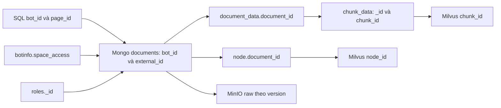

# 01. Database và lưu trữ

[← Mục lục](README.md) · LLD v2.0 — 10/11/2026.

## 1. PostgreSQL nghiệp vụ và nguyên tắc dữ liệu

- **Giữ:** PostgreSQL cho snapshot đối soát và lần chạy ingestion.
- Không dùng PostgreSQL metadata Airflow để lưu tri thức.
- Căn cứ vật lý local: [001-knowledge-base.sql](../../infra/postgres/init/001-knowledge-base.sql).
- DDL local được đối chiếu với caller; chưa có căn cứ xác nhận DDL production của hệ thống tham khảo.

### 1.1. `knowledge_base.documents`

| Trường | Kiểu local / ràng buộc | Ý nghĩa |
| --- | --- | --- |
| `id` | bigint identity, PK | ID hàng SQL, không thay UUID Mongo. |
| `bot_id`, `page_id` | text NOT NULL, unique cặp | Định danh trang nguồn trong namespace bot. |
| `title`, `content` | text, nullable theo DDL | Tiêu đề và nội dung nguồn. Pipeline đích validate nội dung hợp lệ trước train. |
| `content_hash` | text | MD5 nội dung; không phải embedding hoặc nội dung mã hóa. |
| `version_number` | integer | Version Confluence đã thu thập, không phải lịch sử mọi version. |
| `source_link`, `parent_id` | text | Link nguồn và ID trang cha phía Confluence. |
| `sync_status`, `source_type` | text | Writer dùng `SYNCED`, `CONFLUENCE` ở các nhánh upsert. Không tự đặt enum validator mới. |
| `create_by`, `updated_by` | text | Audit actor nguồn, giữ đúng tên `create_by`. |
| `create_at`, `updated_at` | timestamptz | Thời gian nguồn/ghi theo caller, không đổi thành `created_at` trong SQL. |
| `is_deleted` | boolean NOT NULL DEFAULT false | Cờ xóa nguồn. |

- Index hiện có từ DDL local: PK `id`, unique `(bot_id,page_id)`.
- Index khác chỉ thêm khi có access pattern và `EXPLAIN`.
- Reader AUTO cần snapshot theo bot.
- Unique bắt đầu bằng bot đã hỗ trợ prefix đó.
- Content/hash không cần index riêng để so từng page trong batch đã đọc.

- MD5 hiện được tính trên UTF-8 chuỗi `body.storage.value`.
- Wrapper HTML lưu MinIO không được đem so với hash của fragment rồi kết luận mọi trang thay đổi.
- Không dùng hash làm ID tài liệu.
- Procedure local dùng `md5(coalesce(content,''))`.
- Insert trực tiếp dùng MD5 trên content caller truyền, vì vậy adapter phải truyền chuỗi không-null nhất quán.

### 1.2. `knowledge_base.sync_jobs`

| Trường | Kiểu local / ràng buộc | Ý nghĩa |
| --- | --- | --- |
| `id` | bigint identity, PK | Lượt ingestion. |
| `status` | text NOT NULL | Initialize `RUNNING`; finalize trạng thái ingestion, không tự mang nghĩa train hoàn tất. |
| `started_at` | timestamptz NOT NULL DEFAULT now() | Bắt đầu ingestion. |
| `finished_at` | timestamptz nullable | Kết thúc ingestion, không mặc định thời gian FE nhận thông báo. |
| `total_processed`, `total_updated`, `total_deleted` | integer NOT NULL DEFAULT 0 | Giữ cách đếm ingestion hiện có; không tự đổi thành count event Kafka. |
| `logs` | text nullable | Lỗi/chi tiết ingestion; đề xuất mở rộng JSON text ở dưới. |

- **Đề xuất triển khai formatter `logs`:** JSON text version 1 có `ingestion` giữ thông tin gốc và `correlation` gồm `bot_id`, `pipeline_dag_id`, `pipeline_dag_run_id`.
- Thông tin parent run được ghi ngay sau init lấy SQL ID.
- Finalize phải merge/giữ correlation, không ghi đè bằng chuỗi error như helper hiện tại.
- Parser chấp nhận `logs` là chuỗi không-JSON, trả correlation chưa có thay vì lỗi API.
- Không lưu token, toàn văn content hoặc danh sách error vô hạn vào logs.

- Job/run train và manifest tài liệu nằm trong Airflow conf/XCom theo contract.
- Không tạo bảng theo dõi mới.
- API lấy kết quả từ SQL + Airflow/Mongo.
- `sync_jobs.status=COMPLETED` chỉ xác nhận phạm vi ingestion.
- Chưa có correlation thì trả trạng thái chưa xác định của pipeline, không suy thành thành công.

### 1.3. Procedure local

- `sp_sync_confluence_page(bot_id, page_id, title, content, source_link, version, parent_id, create_by, create_at, updated_by, updated_at)` có đúng 11 tham số.
- Upsert current snapshot, tính MD5, cập nhật metadata/version và restore `is_deleted=false`.
- Local procedure bảo toàn audit lần tạo khi conflict.
- Các insert trực tiếp trong source có thể cập nhật create audit.
- Cần test riêng, không khẳng định cả hai đường giống nhau ở mọi field.

- Không có bảng version history hoặc cơ chế chống version cũ ghi đè trong DDL local.
- Thiết kế giữ giả định tuần tự, không thêm procedure recovery/generation.

- Các mục 2–6 dưới ghi rõ **field hiện có theo writer/reader**.
- Phần đích bổ sung/validation tại mục 7 có hiệu lực khi triển khai.

## 2. `documents` — metadata tài liệu

### 2.1. Trường được Confluence writer tạo/cập nhật

| Trường | Kiểu theo code | Nguồn/ý nghĩa | Hành vi |
| --- | --- | --- | --- |
| `_id` | string UUID | ID nội bộ Mongo. | `$setOnInsert`, giữ khi update; không phải Confluence ID. |
| `bot_id` | string | Bot sở hữu document. | Có trong filter upsert. |
| `external_id` | string | Confluence page ID. | `str(page.id)`. |
| `external_parent_id` | string hoặc null | Confluence parent page ID. | Từ ancestor cuối, không cùng loại với parent_id. |
| `parent_id` | string UUID hoặc null | ID document cha nội bộ. | Ban đầu null, resolve_parent_ids cập nhật sau. |
| `level` | int | Độ sâu cây document. | Ban đầu 0, hierarchy processor tính lại. |
| `doc_name` | string | Tiêu đề trang. | Từ title. |
| `doc_name_normalize` | string | Tên đã chuẩn hóa để tra cứu. | `normalize_doc_name`, không thay text nội dung. |
| `created_by`, `updated_by` | string | Thông tin người tạo/sửa phía nguồn. | Một số fallback Unknown; không mặc định là user đăng nhập app. |
| `created_at`, `updated_at` | datetime | Mốc từ nguồn đã normalize. | Writer update có thể ghi cả created_*; không giả định chỉ set lúc insert. |
| `sync_version` | **string** | Số version Confluence. | `str(version_number)`, giá trị string do writer tạo. |
| `sync_status` | string | processing/done/error. | Phân biệt status chữ hoa và training_status. |
| `sync_at` | datetime UTC | Mốc đồng bộ. | Cập nhật ở insert/sync_time. |
| `sync_mode` | **bool** | Trang có tham gia auto sync hay không. | Không phải chuỗi FIRST/PARTIAL/AUTO. Một số update không ghi lại trường này. |
| `source_link` | string | `_links.webui` phía Confluence. | Có thể là đường tương đối; URL tuyệt đối được dựng từ cấu hình nguồn khi cần. |
| `source` | string | `confluence`. | Nhiều consumer/query dùng chính trường này. |
| `source_type` | string | `confluence` trên Mongo. | Cùng mục đích phân loại nhưng tồn tại song song source; SQL dùng CONFLUENCE. |
| `index` | int, có thể vắng | Thứ tự root được chọn trong FIRST. | Bắt đầu 1; không phải ordinal của chunk. |

- **Căn cứ:** [first_mode_processor.py:175](../../beegen-ingestion/beegen-ingestion/confluence_workflow/functions/first_mode_processor.py).
- [partial_mode_processor.py:79](../../beegen-ingestion/beegen-ingestion/confluence_workflow/functions/partial_mode_processor.py).
- [auto_mode_processor.py:1](../../beegen-ingestion/beegen-ingestion/confluence_workflow/functions/auto_mode_processor.py).
- [mongo_processor.py:22](../../beegen-ingestion/beegen-ingestion/confluence_workflow/functions/mongo_processor.py).

- **Identity thực tế:** filter upsert `{bot_id, external_id}`.
- `_id` do writer tạo một lần.
- Chưa thấy migration tạo unique index cho cặp này trong code đã đọc.

### 2.2. Trường được Portal/chunk/train bổ sung hoặc đọc

| Trường | Kiểu/hành vi quan sát | Writer/reader |
| --- | --- | --- |
| `status` | Có thể vắng sau `$unset`; PROCESS/DONE/ERROR trên luồng chunk/upload. | Dispatch đánh PROCESS; chunk success DONE; fail ERROR. |
| `deleted` | bool hoặc vắng. | Active filter thường `{$ne:true}`; FIRST/AUTO restore có thể `$unset`. Không bắt buộc mọi record deleted=false. |
| `chunk_type` | string hierarchical. | Chunk success set. |
| `is_trained` | bool | Chunk success set false; train success true. |
| `training_status` | NOT_TRAINING/PROCESS/DONE/ERROR. | Chunk success reset, train orchestration/process cập nhật. |
| `changed_chunking` | bool | Chunk success false. |
| `trained_at` | datetime hoặc vắng | Train DONE set; chunk success unset. |
| `error_message` | string hoặc vắng | Lỗi set; success/unchanged paths có thể unset. |
| `category_id` | ID hoặc null, chỉ thấy đọc ở đây, chưa xác nhận type ở creator | Train lấy để dựng topic_path; creator chưa được xác nhận trong hai writer. |
| `path` | string, có nơi đọc | `_extract_doc_info` của upload_document_job và converter đọc S3 path từ documents.path; không phải trường document_path hoặc raw version ref do Confluence writer tự lưu. |
| `valid_from`, `valid_to` | Có code unset, chưa đủ evidence schema/type | Không coi là trường bắt buộc của tài liệu Confluence. |
| `role_ids` | Reader retrieval dùng array ID, writer cũ có đường unset | Trong thiết kế đích phải giữ array[string] theo Space; xem mục 7. |

- **Căn cứ:** [document_processor.py:1](../../beegen-portal-api/beegen-portal-api/app/consumer/confluence/processing/document_processor.py).
- [train_document_job.py:1](../../beegen-portal-api/beegen-portal-api/app/job/portal/train_document_job.py).
- [db_validation.py:1](../../beegen-portal-api/beegen-portal-api/app/utils/db_validation.py).

- `sync_version`/sync_status ở document không là bảng lịch sử.
- Cập nhật metadata hiện tại không giữ bản ghi mọi lần sửa, và DONE không chứng minh vector mới đã ghi.

## 3. `document_data` — nội dung sau chunk ban đầu

| Trường | Kiểu | Cách sinh |
| --- | --- | --- |
| `_id` | string UUID | `uuid.uuid4()` cho mỗi chunk mới. |
| `document_id` | string | Tham chiếu `documents._id`. |
| `content` | string | `chunk['content']`; có thể kèm filename/heading theo chunker. |
| `index` | int | enumerate bắt đầu 0. |
| `created_at` | datetime UTC | Thời điểm ghi đoạn. |
| `bot_id` | string | Bot của message/job. |

- **Căn cứ:** `prepare_document_data` trong [document_processor.py:1](../../beegen-portal-api/beegen-portal-api/app/consumer/confluence/processing/document_processor.py) và `prepare_mongo_document_data_only` trong [prepare_document.py:1](../../beegen-portal-api/beegen-portal-api/app/service/portal/utils/prepare_document.py).

- Quan hệ: `documents._id = document_data.document_id`.
- Một document có nhiều document_data, thứ tự theo index.
- Train lấy content ở đây, không chunk lại trong helper chuyển sang chunk_data.

## 4. `chunk_data` — dữ liệu phục vụ embedding/retrieval

| Trường | Kiểu | Cách sinh chính xác |
| --- | --- | --- |
| `_id` | ID record gốc, thường string UUID | Dùng `_id` của document_data; fallback UUID nếu thiếu. |
| `chunk_id` | string | `str(raw_id)`, join với primary key Milvus. |
| `doc_id` | string | `documents._id`; **không phải document_id trong collection này**. |
| `chunk_index` | int | Từ document_data.index. |
| `llm_text` | string | Từ document_data.content, là text dùng để embed. |
| `keywords` | string hoặc kết quả keyword step | Ban đầu `""`; train helper cập nhật keywords. |

- **Căn cứ:** `prepare_chunk_data_from_document_data` trong [prepare_document.py:1](../../beegen-portal-api/beegen-portal-api/app/service/portal/utils/prepare_document.py).

## 5. `node` — cây nội dung khi train

| Trường | Kiểu | Ý nghĩa |
| --- | --- | --- |
| `_id`, `node_id` | string UUID, cùng giá trị | Primary key Mongo và key join Milvus node. |
| `document_id` | string | Tham chiếu documents._id, khác chunk_data.doc_id. |
| `parent_id` | string hoặc null | Node cha trong cây node, không phải documents.parent_id. |
| `title`, `content`, `summary` | string | Nội dung tree node; embedding lấy summary. |
| `level` | int | Cấp node, traverse từ 0. |
| `keywords` | string | `format_keywords`, list được join thành text. |

- **Căn cứ:** `prepare_node_data_from_tree` trong [prepare_document.py:1](../../beegen-portal-api/beegen-portal-api/app/service/portal/utils/prepare_document.py).
- `process_tree_if_applicable` chạy cho PDF/DOCX **hoặc source=confluence**, nên Confluence hiện không mặc định bỏ node tree.
- Việc bỏ tree/summary để tiết kiệm quota là thay đổi cần review, không mô tả như đã có.

## 6. `botinfo` và `category`

### 6.1. Phần schema được đọc của `botinfo`

| Trường | Quan sát |
| --- | --- |
| `_id` | Bot ID; `validate_bot` dùng find_one theo ID. |
| `deleted` | Nếu true, validate_bot trả 404. |
| `space_config.syncing_page` | Array các cấu hình parent page. |
| `space_config.syncing_page[].page_id` | Được chuẩn hóa thành string. |
| `space_config.syncing_page[].active` | Chỉ chọn `is True`. |

- **Căn cứ:** [workflow_config.py:36](../../beegen-ingestion/beegen-ingestion/confluence_workflow/workflow_config.py) và [db_validation.py:1](../../beegen-portal-api/beegen-portal-api/app/utils/db_validation.py).
- Đây là cấu hình cây page.
- Chưa có evidence creator của toàn bộ botinfo trong hai repo.

### 6.2. Phần schema được đọc của `category`

| Trường được reader sử dụng | Ý nghĩa |
| --- | --- |
| `_id` | ID danh mục được tài liệu tham chiếu |
| `bot_id` | Bot sở hữu danh mục |
| `name` | Tên dùng dựng `topic_path` |
| `parent_id` | Tham chiếu danh mục cha |

- Đây là cây danh mục nội dung.
- Không đồng nghĩa role hoặc Space.
- Creator/field bắt buộc ngoài những trường đọc chưa được xác nhận.
- **Căn cứ:** `build_topic_tree` trong [prepare_document.py:1](../../beegen-portal-api/beegen-portal-api/app/service/portal/utils/prepare_document.py) và query category trong [train_document_job.py:1](../../beegen-portal-api/beegen-portal-api/app/job/portal/train_document_job.py).

## 7. Schema đích tối thiểu cho bot, Space và quyền

- **Đề xuất triển khai, chưa ghi vào database:**

| Vị trí | Kiểu/validation | Chủ sở hữu |
| --- | --- | --- |
| `roles._id` | string ổn định, PK Mongo | Admin bootstrap/service |
| `roles.bot_id` | string đúng bot được cấu hình | Admin service |
| `roles.role_name` | INTERNAL hoặc CUSTOMER trong bản cốt lõi | Admin service |
| `botinfo.space_access[]` | Đúng hai entry, không trùng Space | Admin config service |
| `space_access[].space_id` | string ID Space thực, không tên hiển thị | Admin config service |
| `space_access[].role_ids` | array[string] không rỗng, không trùng, cùng bot | Admin config service |
| `documents.space_id` | string Space thực của page | Ingestion |
| `documents.role_ids` | array[string] không rỗng, kế thừa mapping | Ingestion/config propagation |
| `documents.raw_s3_uri` | URI S3 current raw theo version, bucket allowlist | Ingestion |

- Giữ `space_config.syncing_page` tương thích khi cần, nhưng không dùng root selection thay kiểm kê đầy đủ hai Space.
- Kiểm tra policy hiện hành ở retrieval, không chỉ tin ACL được copy từ trước.
- Chi tiết tại [06 — ACL/RAG](06-space-access-control.md).

```json
{
  "_id": "bot-demo",
  "space_access": [
    {"space_id": "space-policy", "role_ids": ["role-internal"]},
    {"space_id": "space-promotion", "role_ids": ["role-internal", "role-customer"]}
  ]
}
```

- Ví dụ bổ sung một phần record, không replace toàn bộ botinfo.
- `create_bot` hiện tạo vector collection, chưa tạo đầy đủ config/roles.
- Bootstrap phải seed rõ hai record roles và botinfo hợp lệ.

### 7.1. Index/validator đích — cần migration sau audit

| Collection | Index đề xuất | Validation/quan hệ |
| --- | --- | --- |
| `roles` | unique `(bot_id,role_name)` | ID cùng bot, string thống nhất. |
| `documents` | unique `(bot_id,external_id)` với partial filter `source=confluence` | Một site nguồn/bot; audit duplicate trước áp dụng. |
| `documents` | `(bot_id,space_id)` nếu listing theo Space; cân nhắc `(bot_id,role_ids)` bằng explain | Không tự tạo mọi tổ hợp compound; `_id` lookup có thể lọc ACL sau. |
| `document_data` | `(document_id,index)` | Nhiều đoạn/document; writer UUID mới nên không áp unique index index trước audit/replacement. |
| `chunk_data` | `(doc_id)`, unique `(chunk_id)` sau audit | Field tham chiếu đúng `doc_id`, không đổi thành document_id. |
| `node` | `(document_id)`, unique `(node_id)` sau audit | parent_id trỏ node cha, không trỏ documents. |
| `category` | `(bot_id)` | Nếu giữ topic tree. |

- Các PK Mongo `_id` đã có unique index.
- Không tự thêm TTL trên dữ liệu tri thức.
- Không có foreign key xuyên Mongo/SQL/Milvus.
- Application service validate quan hệ.
- Field tùy chọn của record cũ không tự được nâng thành NOT NULL khi chưa backfill.

## 8. MinIO và phiên bản

- **Đề xuất triển khai — object key:** `confluence/{bot_id}/{document_id}/versions/{sync_version}/raw.html`.
- Artifact Markdown nếu giữ: cùng prefix, `document.md`, nhưng nằm bucket processed theo resource profile.
- Bucket raw/processed lấy từ ResourceHub, không hardcode `ai-text-raw`.
- Không đưa title vào identity key.
- Chỉ cho version nguồn có dạng số dương đã chuẩn hóa và ID đã validate vào key.

- Object metadata/manifest đi kèm khi capture giữ document/page/Space/version, title, capture time và hash nguồn.
- Metadata Unicode được encode theo contract S3; dùng JSON UTF-8 sidecar `source.json` cùng prefix, không ghi Unicode trực tiếp vào HTTP metadata.
- **Sidecar là object MinIO, không phải collection mới.** Sidecar chỉ chứa metadata cần để kiểm chứng nguồn, không token/ACL cũ làm căn cứ cấp quyền.

- Raw capture chỉ tải và đóng gói HTML đơn giản.
- Bản gốc đã capture giữ lại sau train.
- Chỉ xóa file tạm local.
- MinIO versioning bổ sung bảo vệ ghi object, không thay version nguồn trong key.

- Mỗi document chỉ có một tập derived data hiện hành trong phạm vi cốt lõi tuần tự.
- Khi đang replace dữ liệu, document không eligible.
- Không cam kết zero-downtime thay index.

## 9. Schema Milvus và hợp đồng vector

- Tên collection được build từ bot_id: nếu chưa bắt đầu bằng `bot` thì thêm `bot_`, thay dấu gạch ngang bằng gạch dưới, suffix `_chunk` và `_node`.

| Field | Chunk collection | Node collection |
| --- | --- | --- |
| Primary key | chunk_id VARCHAR(65535), auto_id=false | node_id VARCHAR(65535), auto_id=false |
| content | VARCHAR(65535), analyzer standard/lowercase | Tương tự |
| vector | FLOAT_VECTOR, VECTOR_DIM=1024 trong code | Tương tự |
| sparse_vector | SPARSE_FLOAT_VECTOR do BM25 function từ content | Tương tự |
| topic | VARCHAR(65535), partition key | Tương tự |
| type | VARCHAR(65535), payload document | Tương tự |

- Schema builder: [milvus_schema.py:21](../../beegen-portal-api/beegen-portal-api/app/utils/milvus_schema.py).
- Dense index IVF_FLAT/COSINE, sparse SPARSE_INVERTED_INDEX/BM25.
- Create collection dùng Bounded consistency.
- Đây là cấu hình code hiện có, không kết quả tối ưu và không chứng minh model Cloudflare sẽ khớp D=1024.

- Payload train rất quan trọng: **embedding chunk lấy llm_text nhưng Milvus.content nhận keywords**.
- Node embedding lấy summary và Milvus.content cũng nhận keywords.
- Full text phải join về Mongo.

## 10. Quan hệ và điều kiện đọc



- Điều kiện đọc thống nhất cho retrieval/source: [06, mục 2](06-space-access-control.md#2-interface-policy--đề-xuất-triển-khai).
- Khi chỉ metadata đổi, derived text còn tương đương về body theo AS01.
- Title/source hiển thị lấy metadata hiện hành.
- Version trích dẫn là version nguồn hiện hành có body tương đương và đã đối soát, không tự tuyên bố đã embedding lại.

- Chuỗi `sync_version` chuyển số khi so sánh nguồn, không so lexicographic.
- Similarity score, Kafka event hoặc SQL SYNCED không thay điều kiện đọc.

## 11. Ranh giới dữ liệu

- Không sử dụng `dialogue`, `multimedia`, `document_ingestion` trong luồng Confluence của đồ án.
- `beegen_resource_configs` lưu cấu hình kỹ thuật ResourceHub; xem [danh mục resource](../resource-keys.md).
- Schema tài khoản/phiên phụ thuộc lựa chọn identity provider, chưa thuộc schema triển khai này.
