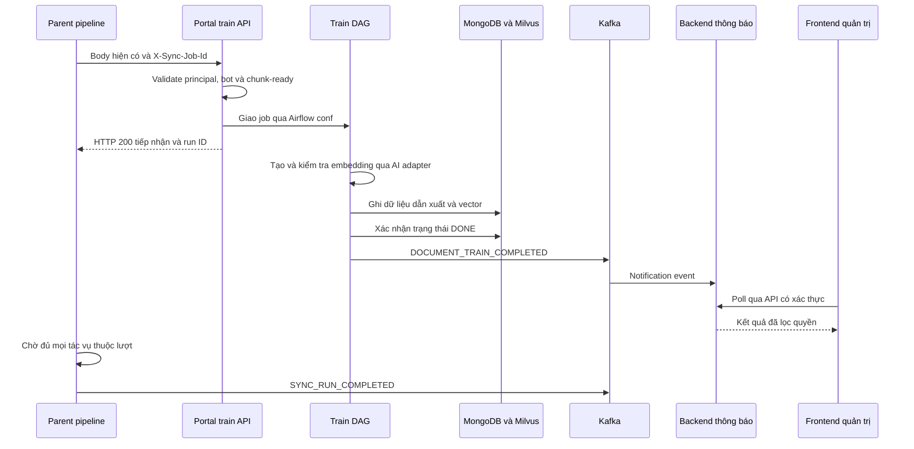

# 02. API và Kafka thông báo

[← Mục lục](../detailed-design.md) · LLD v2.0 — 10/11/2026.

## 1. Phân loại contract

- Prefix Portal: `/portal`, theo [controller/router.py](../../beegen-portal-api/beegen-portal-api/app/controller/router.py).
- Đường dẫn trong bảng được phân loại theo căn cứ mã nguồn và hợp đồng triển khai.
- Căn cứ các route được tái sử dụng nằm tại mục 9.

| Nhóm | Contract | Phân loại |
| --- | --- | --- |
| Train | `POST /portal/train` | Có trong source; semantics response/correlation theo mục 2 |
| Clean | `POST /portal/clean` | Có trong source; áp điều kiện cleanup của tài liệu đã chặn |
| Khởi tạo vector | `POST /portal/create_bot` | Có trong source; phục vụ bootstrap collection |
| Cấu hình | `GET/PUT /portal/source-config` | Đề xuất triển khai |
| Đồng bộ/trạng thái | `POST /portal/sync-jobs`, `GET /portal/sync-jobs/{job_id}`, `GET /portal/pipeline-runs/{dag_run_id}` | Đề xuất triển khai |
| Train status | `GET /portal/train-runs/{dag_run_id}` | Đề xuất triển khai |
| Xử lý lại | `POST /portal/documents/{document_id}/retry` | Đề xuất triển khai, thủ công |
| RAG | `POST /portal/knowledge/ask`, `POST /portal/knowledge/search` | Đề xuất triển khai |
| Nguồn | `GET /portal/sources/{document_id}` | Đề xuất triển khai |
| Thông báo UI | `GET /portal/notifications` | Đề xuất triển khai, polling có quyền quản trị |

- Cơ chế login/logout phụ thuộc lựa chọn identity provider.
- Route tri thức/vận hành yêu cầu principal hợp lệ.
- Service credential được giới hạn theo operation.
- Schema tài khoản/phiên chưa được xác định.

## 2. API train

### 2.1. Request và điều kiện đầu vào

```json
{"bot_id":"bot-demo","type":"document","ids":["doc-uuid-1","doc-uuid-2"]}
```

| Trường | Kiểu/validation theo model | Ý nghĩa |
| --- | --- | --- |
| `bot_id` | String strip, không rỗng | Bot sở hữu tài liệu |
| `ids` | Array string không rỗng; min_length=1 | Danh sách document UUID |
| `type` | Enum `document` hoặc `QA` | Phạm vi Confluence sử dụng `document` |

- Căn cứ: [model/document.py](../../beegen-portal-api/beegen-portal-api/app/model/document.py).

- Precondition: bot active, tài liệu thuộc bot, không deleted, raw/source/ACL hợp lệ và `status=DONE`.
- Record đã `is_trained=true` và `training_status=DONE` bị validator hiện tại trả 409.
- Preparation phải reset trạng thái khi có body mới.
- Không gọi API lại cho mọi trang chỉ vì đến kỳ 60 phút.
- Mảng ID phải loại trùng trước giao job và validate toàn bộ trước trigger.

- **Header nội bộ — đề xuất triển khai:** `X-Sync-Job-Id: 42` dùng string của SQL job ID.
- Server parse bigint dương, xác minh correlation bot trong `sync_jobs.logs` đã được ghi, không chỉ tin ID từ header.
- Header bắt buộc cho chuỗi tự động, có thể vắng với lệnh quản trị độc lập nếu contract UI cho phép.
- Giữ `TrainRequest` không đổi.
- Adapter truyền `sync_job_id` vào Airflow conf và trả lại correlation.

### 2.2. Response đích

- Hợp đồng triển khai: HTTP 200 với envelope hiện có, message “Train request accepted”; chỉ xác nhận tiếp nhận yêu cầu.
- Router tham khảo dùng message “Train completed” dù mới trigger DAG; caller phải dựa vào trạng thái thực thi để xác nhận hoàn tất.
- **Đề xuất triển khai chuẩn hóa `data`** từ workflow output thành các field trực tiếp dưới đây.

```json
{
  "status": 200,
  "error": "OK",
  "soaErrorCode": "200",
  "soaErrorDesc": "Train request accepted",
  "data": {
    "bot_id": "bot-demo",
    "sync_job_id": "42",
    "dag_id": "configured-train-dag",
    "dag_run_id": "train-run-example",
    "dag_state": "queued"
  }
}
```

- `dag_id` lấy từ cấu hình server allowlist.
- Request timeout không được hiểu như job chắc chắn chưa chạy.
- Retry timeout tự động ngoài phạm vi cốt lõi.

### 2.3. Theo dõi job

- Route mới đề xuất `GET /portal/train-runs/{dag_run_id}?bot_id=...`.
- Server tìm run trong configured train DAG, đối chiếu run conf bot và principal.
- Không cho client chọn DAG ngoài allowlist.
- Trả `dag_state`, document ID/status, `processing_complete` và `notification_state` nếu quan sát được.
- `processing_complete=true` đòi hỏi task compute/write/verify thành công cùng predicate train Mongo và kết quả ghi đã xác nhận.
- Không buộc task publish thông báo thành công mới coi dữ liệu đã ghi xong.
- DAG overall có thể failed do publish task trong khi processing_complete vẫn true.
- “Chưa biết” khác false/thành công.
- Không trả secrets/raw conf.

- Parent Airflow task dùng run ID để chờ kết quả.
- `dag_run_id` opaque cần URL encode, không dùng làm file path.
- Child DAG thất bại không phát sự kiện thành công.
- Chi tiết task graph ở [03](03-modules-code-mapping.md).

## 3. API cấu hình và vận hành — đề xuất triển khai

| Route | Input chính | Behavior / output |
| --- | --- | --- |
| `GET /portal/source-config` | Principal quản trị | Cấu hình một bot, hai Space/roles và trạng thái validation; không trả token/secret. |
| `PUT /portal/source-config` | `bot_id`, hai `space_access` entry, tham chiếu resource/secret | Validate quyền, Space không trùng, role đúng bot, nguồn đọc được; lưu config và thực hiện propagation quyền trước xác nhận hiệu lực. Không nhận token rõ nếu đã dùng secret reference. |
| `POST /portal/sync-jobs` | `bot_id`; mode bootstrap hoặc auto theo trạng thái cấu hình | Gửi parent DAG, trả HTTP 202 với pipeline run ID. SQL job ID có thể chưa có trước task initialize; trả null cho tới khi init, không tạo ID SQL giả. Không có lượt chồng cùng nguồn. |
| `GET /portal/sync-jobs/{job_id}` | Job ID và principal quản trị | Đọc SQL job + correlation → Airflow parent/child + Mongo; trả ingestion và pipeline status riêng. Không cần bảng Mongo trạng thái mới. |
| `GET /portal/pipeline-runs/{dag_run_id}` | Parent run ID và bot/principal quản trị | Theo configured sync DAG, validate conf bot và đọc XCom initialize để lấy sync_job_id khi có. Phục vụ polling giai đoạn SQL job chưa tạo; không để client chọn DAG tùy ý. |
| `POST /portal/documents/{document_id}/retry` | `bot_id` và giai đoạn phù hợp | HTTP 202 nếu đủ điều kiện; dùng raw/đầu vào hiện hành, reset/chuẩn bị phù hợp. Không tự nhảy train khi chunk chưa sẵn sàng; không rollback partial write tự động. |
| `POST /portal/clean` | Body hiện có `bot_id/type/ids` | Chỉ tài liệu đã chặn/deleted được cleanup trong contract đích; cần sửa kiểm tra ở service vì validator hiện không buộc mọi document deleted. Không xóa raw lịch sử trong phạm vi cốt lõi. |

- `pipeline_status` mới là projection, không thêm column: `RUNNING`, `SUCCEEDED`, `FAILED`, `UNKNOWN`.
- `outcome` có thể `UPDATED` hoặc `NO_CHANGES`.
- Metadata/quyền/xóa đơn thuần không phải NO_CHANGES.
- SQL `ingestion_status` vẫn giữ giá trị thật.
- Trạng thái notification là độc lập nếu có, không biến lỗi giao thông báo thành chưa embedding.

- Parent conf/XCom giữ tập mục tiêu tài liệu và các child run.
- Logs SQL chỉ giữ pointer correlation và thông tin ingestion giới hạn.

## 4. Contract RAG và nguồn — đề xuất triển khai

### 4.1. Hỏi đáp/tìm kiếm

- `POST /portal/knowledge/ask`: `{"question":"..."}`.
- Bot duy nhất lấy từ server config.
- Không chấp nhận role/Space do client gửi để mở rộng quyền.
- `POST /portal/knowledge/search`: `{"query":"..."}`.
- Chỉ nhân viên/quản trị theo SRS.
- Cấu hình server quyết định limit/context/profile.
- Các ngưỡng max length cần chốt pilot, không coi là constraint đã có trong Pydantic khi chưa kiểm chứng.

```json
{
  "status": 200,
  "error": "OK",
  "soaErrorCode": "200",
  "soaErrorDesc": "OK",
  "data": {
    "request_id": "request-example",
    "answer_status": "ANSWERED",
    "answer": "Nội dung được hỗ trợ bởi nguồn [1].",
    "citations": [
      {"citation_id":"1","document_id":"doc-uuid-1","chunk_ids":["chunk-uuid-1"],"title":"Chương trình khuyến mãi","sync_version":"3","source_url":"/portal/sources/doc-uuid-1?sync_version=3"}
    ]
  }
}
```

- `answer_status`: ANSWERED hoặc INSUFFICIENT_EVIDENCE.
- Thiếu bằng chứng trả 200 với nội dung giới hạn và citations rỗng, khác lỗi dịch vụ.
- Nếu LLM viện dẫn ID không nằm evidence allowlist hoặc không đủ bằng chứng, không dựng URL cho ID giả.
- Loại/đánh dấu kết quả không hợp lệ và phản hồi phù hợp.
- Cấu trúc source không cho biết metadata tài liệu nội bộ bị lọc.

### 4.2. Xem nguồn

- `GET /portal/sources/{document_id}?sync_version=3&chunk_id=...` kiểm tra lại principal, bot, Space, ACL và eligibility hiện hành.
- Nếu version không còn là version hiện hành thì trả 409 SOURCE_CHANGED.
- Chunk/node ID phải thuộc document, không chỉ tồn tại.
- Nguồn trả đoạn text, title/heading khi có, version/capture time và link phù hợp.
- Không trả `raw_s3_uri` hoặc presigned public URL để bỏ qua auth.
- Đọc capture time từ raw sidecar hoặc `sync_at` với nhãn rõ khác biệt.
- Không tự lấy `updated_at` nguồn làm thời điểm thu thập.

- Khách hàng đọc nguồn khuyến mãi trong ứng dụng, không cần tài khoản Confluence.
- Document không tồn tại/không được phép trả cùng lỗi không tiết lộ metadata (đề xuất 404).
- Link Confluence chỉ xuất nếu được phép.

## 5. Authentication, lỗi và response

- Auth hiện tại [middleware.py](../../beegen-portal-api/beegen-portal-api/app/auth/middleware.py): HTTPBearer → Keycloak verify → `client_id=ai_center`.
- **Yêu cầu tích hợp:** identity adapter trả principal với kind USER/SERVICE, subject, application role và quyền đọc do server ánh xạ.
- Chưa chọn local auth hay IdP.
- Service chỉ có scope TRAIN/PREPARE phù hợp, không tự đọc tri thức toàn kho.

- Giữ envelope lỗi từ [portal.py](../../beegen-portal-api/beegen-portal-api/app/exception/portal.py): `status`, `error`, `soaErrorCode`, `soaErrorDesc`.
- Description không chứa stack trace hoặc secret.

| HTTP status đề xuất | Điều kiện |
| --- | --- |
| 401 | Thiếu thông tin xác thực hoặc phiên không hợp lệ |
| 403 | Thiếu quyền thực hiện chức năng |
| 404 | Tài liệu không tồn tại hoặc không được phép đọc |
| 409 | Trạng thái xung đột hoặc phiên bản nguồn đã thay đổi |
| 422 | Đầu vào không hợp lệ |
| 429 | Lỗi quota/rate limit đã được xác định |
| 503 | Dependency chưa sẵn sàng |
| 500 | Lỗi nội bộ chưa phân loại |

- Source/code mapping hiện có phải được adapter kiểm tra, không mặc định mọi handler đã trả chuẩn này.

## 6. Kafka notification — đề xuất triển khai

- Topic: **`doan.knowledge.notifications.v1`**.
- Key: UTF-8 `bot_id` (giữ cùng namespace cho cả tài liệu/lượt).
- Một partition cho pilot là đề xuất triển khai.
- Không dựa thứ tự partition để thay việc kiểm tra trạng thái.
- Consumer group riêng **`doan-knowledge-notification-v1`**.
- Consumer group thông báo tách group xử lý nội dung.

| Field | Kiểu | Rule |
| --- | --- | --- |
| `schema_version` | integer | 1; version khác không xử lý như v1. |
| `event_id` | string UUID | Correlation event, không cam kết exactly-once. |
| `event_type` | enum | DOCUMENT_TRAIN_COMPLETED hoặc SYNC_RUN_COMPLETED. |
| `occurred_at` | string RFC3339 UTC | Thời điểm completion đã xác nhận. |
| `bot_id` | string | Khớp Kafka key, một bot hợp lệ. |
| `sync_job_id` | string bigint dương | Lượt ingestion đã được xác minh. |
| `pipeline_run` | object | `dag_id`, `dag_run_id` của parent để đối soát; không secret. |
| `status` | enum | SUCCEEDED trong sự kiện hoàn tất này; lỗi được phản ánh qua status API, không giả event success. |
| `document` | object/null | Bắt buộc với event tài liệu: `id`, `sync_version`; toàn lượt null. |
| `train_run` | object/null | Child DAG/run với event train; null nếu toàn lượt không có train riêng. |
| `summary` | object/null | Toàn lượt: số items, train required/completed, metadata updated, deleted, unchanged; không phải SQL counter tự đổi nghĩa. |

```json
{
  "schema_version": 1,
  "event_id": "93ea3fe3-92ca-4e4a-9a6d-d067eae264bb",
  "event_type": "DOCUMENT_TRAIN_COMPLETED",
  "occurred_at": "2026-11-10T04:30:00Z",
  "bot_id": "bot-demo",
  "sync_job_id": "42",
  "pipeline_run": {"dag_id":"configured-sync-dag","dag_run_id":"sync-run-example"},
  "status": "SUCCEEDED",
  "document": {"id":"doc-uuid-1","sync_version":"3"},
  "train_run": {"dag_id":"configured-train-dag","dag_run_id":"train-run-example"},
  "summary": null
}
```

- Toàn lượt dùng cùng envelope, `event_type=SYNC_RUN_COMPLETED`, `document=null`, `train_run=null`, summary hữu hạn.
- Mỗi item thuộc đúng một loại cuối trong manifest: train, metadata-only (gồm ACL/move nếu không đổi body), deleted hoặc unchanged.
- `total_items` là union được đối soát, không chỉ số trang đang tồn tại trên Confluence.
- `train_completed= train_required` và các tác vụ khác đã xong trước publish.
- Lượt không đổi: required/completed bằng 0, chỉ thông báo đối soát.
- Không có DOCUMENT_TRAIN_COMPLETED giả.

- Job train publish event tài liệu sau kiểm tra write.
- Parent publish event toàn lượt sau kiểm tra manifest và child result.
- Không dùng event tài liệu cuối cùng để tự phỏng đoán tổng số tác vụ.

### 6.1. Consumer behavior

1. Validate kích thước, schema, loại event, key, bot và correlation.
2. Cập nhật view kết quả tạm theo job/document ID.
3. Commit offset sau khi xử lý thành công.

- Payload invalid/version lạ: ghi log metadata đã làm sạch, bỏ qua và commit theo policy pilot.
- Không xử lý như lệnh train, chưa dựng DLQ.
- Group auto-commit tắt.
- Có thể giao lại message khi restart, do đó projection phải set trạng thái theo ID thay vì cộng count vô điều kiện.
- Có thể giữ bounded event-ID cache trong RAM để tránh toast lặp trong cùng runtime.
- Không coi cache là durable receipt.

- `GET /portal/notifications` chỉ admin, lọc bot hiện hành.
- Trả view tạm có cursor/event ID, không hứa history/replay qua backend restart.
- UI poll/refresh API.
- Trạng thái đúng đọc lại endpoint job nếu mất view notification.
- Trình duyệt không kết nối broker.
- Poll response không có dữ liệu mới khác với job thất bại.

### 6.2. Ranh giới tích hợp với processing graph

| Căn cứ source | Ngữ nghĩa | Ràng buộc tích hợp |
| --- | --- | --- |
| `build_chunk_job_message` | CHUNKING, key bot_id, batch dữ liệu | Không tham gia điều phối pipeline API trực tiếp |
| Processing graph | Chuẩn bị và chunk | Gọi qua public package entrypoint |
| `job_response` | Kết quả preparation | Không đại diện train completion |
| Notification topic | Kết quả sau train | Tách khỏi handler/consumer nội dung |

## 7. Dòng tương tác train và thông báo



## 8. Ràng buộc giao tiếp

- Body dùng `bot_id/type/ids`, không chứa raw HTML.
- Cập nhật API helper Airflow theo version local thực, không copy Basic Auth/path môi trường gốc hoặc `verify=False`.

## 9. Căn cứ API tái sử dụng

| Method và URL đầy đủ | Handler | Status khai báo | Căn cứ |
| --- | --- | --- | --- |
| `POST /portal/train` | `update_document` | 200 mặc định; xem JSONResponse trong body | [router.py:128](../../beegen-portal-api/beegen-portal-api/app/controller/v1/portal/router.py) |
| `POST /portal/clean` | `clean` | 200 mặc định; xem JSONResponse trong body | [router.py:208](../../beegen-portal-api/beegen-portal-api/app/controller/v1/portal/router.py) |
| `POST /portal/create_bot` | `create_bot` | 200 mặc định; xem JSONResponse trong body | [router.py:228](../../beegen-portal-api/beegen-portal-api/app/controller/v1/portal/router.py) |
