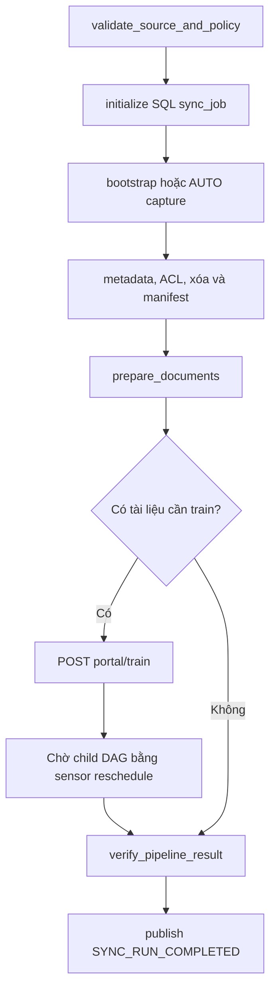

# 03. Module, interface và thuật toán xử lý

[← Mục lục](../detailed-design.md) · LLD v2.0 — 10/11/2026.

## 1. Dependency và module ownership

| Module mục tiêu | Code tham khảo | Trách nhiệm / boundary |
| --- | --- | --- |
| Ingestion connector/inventory | `confluence_workflow` | Đọc Confluence, kiểm kê đầy đủ hai Space, phân loại và ghi snapshot/raw/metadata. |
| Source policy | `workflow_config` và botinfo reader | Resolve bot/Space/ACL; không để chunker tự quyết định role. |
| DocumentPreparationService | Graph `chunk_confluence_document` và processing helpers | Public package entrypoint mới, HTML → Markdown → document_data; không phụ thuộc Kafka consumer lifecycle. |
| HtmlMarkdownConverter | Beedoc engine/model/reader/renderer | Chỉ chuyển đổi HTML đơn giản, giữ ref ảnh; output có trạng thái và Markdown đã kiểm tra. |
| ChunkingService | Chunker hiện có được thu hẹp | Nhận Markdown/source context, tạo ordered chunks; không tải nguồn hoặc gọi AI ảnh. |
| TrainDocumentService/Job | Portal `process_document` và `train_document_job` | Validate/giao job; sinh chunk/node/embedding/index và cập nhật kết quả. |
| RunStatusService | Đề xuất triển khai | Project SQL job + Airflow run + Mongo; không sở hữu bảng trạng thái mới. |
| NotificationPublisher/Consumer | KafkaNode/engine làm adapter | Publish sau completion; consumer chỉ cập nhật UI view có quyền, không gọi train. |
| KnowledgeService | Nhánh chat/retriever phù hợp | Retrieval, authorization evidence, LLM và citations. |
| SourceService | Đề xuất triển khai | Đọc nguồn theo ID/version/principal, không trả URI S3 tùy ý. |

- Tên module/class trên là interface đề xuất, chưa phải file đã tạo.
- Portal controller chỉ ánh xạ DTO/auth/error.
- Application service không import ngược router.
- Ingestion không gọi private function trong consumer bằng sys.path hack.
- Public entrypoint preparation được đóng gói trong package Portal đã cài vào runtime Airflow.
- Thư viện Beedoc/Beeflow không import nghiệp vụ Portal/Chat.

## 2. Task graph Airflow mục tiêu



- **Phương án LLD:** parent DAG max_active_runs=1 cho nguồn, pilot một train batch cho một lượt, child train DAG xử lý tuần tự các document.
- Global Airflow parallelism hiện nhỏ.
- Bước chờ dùng sensor `mode=reschedule` hoặc implementation tương đương đã kiểm chứng nhường slot, không loop sleep giữ slot.
- Task timeout hữu hạn theo profile.
- Giá trị phải đo, không suy từ API trigger timeout 30s của code gốc.

- Parent gọi API train trực tiếp.
- Portal giao child DAG như code tham khảo.
- Sensor đọc configured train DAG/run và Mongo state, không chờ Kafka event để quyết định train xong.
- Child DAG không gọi ngược parent hoặc tự schedule AUTO.
- Notifications không là dependency để chạy bước train tiếp theo.

- `sync_jobs.id` chỉ có sau initialize.
- Ghi correlation parent vào `logs` theo [01](01-data-storage.md).
- Parent XCom giữ manifest tham chiếu: bot, SQL job, document IDs/version/action, raw references và child run ID.
- Không đẩy toàn HTML/vector vào XCom.
- Nếu manifest lớn, lưu JSON object trong MinIO và chỉ truyền URI đã validate.
- Đây là artifact của lượt, không bảng job mới và không cơ chế replay/crash recovery.

## 3. Ingestion: inventory và đối soát

### 3.1. Đầu vào và đầu ra đề xuất

- `run_capture(bot_id, mode, pipeline_run_context) -> CaptureResult` gồm SQL job ID, ingest result, items và `fetch_complete`.
- Item có `document_id`, `page_id`, `space_id`, `sync_version`, action, raw URI khi cần preparation.
- Action hữu hạn: CONTENT_CHANGED (gồm mới), METADATA_ONLY (gồm ACL/move-only), DELETED, UNCHANGED.
- Các group phải rời nhau cho mục đích tổng hợp.
- Source có nhiều thay đổi cùng lúc được phân loại theo việc cần xử lý cao nhất, không đếm nhiều lần.

- **Bootstrap:** liệt kê mọi trang hợp lệ của hai Space qua connector Cloud API có phân trang.
- Resolve hierarchy.
- FIRST/root selection hiện có không tự đảm bảo đã phủ toàn Space.
- `space_config.syncing_page` có thể giữ để tương thích nhưng contract cuối phải phủ đúng phạm vi đã cấu hình, không chỉ một root tình cờ được chọn.

- **AUTO:** lấy snapshot SQL theo bot và inventory mới.
- Giữ hash/version so sánh như source.
- So page ID để phát hiện mới/xóa.
- So content hash để phát hiện body đổi.
- Title/link/parent/Space/ACL đối soát riêng.
- Fetch chưa đủ không kết luận xóa.
- Không coi page vắng do lỗi request là đã xóa.
- Source version lưu theo nội dung thực tế tải về, không ghép version danh sách cũ với body mới.

### 3.2. Thứ tự ghi cho trang có body mới

1. Resolve identity Mongo bằng `(bot_id,external_id)`; tạo UUID nếu mới, giữ UUID nếu update.
2. Gán policy Space, chặn document đang xử lý: `sync_status=processing`, `status=PROCESS`, `is_trained=false`, `training_status=NOT_TRAINING`; không để old DONE đủ predicate đọc trong lúc thay nội dung.
3. Ghi snapshot PostgreSQL content/hash/version theo caller/procedure; không dùng SQL SYNCED làm tín hiệu RAG ready.
4. Lưu raw HTML/version và sidecar MinIO, giữ ref `documents.raw_s3_uri`; cập nhật title/parent/source/audit/ACL đúng writer ownership.
5. Đưa item vào manifest preparation. Đối với trang mới, parent Mongo UUID được resolve sau inventory nếu cần; parent Confluence ID và Mongo parent ID không lẫn nhau.
6. Finalize phạm vi ingestion theo cơ chế SQL hiện có, giữ correlation trong logs. Parent pipeline vẫn còn preparation/train; không publish toàn lượt xong ở đây.

- Đây là thứ tự triển khai đề xuất; giới hạn giao dịch và xử lý lỗi tại [04](04-state-transitions.md).
- Người vận hành kiểm tra raw/manifest/đầu vào hiện hành trước khi chạy lại task/DAG phù hợp trên Airflow.

### 3.3. Metadata/ACL và xóa

- Metadata-only cập nhật SQL/Mongo field liên quan, không reset is_trained chỉ vì title/quyền đổi khi body không đổi.
- Trạng thái tốt trước đó không bị biến thành thành công nếu tài liệu chưa từng train.
- Đổi ACL thực hiện theo [06](06-space-access-control.md), không đợi hash đổi.
- Source version có body tương đương có thể cập nhật metadata.
- Tiêu đề hiển thị/trích dẫn lấy từ metadata hiện hành; filename prefix trong nội dung chunk không quyết định tiêu đề nguồn.

- Xóa/ra ngoài phạm vi: chặn `documents.deleted=true` trước, cập nhật SQL `is_deleted=true` khi có căn cứ.
- Cleanup child Mongo/vector sau.
- Không gọi train, không xóa raw lịch sử.
- Hard-delete `documents` chỉ khi có chính sách riêng ngoài phạm vi cốt lõi vì cần giữ identity/truy vết.
- Job clean hiện có có thể xóa parent nên phải thu hẹp.

## 4. Public interface preparation — đề xuất triển khai

- **Đề xuất triển khai:**

```text
prepare_document(
    bot_id: str,
    document_id: str,
    sync_version: str,
    raw_s3_uri: str,
    sync_job_id: str
) -> PreparationResult

PreparationResult:
    document_id, sync_version, chunk_count,
    preparation_status: READY | ERROR,
    error_code?, safe_error_message?
```

- Các ID/ref tới từ manifest server, không query trực tiếp URL tùy ý do người dùng cung cấp.
- Service đọc Mongo document bằng ID+bot, đối chiếu version/policy/source ref.
- Raw bucket/key phải thuộc allowlist và đúng prefix document/version.
- Không dùng endpoint `/portal/chunk` multipart làm thay thế ngầm cho contract S3 này.

- Các bước:

1. Đặt PROCESS/processing; giữ ACL, xóa lỗi cũ chỉ khi hợp lệ.
2. Tải raw UTF-8, gọi Beedoc. Engine trả Document/model chứ không tự là Markdown string; adapter kiểm tra result/status rồi lấy text đúng API engine đã chọn.
3. Không gọi ảnh AI/OCR; giữ tham chiếu img. Không thực thi script hoặc tải URL ảnh theo nội dung không tin cậy.
4. Chunk theo heading và kích thước cấu hình; giữ bảng/list/code trong khả năng converter. Chunker trả ordered content; tài liệu thực sự không có text cần đánh dấu không đủ dữ liệu/ERROR để vận hành xử lý, không mặc định empty success rồi train zero vectors.
5. Chặn serving trong quá trình thay dữ liệu; xóa `document_data` cũ của document và ghi tập mới theo contract hiện tại. Không cam kết atomic replacement hoặc khả dụng liên tục khi thay chỉ mục.
6. Xác nhận insert thành công, có chunk hợp lệ; cập nhật `status=DONE`, `sync_status=done`, `is_trained=false`, `training_status=NOT_TRAINING`, `chunk_type` theo profile; không unset `role_ids`, Space hoặc raw ref.
7. Trả READY để parent gọi train; chỉ dọn temp local, không xóa raw MinIO sau thành công.

- Căn cứ: [document_processor.py](../../beegen-portal-api/beegen-portal-api/app/consumer/confluence/processing/document_processor.py), [chunk_confluence_document.py](../../beegen-portal-api/beegen-portal-api/app/consumer/confluence/chunk_confluence_document.py).
- Tách image upload/HTML deletion/job_response khỏi public preparation.

## 5. Train service/job

### 5.1. Entry và precondition

- Giữ `ProcessDocumentService.train` và `TrainJobRequest(bot_id,id)`.
- Batch orchestration phải validate cùng bot, non-deleted, chunk-ready, hợp lệ Space/ACL trước trigger.
- Header correlation được chuyển vào DAG conf cấp batch.
- DTO per-document không cần đổi tất cả field chỉ để mang SQL job ID.
- Child job nhận correlation qua execution context.

### 5.2. Thuật toán một document

| Bước | I/O | Điều kiện |
| --- | --- | --- |
| 1 | Đọc document, document_data và category nếu dùng | Sắp xếp index; không tự chunk lại `document_data`. |
| 2 | Tạo chunk_data | Giữ `_id` gốc, `chunk_id=str(_id)`, `doc_id`, `llm_text`; keywords theo profile. |
| 3 | Reconstruct Markdown và tree/node nếu bật | Node summary/title/content theo helper; node source trỏ về document. |
| 4 | Gọi embedding | Chunk từ llm_text; node từ summary theo nhánh hiện tại. Kiểm tra cardinality, dimension, finite values, vector không zero cho cosine; lỗi không ghi DONE. |
| 5 | Tạo payload Milvus | Đúng PK/dimension/type/topic; content/keywords semantics thống nhất schema, không coi keywords là toàn văn nguồn. |
| 6 | Thay dữ liệu dẫn xuất trong Mongo/Milvus | Document chưa eligible trong lúc thay; kiểm tra từng operation bắt buộc và count mong đợi. |
| 7 | Xác nhận index usable | Collection được load và ghi thành công; adapter xác minh các ID bắt buộc có thể đọc theo consistency được chọn trước completion, không chỉ đếm vector trả về từ AI. |
| 8 | Update documents | `is_trained=true`, `training_status=DONE`, `trained_at=UTC`; giữ status/sync DONE và ACL. |
| 9 | Publish tài liệu hoàn tất | Event có correlation/ID/version, sau bước 8; không gọi publish từ HTTP trigger handler. |

- Code [train_document_job.py](../../beegen-portal-api/beegen-portal-api/app/job/portal/train_document_job.py) có check kết quả operation, chưa chứng minh đầy đủ dimension/finite/read visibility như contract đích.
- Adapter phải chọn phép đọc xác minh phù hợp, không hứa immediate visibility chỉ từ một ACK insert.
- Cách flush/load/read và timeout chính xác kiểm chứng với client local ở bước triển khai.

- Tree/node vẫn là profile cần chọn với quota.
- Nếu node list rỗng do profile không dùng tree, không yêu cầu insert node giả.
- Nếu profile yêu cầu tree mà tree generation lỗi thì không tự coi là không cần node.
- Batch hoàn tất chỉ khi mỗi document yêu cầu đã có kết quả thành công.

- **Ranh giới task:** tách `compute_write_verify_document` khỏi `publish_document_notification`.
- Bước 1–8 thuộc compute task/job.
- Bước 9 thuộc task delivery sau compute.
- Publisher nằm ngoài khối xử lý lỗi compute của TrainDocumentJob; lỗi publish không được gọi `_mark_training_error` cho dữ liệu đã DONE.
- Child DAG state, compute result và notification result được project riêng.
- Parent chỉ phát whole-run success khi các điều kiện lượt và delivery theo luồng chính đều đáp ứng.

### 5.3. AI adapter contract đề xuất

- `embed(texts, profile) -> vectors` bảo toàn thứ tự, batch count và profile ID.
- `generate(prompt, allowed_context, profile) -> text/structured answer` không tự chuyển provider trả phí.
- Phân loại quota/rate/auth/network/invalid output thành lỗi có kiểu.
- Chỉ hiển thị thông tin an toàn.
- Model/dimension/profile còn chờ lựa chọn, không gán tên model mới khi chưa kiểm tra provider.
- Thay profile embedding có thể cần reindex toàn tập.
- Không dùng query model khác index model.

## 6. Projection trạng thái và thông báo

- RunStatusService nhận job ID → đọc SQL logs correlation → đọc parent/child run bằng Airflow API allowlist → đọc trạng thái tài liệu cùng bot → tính pipeline status.

- Manifest item counts là authoritative tập kế hoạch, kết quả task là bằng chứng completion.
- Nếu dependency trạng thái không đọc được thì trả UNKNOWN/lỗi phù hợp, không dựng success từ cached toast.

- Publisher dùng Kafka adapter theo [02](02-api-events.md).
- Consumer có lifecycle riêng trong backend, không chạy poll broker blocking trong async FastAPI handler.
- Pilot dùng một backend process và view thông báo giới hạn trong RAM; không cấu hình nhiều API worker khi chưa có cơ chế chia sẻ view.

## 7. KnowledgeService và SourceService

- Public interface đề xuất:

```text
ask(question, principal, request_context) -> AnswerResult
search(query, principal, request_context) -> SearchResult
get_source(document_id, sync_version, chunk_id?, principal) -> SourceResult
```

- Bot/roles lấy từ server context, không từ prompt hoặc body mở quyền.
- SourceService thực hiện lại cùng policy.
- Thiết kế chi tiết ở [06](06-space-access-control.md).

- `RetrieverNodeV3` import thiếu trong package khảo sát phải được giải quyết trước chọn entrypoint.

## 8. Yêu cầu tích hợp và kiểm chứng

| Điểm tích hợp | Hợp đồng triển khai | Kiểm chứng |
| --- | --- | --- |
| Ingestion workflow download/dispatch | Raw versioned key, full Space inventory, API path thay Kafka CHUNKING | Không produce request nội dung; raw v1/v2 giữ riêng. |
| build_finalize_payload | Giữ ingestion semantics, merge logs correlation thay overwrite error | Logs chuỗi/JSON parse đúng; không đổi SQL status thành pipeline status. |
| Chunk processing graph | Tách public entrypoint, giữ quyền/raw, bỏ image AI/empty success giả | Chunk-ready đầy đủ, ACL không mất. |
| Portal train router/service | Accepted message/data, service auth, header correlation, local Airflow API | ACK khác completion; body bot_id/type/ids tương thích. |
| Train job | Validate vector/profile/readiness, completion publisher | Kafka sau write/state, không trước. |
| Chat retriever/document store | Server policy và query eligibility đủ; nguồn/citation | CUSTOMER không đi qua chunk/node/tool để lấy nội bộ. |
| Frontend/status | Consumer backend + auth poll API | Đúng ID, không broadcast cho user thường. |

- Kết quả integration test phải có minh chứng theo [kế hoạch kiểm chứng](05-runtime-validation.md).
