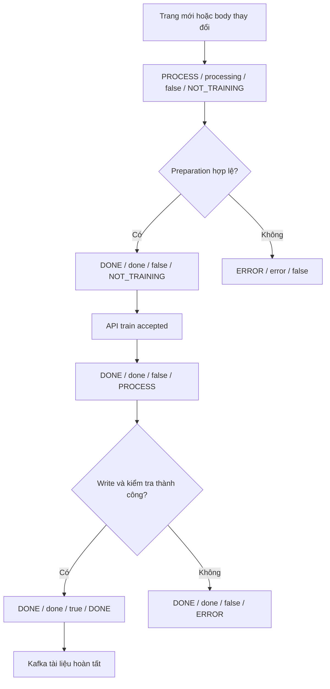

# 04. Trạng thái, completion và xử lý lỗi

[← Mục lục](README.md) · LLD v2.0 — 10/11/2026.

## 1. Phạm vi

- Giữ AS01–AS03 của SRS: luồng tuần tự, không chạy chồng cùng nguồn, đủ điều kiện dịch vụ cho đánh giá luồng chính.
- Không thiết kế tự phục hồi partial write, transactional outbox, stale-event fencing, generation hoặc exactly-once.

## 2. Các lớp trạng thái

| Nơi | Trường/giá trị | Scope |
| --- | --- | --- |
| SQL documents | sync_status SYNCED hoặc giá trị nhánh SQL thực tế, is_deleted | Snapshot nguồn đã đối soát; không index complete. |
| SQL sync_jobs | RUNNING, finalize COMPLETED hoặc trạng thái upstream | Chỉ lượt ingestion; logs correlation giữ parent pointer. |
| Mongo documents | sync_status processing/done/error | Đồng bộ/chunk theo writer hiện có. |
| Mongo documents | status PROCESS/DONE/ERROR hoặc vắng ở legacy | DONE là chuẩn bị nội dung xong, không tự train DONE. |
| Mongo documents | training_status NOT_TRAINING/PROCESS/DONE/ERROR | Lifecycle train. |
| Mongo documents | is_trained bool, trained_at | Kết quả xác nhận train, không có trained_version mới. |
| Airflow | DAG/task/run state | Runtime parent/child; phải liên hệ đúng conf/bot. |
| RunStatus projection | RUNNING/SUCCEEDED/FAILED/UNKNOWN | Pipeline tổng hợp, không field/bảng mới. |
| Notification view | Kết quả event và delivery metadata quan sát được | UI view tạm; không nguồn chân lý của data readiness. |

- Không ép enum chữ hoa SQL và chữ thường Mongo thành cùng field.
- Các enum mới của projection nằm ở service response, không tự migration database.

## 3. Transition Mongo đích



- Thứ tự nhãn trong hình: `status / sync_status / is_trained / training_status`.
- Preparation ERROR còn giữ NOT_TRAINING nếu train chưa bắt đầu.
- Không đặt ERROR train cho lỗi chỉ xảy ra ở converter.
- Trước reprocess phải unset trained_at cũ, nhưng không unset ACL.
- Trigger train thất bại cập nhật training ERROR, không gọi converter ERROR nếu converter đã xong.

### 3.1. Bảng thao tác ghi

| Tình huống | SQL | Mongo | Kafka |
| --- | --- | --- | --- |
| Mở lượt | INSERT sync_jobs RUNNING | Không tự đổi mọi tài liệu thành PROCESS | Không success |
| Trang mới/body đổi | Upsert content/hash/version | Đặt không eligible, metadata/ACL/raw ref và trạng thái preparation | Không CHUNKING |
| Preparation success | Không đổi hash vì converter | Ghi document_data, DONE/done, reset train=false/NOT_TRAINING | Không train complete |
| Train accepted | Không finalize whole pipeline | training PROCESS, false | Không success |
| Train complete | Không giả đây là lúc SQL snapshot vừa ghi | Derived data/vector đã xác nhận, train DONE/true/trained_at | Publish DOCUMENT_TRAIN_COMPLETED |
| Chỉ metadata/ACL | Update thông tin tương ứng | Giữ train state tốt hiện có, cập nhật policy/metadata | Chỉ kết quả lượt sau tổng hợp |
| Trang không đổi | Ghi nhận đối soát theo cơ chế ingestion | Không reset trạng thái hoặc tạo đoạn mới | Không event train giả |
| Xóa xác minh | is_deleted=true | deleted=true trước cleanup, không được đọc | Kết quả toàn lượt sau tác vụ xóa |
| Ingestion finalize | Update counts/status/time/logs | Không đánh mọi document DONE | Chưa đủ để phát whole-run success |

- Derived replacement không atomic.
- Tài liệu đang PROCESS/training PROCESS không được dùng ở chat/source.
- Không cam kết phục vụ liên tục trong thời gian cập nhật.
- Điều kiện quyền có hiệu lực cả khi chưa dọn hết vector cũ.

## 4. Completion predicate

### 4.1. Tài liệu

```text
document_complete :=
    bot/document/source/policy hợp lệ
    AND preparation ghi đủ đoạn bắt buộc
    AND embedding count/dimension/values hợp lệ
    AND Mongo + Milvus operations bắt buộc thành công
    AND collection/index dùng được theo adapter đã kiểm chứng
    AND training_status = DONE AND is_trained = true
```

- Đọc sau ghi xác minh là contract mới cần adapter triển khai.
- Chỉ xác nhận khả năng đọc sau ghi khi có kiểm thử adapter và consistency tương ứng.
- Empty list chỉ hợp lệ với nhánh optional như node disabled, không hợp lệ cho tài liệu yêu cầu chunk/text nhưng không có đoạn.
- State DONE trước khi hoàn tất ghi bị coi là lỗi contract.

- Publish chỉ sau predicate.
- Job/runtime result và notification delivery là hai kết quả tách biệt.
- API trả queued không đặt predicate true.

### 4.2. Toàn lượt

- Parent manifest là tập items rời nhau: train, metadata-only, deleted, unchanged.
- Toàn lượt SUCCEEDED khi ingestion đủ nguồn + preparation/train cần thiết thành công + metadata/ACL/xóa cần thiết xong.
- Không chỉ kiểm tra train_completed bằng train_required nếu phần cleanup chưa xong.
- NO_CHANGES chỉ là outcome khi mọi item unchanged, không trạng thái train.

- `sync_jobs.status=COMPLETED` có thể xuất hiện trước train.
- API status phải trả `ingestion_status` và `pipeline_status` riêng.
- Lỗi đọc runtime → UNKNOWN hoặc dependency error, không default success.
- Counter SQL giữ ý nghĩa ingestion; không dùng thay kết quả toàn pipeline.

- Xử lý thông báo và commit offset: [02, mục 6.1](02-api-events.md#61-consumer-behavior).

## 5. Error contract

| Lỗi | State/response đích | Giới hạn |
| --- | --- | --- |
| Config/Space/role không hợp lệ | Dừng trước thao tác xử lý, trả lỗi validation phù hợp | Không default công khai hoặc L1. |
| Fetch thiếu/phân trang lỗi | Ingestion báo lỗi/không hoàn tất; bỏ suy luận xóa | Không xóa hàng loạt chỉ vì response rỗng. |
| Download/raw write lỗi | sync error và nguyên nhân an toàn | Không train tài liệu thiếu raw. |
| Converter/chunk rỗng hoặc thất bại | status ERROR, sync_status error, is_trained=false | Không xác nhận completion khi thiếu đoạn bắt buộc. |
| AI quota/rate/auth/network | training ERROR hoặc lỗi query được phân loại | Không tự chuyển trả phí, không báo thiếu tài liệu thay lỗi dịch vụ. |
| Vector dimension/cardinality/finite sai | Không DONE, không publish success | Kiểm tra trước insert khi có thể. |
| Ghi Mongo/Milvus lỗi | training ERROR; record thao tác đã ghi có thể còn | Không tự rollback nhiều kho, không tự phục hồi partial write. |
| Airflow trigger/status timeout | Lỗi/UNKNOWN phù hợp, không tuyên bố chưa có job chắc chắn | Không tự gửi lại trigger vì có thể job đã được tạo. |
| Kafka publish lỗi sau train | Data complete giữ nguyên, lỗi delivery được ghi riêng | Không embedding lại chỉ để gửi thông báo; tự recovery delivery ngoài scope. |
| Backend/UI notification chưa có | UI có thể đọc job status có auth | Không hứa notification history sau restart. |

- Thông tin lỗi lưu vừa đủ ở documents/error log và task log/correlation.
- Không stack trace/credential trong API/notification.
- Lỗi Kafka hiển thị task delivery thất bại không được đánh `is_trained=false` nếu dữ liệu đã thành công.

## 6. Chạy lại thủ công

- Quản trị kiểm tra nguồn, quyền, raw và state.
- Không có work trùng đang chạy.
- Nếu preparation lỗi thì chuẩn bị lại trước train.
- Nếu chunk đã tốt nhưng train lỗi, chạy lại train theo validator/cleanup phù hợp.
- Nếu đã trained DONE thì API hiện từ chối.
- Không sửa trực tiếp trạng thái để ép chạy lại; reindex cần thao tác quản trị được thiết kế và kiểm thử riêng.

- Nếu chỉ gửi notification lỗi, không chạy lại embedding.
- Không tự lấy hash SQL giống để kết luận lỗi trước đã được giải quyết.
- Trường hợp SQL đổi hash nhưng downstream crash được ghi là giới hạn AS01.

## 7. Transaction boundary và tài nguyên

- Mỗi lệnh SQL/Mongo/vector là đơn vị adapter thực hiện.
- Graph không tự tạo transaction chung.

- No-overlap của parent DAG không tự ngăn mọi API caller độc lập.
- Route/service kiểm tra tài liệu đang PROCESS/training PROCESS và từ chối yêu cầu xử lý chồng.

- Truy vết nghiệm thu và kiểm thử: [05, mục 6](05-runtime-validation.md#6-truy-vết-srs).
