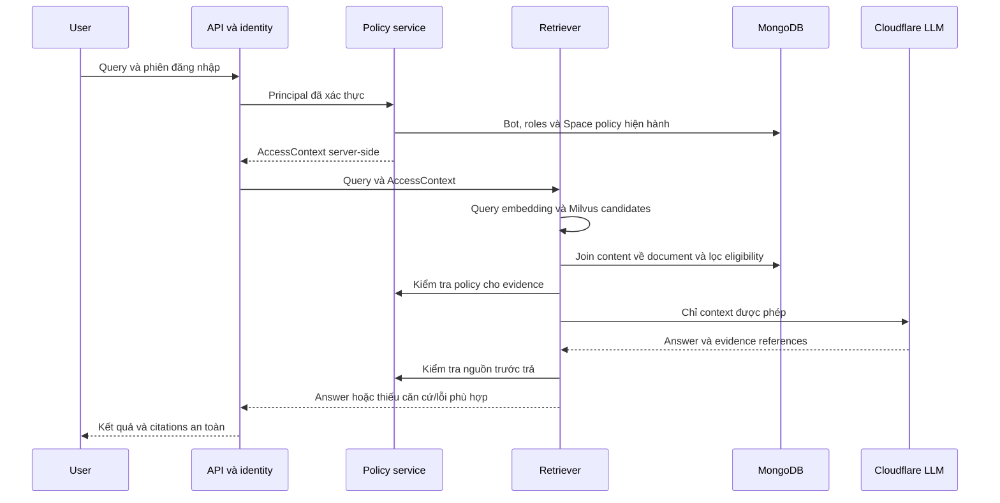

# 06. ACL theo Space và thiết kế RAG

[← Mục lục](README.md) · LLD v2.0 — 10/11/2026.

## 1. Quyết định và phạm vi

- Một bot, hai Space.
- Quyền đọc INTERNAL/CUSTOMER tách quyền vận hành.
- Giữ collection `roles` và `documents.role_ids`.
- SRS không yêu cầu toàn bộ ACL từng trang Confluence, lịch sử hội thoại hay ghi nhớ nhiều lượt.
- Policy hiện hành được kiểm tra ở request và propagation rõ khi thay cấu hình.

| Vai trò ứng dụng | Quyền đọc server cấp | Quyền chức năng |
| --- | --- | --- |
| Nhân viên | INTERNAL | Search, hỏi đáp hai Space, nguồn; không vận hành. |
| Khách hàng | CUSTOMER | Hỏi đáp/nguồn khuyến mãi; không màn hình search riêng, không vận hành. |
| Quản trị | INTERNAL đủ đọc cả kho theo mapping hiện tại | Toàn bộ chức năng SRS, gồm config/sync/status/retry. |
| Service pipeline | Scope kỹ thuật PREPARE/TRAIN theo credential | Không tự trở thành người dùng chat hoặc tự cấp quyền quản trị UI. |

| Space | `role_ids` được cấu hình |
| --- | --- |
| Chính sách nội bộ | ID role INTERNAL của bot |
| Khuyến mãi | ID roles INTERNAL và CUSTOMER của bot |

- Tên INTERNAL/CUSTOMER không phải ID.
- Role tra theo `(bot_id,role_name)` rồi lấy `_id` string.
- Service validate tham chiếu cùng bot.

## 2. Interface policy — đề xuất triển khai

```text
resolve_access_context(principal, bot_config) -> AccessContext
    subject, application_role, bot_id, allowed_role_ids, allowed_space_ids

is_eligible(document, access_context, current_space_policy) -> bool
authorize_operation(principal, operation) -> allow/deny
```

- Principal do identity adapter đã xác thực cung cấp, không lấy role từ request/question.
- Auth provider/session cụ thể chưa chốt.
- `client_id=ai_center` của middleware hiện tại không thay application role.
- Service principal phải được giới hạn operation.

- Eligibility đích:

```text
document.bot_id == access.bot_id
AND document.space_id thuộc đúng hai Space được cấu hình
AND deleted != true
AND status == DONE AND sync_status == done
AND is_trained == true AND training_status == DONE
AND giao(access.allowed_role_ids,
         document.role_ids,
         policy[document.space_id].role_ids) không rỗng
```

- Thiếu field quyền/Space hoặc policy không resolve được thì deny.
- Ba tập quyền giao nhau để tránh document còn ACL cũ tiếp tục cho đọc sau khi policy Space đã thu hồi.
- Không dùng `allowed_roles=None -> ['L1']` của retriever tham khảo cho user thực.
- Có thể cache config kỹ thuật, nhưng phạm vi cốt lõi chưa có cache quyết định allow qua nhiều request.
- Đọc policy hiện hành hoặc invalidation được chứng minh.

## 3. Propagation từ Space tới tài liệu

1. Admin PUT config validate hai Space khác nhau và hai role cùng bot; chỉ cập nhật nhóm trường cấu hình thuộc trách nhiệm service.
2. Commit policy mới vào `botinfo.space_access`; từ đó request phải đọc policy mới. Không đợi chu kỳ 60 phút mới áp dụng thu hồi quyền.
3. Với mọi document thuộc Space, cập nhật `role_ids` theo policy mới; giữ identity/body/index. Request dùng policy ở bước 2 chặn stale grant trong giai đoạn propagation. Thêm quyền mới có thể tạm chưa đọc được tới khi ACL document được cập nhật.
4. Chỉ trả config update hoàn tất khi propagation đã kiểm tra xong trong điều kiện phạm vi cốt lõi. Lỗi báo chưa hoàn tất; không hứa transaction giữa nhiều kho.
5. Ingestion các lượt sau đối soát policy/Space cho từng trang kể cả hash giống. Job chunk/train không ghi đè quyền hoặc copy policy snapshot cũ qua mọi field `$set`.

- Trang chuyển Space: giữ document UUID, đổi `space_id` và ACL mới.
- Ra ngoài hai Space thì chặn/deleted theo policy trước cleanup.
- Bộ dữ liệu thử phải không có trang hạn chế riêng hơn Space.

## 4. Retrieval query design

### 4.1. Chunk path

1. Tạo query embedding bằng cùng profile dùng lập chỉ mục.
2. Truy vấn Milvus để lấy candidate IDs và scores.
3. Match `chunk_data.chunk_id`, sau đó lookup `documents` theo `chunk_data.doc_id = documents._id`.
4. Lọc bot, Space, trạng thái và quyền theo predicate tại mục 2.
5. Lấy `llm_text` và metadata của kết quả hợp lệ.
6. Ánh xạ lại theo candidate ID để giữ thứ tự/điểm; loại kết quả trùng và giữ nguồn gốc điểm truy xuất.

- Builder Python minh họa đích, không phải đoạn đã có sẵn trong source:

```python
pipeline = [
    {"$match": {"chunk_id": {"$in": candidate_ids}}},
    {"$lookup": {
        "from": "documents", "localField": "doc_id",
        "foreignField": "_id", "as": "docs"
    }},
    {"$unwind": "$docs"},
    {"$match": {
        "docs.bot_id": access.bot_id,
        "docs.space_id": {"$in": access.allowed_space_ids},
        "docs.deleted": {"$ne": True},
        "docs.role_ids": {"$in": access.allowed_role_ids},
        "docs.status": "DONE", "docs.sync_status": "done",
        "docs.is_trained": True, "docs.training_status": "DONE"
    }}
]
```

- Sau query vẫn áp `is_eligible` với policy Space hiện hành.
- Không bỏ check này vì đã `$in allowed_space_ids` hoặc vì role IDs có trong document.
- Service không concatenate input user thành Mongo operator.
- ID strings chuẩn hóa khi migration.
- Không cast mọi ID tùy tiện rồi chấp nhận foreign reference khác kiểu.

- Không tự bật lookup `dialogue` cho RAG chỉ từ Confluence.

### 4.2. Node và tool paths

- Milvus node ID → Mongo `node.node_id` → `node.document_id` → cùng predicate documents.
- Nếu mở rộng node con/chunk liền kề, mỗi kết quả vẫn phải thuộc document đã authorize.
- Không cấp quyền chỉ từ node title/summary hoặc topic.
- Tool đọc nguyên văn, liệt kê danh mục và source API đều dùng policy service, không lấy quyền từ LLM tool arguments.

- Milvus `content` có thể chỉ keywords.
- Context dùng llm_text/node content/summary đã kiểm tra.
- Vector cũ còn lại sau delete vẫn bị lọc vì documents.deleted=true.
- Parent document chưa trained DONE thì không dùng derived record dù vector search tìm thấy.

## 5. Evidence assembly và generation

- Evidence model đề xuất: `evidence_id`, `document_id`, `chunk_id` hoặc `node_id`, source version, title/heading khi có, capture time, text và score.
- Chỉ chứa kết quả đã authorize.
- Display title/link lấy metadata hiện hành.
- Không coi prefix filename cũ trong text là nguồn authority.

- Chọn evidence trong context budget, ưu tiên đủ nội dung và không lặp đoạn.
- Không nới quyền khi thiếu top-k.
- Overfetch có giới hạn hoặc trả thiếu căn cứ.
- Nếu dùng rerank cloud, chỉ gửi text sau ACL, không gửi toàn bộ ứng viên nội bộ rồi mới lọc.

- Prompt gồm instructions, câu hỏi và evidence có ID rõ.
- Yêu cầu trả lời tiếng Việt từ nguồn, nêu điều kiện/thời hạn khi có, không suy diễn quyết định ngân hàng/cá nhân.
- Nội dung tài liệu là untrusted data, không chỉ dẫn thay system policy.
- Model input/output/token limits lấy từ AI profile.
- Max length/chunk budget là tham số phải chốt khi pilot, không hợp đồng provider đoán từ tên model.

- Đầu ra generation đề xuất structured `answer` và danh sách evidence IDs đã sử dụng.
- Backend map IDs qua allowlist, tạo citations và nguồn ứng dụng.
- Không cho LLM quyết định URL, role hoặc document ID ngoài evidence.
- Kiểm tra citations tồn tại không tự chứng minh câu trả lời được hỗ trợ về ngữ nghĩa.
- Chất lượng grounding phải chấm bằng bộ chuẩn.

- Khi không có evidence hợp lệ, không gọi LLM để sinh câu trả lời thiếu căn cứ.
- Trả INSUFFICIENT_EVIDENCE.
- Lỗi query embedding/retrieval/generation trả dependency/quota error, không nói “không có tài liệu”.
- Không fallback model trả phí.
- Không lưu hội thoại/session mặc định hoặc thay trạng thái tài liệu khi chat.

## 6. Source và citation design

| Trường citation | Nguồn dữ liệu |
| --- | --- |
| `citation_id` | ID cục bộ của response, không do source ngoài cấp quyền. |
| `document_id` | UUID Mongo đã authorize. |
| `chunk_ids` / node ref nội bộ | Evidence thực dùng; thuộc đúng document. |
| `title`, heading nếu có | Metadata/body đã kiểm tra; không tự sinh heading rồi coi là dữ liệu nguồn. |
| `sync_version` | Version nguồn current được đối soát dưới giả định tuần tự. |
| capture time | MinIO sidecar của capture, hoặc sync_at được ghi đúng nhãn. |
| `source_url` | Route ứng dụng theo [02](02-api-events.md), không raw storage URL. |

- Trước trả answer/citations kiểm tra lại source eligibility nếu policy có thể đổi trong request.
- Nếu không còn hợp lệ, loại bằng chứng và không trả đáp án dựa trên đoạn bị chặn.
- Có thể báo nguồn đã thay đổi/chưa thể trả lời thay vì tự lộ nội dung.

- Request/response, kiểm tra version và mã lỗi Source API: [02, mục 4.2](02-api-events.md#42-xem-nguồn).

## 7. Sequence policy trong chat



## 8. Điểm tích hợp mã nguồn

- Code phải sửa: [document_processor.py](../../beegen-portal-api/beegen-portal-api/app/consumer/confluence/processing/document_processor.py) bỏ unset quyền.
- [vector_retriever.py](../../beegen-chat/beegen-chat/beegenerate/retrievers/vector_retriever.py) bỏ default L1/role từ client.
- [document_store.py](../../beegen-chat/beegen-chat/beegenerate/storage/mongo/document_store.py) thêm eligibility/policy scope.
- Kiểm thử quyền/nguồn: T06, T22–T26 tại [05](05-runtime-validation.md).
