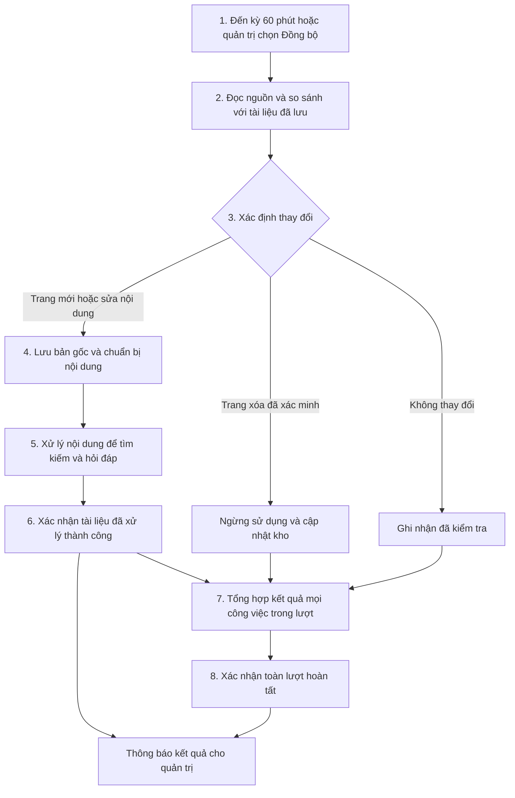

# Tài liệu đặc tả yêu cầu

| Thông tin | Nội dung |
| --- | --- |
| Đề tài | Nghiên cứu và xây dựng hệ thống kho tri thức doanh nghiệp thông minh từ Confluence |
| Học viên | Đặng Nam Cường |
| Loại tài liệu | Đặc tả yêu cầu phần mềm |
| Phiên bản | 2.0 |
| Ngày cập nhật | 17/11/2026 |
| Trạng thái | Dự thảo để thẩm định |
| Tài liệu liên quan | [Thiết kế chung](architecture.md), [Thiết kế chi tiết](detailed-design.md) |

- **Mục đích:** xác định hệ thống phục vụ ai, giải quyết việc gì, có những chức năng nào và cần trả kết quả gì.
- **Đối tượng đọc:** giảng viên hướng dẫn, người thực hiện đồ án và người kiểm thử.
- Tài liệu mô tả yêu cầu của sản phẩm. Cách tổ chức hệ thống và triển khai nằm trong tài liệu thiết kế.
- Kết quả đã thực hiện và kiểm chứng được ghi tại [báo cáo tiến độ](progress/README.md).

## Mục lục

1. [Bài toán và lý do hình thành](#1-bài-toán-và-lý-do-hình-thành)
2. [Sản phẩm đầu ra](#2-sản-phẩm-đầu-ra)
3. [Phạm vi và ràng buộc](#3-phạm-vi-và-ràng-buộc)
4. [Người sử dụng và phân quyền](#4-người-sử-dụng-và-phân-quyền)
5. [Danh mục yêu cầu chức năng](#5-danh-mục-yêu-cầu-chức-năng)
6. [Sơ đồ Use Case](#6-sơ-đồ-use-case)
7. [Mô tả chi tiết các chức năng](#7-mô-tả-chi-tiết-các-chức-năng)
8. [Yêu cầu xử lý tự động](#8-yêu-cầu-xử-lý-tự-động)

<!--
9. [Quy tắc nghiệp vụ](#9-quy-tắc-nghiệp-vụ)
10. [Yêu cầu phi chức năng](#10-yêu-cầu-phi-chức-năng)
11. [Tiêu chí và kịch bản nghiệm thu](#11-tiêu-chí-và-kịch-bản-nghiệm-thu)
12. [Ma trận truy vết](#12-ma-trận-truy-vết)
13. [Quyết định còn mở](#13-quyết-định-còn-mở)
-->

14. [Thuật ngữ và tài liệu liên quan](#14-thuật-ngữ-và-tài-liệu-liên-quan)

## 1. Bài toán và lý do hình thành

### 1.1. Bối cảnh

- Doanh nghiệp lưu các chính sách, quy trình và hướng dẫn trên Confluence.
- Trong bối cảnh ngân hàng, nhân viên cần tra cứu chính sách công ty và thông tin chương trình khuyến mãi để làm việc, hỗ trợ khách hàng.
- Khách hàng cần tìm hiểu ưu đãi, đối tượng áp dụng, điều kiện và thời gian của từng chương trình.
- Tài liệu được cập nhật thường xuyên; không phải người dùng nào cũng được đọc toàn bộ tài liệu.
- Đồ án sử dụng dữ liệu của một tổ chức ngân hàng giả lập, do người thực hiện chuẩn bị và kiểm soát.

### 1.2. Vấn đề cần giải quyết

| Vấn đề | Khó khăn hiện tại | Kết quả mong muốn |
| --- | --- | --- |
| Quyền sử dụng tài liệu | Nhân viên được đọc chính sách nội bộ; khách hàng chỉ được đọc thông tin khuyến mãi dành cho họ | Mỗi người chỉ hỏi đáp và xem tài liệu trong phạm vi được phép |
| Thời gian tra cứu | Người dùng phải tìm, đọc và tổng hợp nhiều trang; bộ phận hỗ trợ phải trả lời các câu hỏi lặp lại | Người dùng hỏi bằng tiếng Việt, nhận câu trả lời từ tài liệu và có nguồn để kiểm tra |

### 1.3. Phát biểu bài toán

- Xây dựng một kho tri thức được cập nhật tự động từ hai không gian tài liệu trên Confluence.
- Cung cấp một chatbot chung, trả lời dựa trên nội dung tài liệu mà tài khoản được phép đọc.
- Cho nhân viên và quản trị tìm kiếm tài liệu khi cần tra cứu trực tiếp.
- Cho người dùng xem đoạn tài liệu làm căn cứ cho câu trả lời.
- Cho quản trị cấu hình nguồn, theo dõi cập nhật và nhận thông báo khi xử lý hoàn tất.

## 2. Sản phẩm đầu ra

| Sản phẩm | Nội dung cần có |
| --- | --- |
| Kho tri thức doanh nghiệp | Nội dung thu thập từ 100–300 trang thuộc hai Space, kèm nguồn, phiên bản và quyền đọc |
| Ứng dụng hỏi đáp và tra cứu | Hỏi đáp tiếng Việt theo quyền tài khoản; câu trả lời có trích dẫn; nhân viên và quản trị có chức năng tìm kiếm tài liệu |
| Chức năng cập nhật tự động | Kiểm tra nguồn mỗi 60 phút, xử lý trang thêm/sửa/xóa và đưa nội dung đã xử lý vào kho hỏi đáp |
| Giao diện quản trị | Cấu hình nguồn, yêu cầu đồng bộ, xem trạng thái, xử lý lại công việc và nhận thông báo kết quả |
| Mã nguồn và cấu hình chạy | Mã nguồn ứng dụng, cấu hình mẫu không chứa thông tin bí mật và hướng dẫn khởi động hệ thống |
| Tài liệu bàn giao | Đặc tả yêu cầu, thiết kế chung, thiết kế chi tiết và hướng dẫn sử dụng/vận hành |
| Bộ kiểm thử và báo cáo đánh giá | Dữ liệu thử, bộ câu hỏi, kết quả kiểm thử và đánh giá chất lượng câu trả lời, thời gian xử lý |

## 3. Phạm vi và ràng buộc

### 3.1. Phạm vi xác định

| Nội dung | Yêu cầu |
| --- | --- |
| Nguồn tài liệu | Một hệ thống Confluence Cloud Free |
| Không gian tài liệu | Hai Space: chính sách nội bộ và chương trình khuyến mãi |
| Chatbot | Một chatbot chung cho cả hai Space |
| Quy mô | Tổng 100–300 trang |
| Ngôn ngữ | Tài liệu, câu hỏi và giao diện bằng tiếng Việt |
| Định dạng tài liệu | Trang HTML đơn giản, gồm tiêu đề, đoạn văn, danh sách, bảng văn bản, liên kết và khối mã |
| Ảnh | Giữ tham chiếu ảnh trong nội dung; không đọc hoặc giải thích chữ/nội dung trong ảnh |
| Cập nhật | Thu thập lần đầu; tự kiểm tra thay đổi mỗi 60 phút; quản trị có thể yêu cầu đồng bộ thủ công |
| Phiên bản | Giữ các phiên bản mà hệ thống thực tế thu thập được |
| Khai thác | Hỏi đáp và xem nguồn theo quyền; tìm kiếm tài liệu dành cho nhân viên và quản trị |
| Vận hành | Cấu hình nguồn, theo dõi trạng thái, nhận thông báo và yêu cầu xử lý lại thủ công |

### 3.2. Ràng buộc sử dụng và triển khai

- Hệ thống được thử nghiệm trên máy phát triển có 32 GB RAM, không có GPU.
- Việc cập nhật định kỳ được thực hiện khi hệ thống đang hoạt động và kết nối được với nguồn tài liệu.
- Dịch vụ AI sử dụng hạn mức miễn phí; hệ thống không tự chuyển sang gói trả phí khi hết hạn mức.
- Tài liệu thử nghiệm phải được phép thu thập và sử dụng với dịch vụ AI.
- Công nghệ, cơ sở dữ liệu và cấu hình triển khai được mô tả tại [thiết kế chung](architecture.md) và [thiết kế chi tiết](detailed-design.md).

## 4. Người sử dụng và phân quyền

### 4.1. Tác nhân

| Mã | Người sử dụng | Nhu cầu |
| --- | --- | --- |
| A01 | Nhân viên nội bộ | Tra cứu chính sách công ty và chương trình khuyến mãi |
| A02 | Khách hàng có tài khoản | Hỏi về chương trình khuyến mãi và xem tài liệu giải thích |
| A03 | Quản trị kho tri thức | Sử dụng kho tri thức và quản lý việc cập nhật tài liệu |

### 4.2. Ma trận quyền chức năng

| Chức năng | Nhân viên | Khách hàng | Quản trị |
| --- | --- | --- | --- |
| UC10 — Đăng nhập/đăng xuất | Có | Có | Có |
| UC01 — Tìm kiếm tài liệu | Cả hai Space | Không | Cả hai Space |
| UC02 — Hỏi đáp chính sách | Có | Không | Có |
| UC11 — Hỏi đáp khuyến mãi | Có | Có | Có |
| UC03 — Xem nguồn | Cả hai Space | Chỉ khuyến mãi | Cả hai Space |
| UC04 — Cấu hình nguồn | Không | Không | Có |
| UC05 — Đồng bộ thủ công | Không | Không | Có |
| UC08 — Xem trạng thái và nhận thông báo vận hành | Không | Không | Có |
| UC09 — Xử lý lại thủ công | Không | Không | Có |

### 4.3. Quyền đọc theo Space

| Space | Người được phép đọc |
| --- | --- |
| Chính sách nội bộ | Nhân viên và quản trị |
| Chương trình khuyến mãi | Khách hàng, nhân viên và quản trị |

- Mỗi trang nhận quyền đọc từ Space chứa trang đó.
- Tài liệu chưa được xác định quyền đọc không được sử dụng để trả lời hoặc cung cấp nguồn.
- Khi trang chuyển Space hoặc quyền của Space thay đổi, quyền đọc tài liệu phải được cập nhật, kể cả khi nội dung không đổi.

### 4.4. Nguyên tắc kiểm soát truy cập

- Người dùng phải đăng nhập để sử dụng chức năng được cấp.
- Hệ thống xác định quyền từ tài khoản; nội dung câu hỏi không làm thay đổi quyền.
- Tài liệu ngoài quyền không được dùng để tạo câu trả lời, hiển thị kết quả tìm kiếm hoặc xem nguồn.
- Khách hàng không cần có tài khoản Confluence để xem nguồn khuyến mãi được phép trong ứng dụng.
- Thông tin đăng nhập nguồn và thông tin bí mật không được hiển thị cho người dùng.
- Chức năng và thông báo vận hành chỉ dành cho quản trị.

## 5. Danh mục yêu cầu chức năng

| Mã | Yêu cầu | Người sử dụng/đối tượng phục vụ | Kết quả cần có |
| --- | --- | --- | --- |
| FR01 | Cấu hình nguồn và quyền đọc | Quản trị | Lưu được nguồn Confluence, hai Space và nhóm người được đọc từng Space |
| FR02 | Thu thập tài liệu lần đầu | Quản trị; hệ thống thực hiện | Thu thập đủ các trang hợp lệ trong phạm vi đã chọn, kèm nguồn và phiên bản |
| FR03 | Đồng bộ định kỳ và thủ công | Quản trị; hệ thống thực hiện | Tự kiểm tra mỗi 60 phút hoặc chạy theo yêu cầu; không có hai lượt cùng nguồn chạy đồng thời |
| FR04 | Nhận biết thay đổi tài liệu | Hệ thống thực hiện | Phân biệt trang mới, sửa, xóa và thay đổi thông tin/quyền; không xử lý lại nội dung không đổi khi không cần thiết |
| FR05 | Ghi nhận phiên bản và nguồn | Người đọc tài liệu; quản trị | Xác định được tài liệu, phiên bản đã thu thập và nguồn dùng cho kết quả |
| FR06 | Bắt đầu xử lý tài liệu đã chuẩn bị | Hệ thống thực hiện | Chỉ bắt đầu khi nội dung đã chuẩn bị xong; phân biệt yêu cầu được tiếp nhận với xử lý hoàn tất |
| FR07 | Chuẩn bị tài liệu để hỏi đáp | Hệ thống thực hiện | Nội dung được chuyển đổi, chia thành các đoạn và lưu để tìm kiếm/hỏi đáp; chỉ sử dụng sau khi xử lý thành công |
| FR09 | Tìm kiếm và hỏi đáp từ tài liệu | Nhân viên, khách hàng, quản trị theo mục 4.2 | Kết quả đúng quyền, dựa trên tài liệu và có nguồn để kiểm tra |
| FR12 | Ghi nhận kết quả và số liệu xử lý | Quản trị; người đánh giá | Theo dõi được tài liệu/lượt cập nhật và có số liệu thời gian, kết quả phục vụ đánh giá |
| FR14 | Áp dụng quyền đọc tài liệu | Cả ba nhóm người dùng | Cùng một quyền đọc được áp dụng khi tìm kiếm, hỏi đáp và xem nguồn |
| FR15 | Thông báo xử lý hoàn tất | Quản trị | Nhận được kết quả đúng tài liệu/lượt cập nhật sau khi xử lý thành công |

## 6. Sơ đồ Use Case

- Sơ đồ thể hiện những chức năng mỗi nhóm người dùng được sử dụng.
- Hình người biểu diễn người sử dụng; hình elip biểu diễn chức năng.
- Liên kết tác nhân–Use Case thể hiện quyền tham gia chức năng, không biểu diễn thứ tự xử lý.
- Mũi tên nét đứt `«extend»` hướng từ Use Case mở rộng đến Use Case gốc; điều kiện và điểm mở rộng được xác định tại mục 6.4 và mô tả chi tiết ở mục 7.

### 6.1. Nhân viên nội bộ

### 6.2. Khách hàng có tài khoản

### 6.3. Quản trị kho tri thức

- Mã nguồn và cách chỉnh sửa sơ đồ: [tài nguyên Use Case](use-cases/README.md).

### 6.4. Quan hệ mở rộng giữa các Use Case

| Use Case mở rộng | Use Case gốc | Điểm mở rộng trong UC gốc | Điều kiện kích hoạt |
| --- | --- | --- | --- |
| UC03 — Xem và kiểm chứng nguồn | UC01 — Tìm kiếm tài liệu | EP01 — Xem kết quả tìm kiếm, sau bước 5 | Người dùng chọn một nguồn trong danh sách kết quả |
| UC03 — Xem và kiểm chứng nguồn | UC02 — Hỏi đáp chính sách | EP02 — Kiểm chứng câu trả lời chính sách, sau bước 7 | Câu trả lời có trích dẫn và người dùng chọn trích dẫn |
| UC03 — Xem và kiểm chứng nguồn | UC11 — Hỏi đáp khuyến mãi | EP11 — Kiểm chứng câu trả lời khuyến mãi, sau bước 7 | Câu trả lời có trích dẫn và người dùng chọn nguồn |
| UC09 — Xử lý lại thủ công | UC08 — Theo dõi trạng thái và nhận thông báo | EP08 — Xem chi tiết công việc lỗi, sau bước 4 | Quản trị chọn Xử lý lại; công việc đáp ứng điều kiện tiếp nhận của UC09 |

- UC01, UC02, UC11 và UC08 hoàn thành mục tiêu ngay cả khi người dùng không thực hiện phần mở rộng.
- Hiển thị trích dẫn trong câu trả lời có căn cứ là hành vi của UC02/UC11; mở nội dung nguồn để kiểm chứng là hành vi mở rộng của UC03.
- Các trường hợp input sai, thiếu bằng chứng hoặc lỗi dịch vụ được mô tả bằng luồng thay thế/ngoại lệ; không mặc nhiên tách thành Use Case mở rộng.

## 7. Mô tả chi tiết các chức năng

- Luồng chính mô tả trường hợp thực hiện thành công; số bước được dùng để xác định vị trí phát sinh luồng thay thế, ngoại lệ và mở rộng.
- Luồng thay thế là cách thực hiện khác trong cùng Use Case. Ngoại lệ mô tả tình huống không thể tiếp tục hoặc không đạt kết quả mong muốn.
- `«extend»` đi từ Use Case cung cấp hành vi mở rộng tới Use Case gốc. Use Case gốc vẫn đạt mục tiêu khi người dùng không chọn hành vi mở rộng.
- Mọi thao tác đọc dữ liệu và vận hành phải kiểm tra quyền tại thời điểm thực hiện, kể cả khi người dùng gọi trực tiếp chức năng hoặc phiên đã hết hạn.

### 7.1. UC10 — Đăng nhập và đăng xuất

| Nội dung | Mô tả |
| --- | --- |
| Mục tiêu | Xác thực tài khoản, cho phép sử dụng đúng chức năng và kết thúc phiên khi người dùng đăng xuất |
| Tác nhân chính | Nhân viên, khách hàng, quản trị |
| Tiền điều kiện | Người dùng có tài khoản được cấp; chức năng đăng nhập truy cập được |
| Đầu vào | Thông tin đăng nhập; yêu cầu đăng xuất |
| Kích hoạt | Người dùng chọn Đăng nhập; đăng xuất là luồng thay thế khi đã có phiên |
| Hậu điều kiện thành công | Tài khoản được xác thực và gắn đúng quyền; khi đăng xuất, phiên không còn cho phép truy cập chức năng cần xác thực |
| Hậu điều kiện không thành công | Không cấp phiên hoặc quyền truy cập mới cho yêu cầu đăng nhập thất bại |
| Quan hệ | Đăng nhập thành công là tiền điều kiện của các UC còn lại; không dùng `include` hoặc `extend` để biểu diễn điều kiện này |

**Luồng chính — đăng nhập**

| Bước | Người dùng | Hệ thống |
| --- | --- | --- |
| 1 | Mở ứng dụng và chọn Đăng nhập | Hiển thị nơi nhập thông tin đăng nhập |
| 2 | Nhập thông tin tài khoản và gửi yêu cầu | Kiểm tra thông tin bắt buộc trước khi xác thực |
| 3 | — | Xác thực tài khoản bằng cơ chế xác thực được chọn |
| 4 | — | Xác định vai trò và quyền từ tài khoản đã xác thực; không lấy quyền do người dùng tự khai báo |
| 5 | Xem màn hình sau đăng nhập | Thiết lập phiên và hiển thị các chức năng được cấp cho tài khoản |

**Luồng thay thế và ngoại lệ**

| Mã / tại bước | Điều kiện | Xử lý và điểm kết thúc/quay lại |
| --- | --- | --- |
| A1 / khi đã đăng nhập | Người dùng chọn Đăng xuất | Hệ thống kết thúc phiên, đưa người dùng về màn hình đăng nhập; yêu cầu tiếp theo cần xác thực phải đăng nhập lại; kết thúc UC |
| E1 / bước 2 | Thiếu thông tin bắt buộc | Thông báo thông tin cần bổ sung; quay lại bước 2 |
| E2 / bước 3 | Thông tin đăng nhập không hợp lệ | Thông báo đăng nhập không thành công, không cấp phiên; cho phép nhập lại ở bước 2 |
| E3 / bước 3 | Dịch vụ xác thực không sẵn sàng | Thông báo chưa thể đăng nhập; không cấp quyền mặc định; kết thúc lần thực hiện |
| E4 / bước 4 | Không xác định được quyền sử dụng ứng dụng | Không cho truy cập chức năng nghiệp vụ; thông báo tài khoản chưa được cấp quyền phù hợp; kết thúc lần thực hiện |
| E5 / khi dùng UC khác | Phiên hết hạn hoặc không hợp lệ | Chặn thao tác cần xác thực và yêu cầu đăng nhập lại; không tự tiếp tục một yêu cầu vận hành chưa được người dùng gửi lại |

### 7.2. UC01 — Tìm kiếm tài liệu

| Nội dung | Mô tả |
| --- | --- |
| Mục tiêu | Tìm tài liệu hoặc đoạn nội dung liên quan trong phạm vi tài khoản được phép đọc |
| Tác nhân chính | Nhân viên, quản trị |
| Tiền điều kiện | Đã đăng nhập và có quyền tìm kiếm tài liệu |
| Đầu vào | Từ khóa hoặc nội dung cần tìm bằng tiếng Việt |
| Kích hoạt | Người dùng mở chức năng Tìm kiếm và gửi nội dung cần tìm |
| Hậu điều kiện thành công | Hiển thị kết quả phù hợp quyền và trạng thái tài liệu, hoặc thông báo không có kết quả phù hợp |
| Hậu điều kiện không thành công | Không cung cấp dữ liệu ngoài quyền; thông báo rõ khi chưa thể tìm kiếm |
| Điểm mở rộng | EP01 — Xem kết quả tìm kiếm: sau bước 5, khi danh sách có nguồn có thể lựa chọn |
| Quan hệ | UC03 `«extend»` UC01 tại EP01 khi người dùng chọn một nguồn |

**Luồng chính**

| Bước | Người dùng | Hệ thống |
| --- | --- | --- |
| 1 | Mở chức năng Tìm kiếm | Kiểm tra phiên và quyền tìm kiếm; hiển thị ô nhập nội dung |
| 2 | Nhập nội dung cần tìm và gửi yêu cầu | Kiểm tra nội dung không rỗng và đáp ứng giới hạn đầu vào được xác định |
| 3 | — | Xác định phạm vi tài liệu theo quyền tài khoản; tìm nội dung liên quan trong kho đã xử lý |
| 4 | — | Loại bỏ kết quả thuộc tài liệu chưa sẵn sàng, đã xóa hoặc không còn được phép đọc |
| 5 | Xem danh sách kết quả | Hiển thị tiêu đề, đoạn trích, phiên bản và tham chiếu nguồn tương ứng; đạt điểm mở rộng EP01 |

**Luồng thay thế và ngoại lệ**

| Mã / tại bước | Điều kiện | Xử lý và điểm kết thúc/quay lại |
| --- | --- | --- |
| A1 / bước 4 | Không còn kết quả phù hợp | Thông báo không tìm thấy nội dung phù hợp trong phạm vi được phép; không suy ra tài liệu đó không tồn tại trên Confluence; kết thúc UC |
| A2 / sau bước 5 | Người dùng muốn tìm nội dung khác | Người dùng sửa nội dung; quay lại bước 2 |
| X1 / EP01 | Người dùng chọn một nguồn trong kết quả | Thực hiện UC03; khi đóng nguồn, trở lại danh sách kết quả tại bước 5 |
| E1 / bước 2 | Nội dung rỗng hoặc vượt giới hạn | Nêu lý do và yêu cầu sửa; quay lại bước 2 |
| E2 / bước 1 hoặc 4 | Phiên không hợp lệ hoặc tài khoản không có quyền | Chặn thao tác; yêu cầu đăng nhập lại hoặc thông báo không đủ quyền; kết thúc lần thực hiện |
| E3 / bước 3–4 | Dịch vụ tìm kiếm hoặc kho dữ liệu gặp lỗi | Thông báo chưa thể tìm kiếm; không trả thông báo không có dữ liệu thay cho lỗi dịch vụ; kết thúc lần thực hiện |

### 7.3. UC02 — Hỏi đáp chính sách công ty

| Nội dung | Mô tả |
| --- | --- |
| Mục tiêu | Giải thích chính sách, quy trình và hướng dẫn nội bộ dựa trên tài liệu được phép sử dụng |
| Tác nhân chính | Nhân viên, quản trị |
| Tiền điều kiện | Đã đăng nhập và có quyền đọc Space chính sách nội bộ |
| Đầu vào | Câu hỏi tiếng Việt về chính sách công ty |
| Kích hoạt | Người dùng gửi câu hỏi cho chatbot chung |
| Hậu điều kiện thành công | Hiển thị câu trả lời có căn cứ và trích dẫn tương ứng, hoặc nêu rõ giới hạn bằng chứng/chưa đủ thông tin |
| Hậu điều kiện không thành công | Không tạo đáp án hoặc nguồn giả; không cung cấp nội dung ngoài quyền; lỗi xử lý được thông báo rõ |
| Điểm mở rộng | EP02 — Kiểm chứng câu trả lời chính sách: sau bước 7, khi câu trả lời có trích dẫn |
| Quan hệ | UC03 `«extend»` UC02 tại EP02 khi người dùng chọn trích dẫn |

**Luồng chính**

| Bước | Người dùng | Hệ thống |
| --- | --- | --- |
| 1 | Mở chatbot và nhập câu hỏi về chính sách | Hiển thị nội dung đang nhập |
| 2 | Gửi câu hỏi | Kiểm tra phiên, quyền đọc và tính hợp lệ của câu hỏi |
| 3 | — | Xác định phạm vi tài liệu chính sách mà tài khoản được phép đọc |
| 4 | — | Tìm các đoạn liên quan thuộc tài liệu đã xử lý xong; loại bỏ tài liệu đã xóa, chưa sẵn sàng hoặc không còn đúng quyền |
| 5 | — | Đánh giá nội dung tìm được có đủ căn cứ cho câu hỏi; chỉ đưa các đoạn hợp lệ vào bước tạo câu trả lời |
| 6 | — | Tổng hợp câu trả lời bám nội dung tài liệu; gắn các khẳng định với tham chiếu nguồn và phiên bản thực tế đã sử dụng |
| 7 | Đọc câu trả lời | Kiểm tra nguồn tham chiếu và hiển thị câu trả lời kèm trích dẫn; đạt điểm mở rộng EP02 |

**Luồng thay thế và ngoại lệ**

| Mã / tại bước | Điều kiện | Xử lý và điểm kết thúc/quay lại |
| --- | --- | --- |
| A1 / bước 5 | Không có hoặc không đủ bằng chứng | Nêu phần chưa đủ căn cứ; chỉ trả lời phần được tài liệu hỗ trợ nếu có, không bịa điều kiện/số liệu/nguồn; kết thúc UC |
| A2 / bước 5 | Câu hỏi mơ hồ, chưa xác định được nội dung cần tra cứu | Yêu cầu người dùng nêu rõ thêm; kết thúc lượt hỏi hiện tại. Câu hỏi bổ sung được gửi như một yêu cầu mới, không yêu cầu lưu lịch sử nhiều lượt |
| X1 / EP02 | Người dùng chọn trích dẫn | Thực hiện UC03; khi đóng nguồn, trở lại câu trả lời tại bước 7 |
| E1 / bước 2 | Câu hỏi rỗng hoặc vượt giới hạn | Thông báo và yêu cầu sửa câu hỏi; quay lại bước 1 |
| E2 / bước 2–5 | Tài khoản không có quyền hoặc yêu cầu cố thay đổi quyền qua câu hỏi | Từ chối phần truy cập trái quyền; không đưa nội dung bị cấm vào ngữ cảnh, câu trả lời hoặc nguồn; kết thúc lần thực hiện nếu không thể phục vụ |
| E3 / bước 4–7 | Kho dữ liệu hoặc dịch vụ AI lỗi, hết hạn mức | Thông báo chưa thể trả lời; không kết luận là không có chính sách và không tự chuyển sang gói trả phí; kết thúc lần thực hiện |
| E4 / bước 7 | Không xác minh được một trích dẫn | Không hiển thị khẳng định dựa riêng trên nguồn không hợp lệ; nếu không còn đủ căn cứ, xử lý như A1 |

- Người dùng hỏi trực tiếp; không cần thực hiện UC01 trước. Truy xuất nội bộ tại bước 4 không phải thao tác Tìm kiếm tài liệu của UC01.

### 7.4. UC11 — Hỏi đáp chương trình khuyến mãi

| Nội dung | Mô tả |
| --- | --- |
| Mục tiêu | Giải thích ưu đãi, đối tượng, điều kiện và thời gian áp dụng chương trình dựa trên tài liệu |
| Tác nhân chính | Khách hàng, nhân viên, quản trị |
| Tiền điều kiện | Đã đăng nhập và có quyền đọc Space chương trình khuyến mãi |
| Đầu vào | Câu hỏi tiếng Việt về chương trình khuyến mãi |
| Kích hoạt | Người dùng gửi câu hỏi cho chatbot chung |
| Hậu điều kiện thành công | Hiển thị câu trả lời có nguồn về khuyến mãi; nêu điều kiện, thời hạn hoặc phần chưa có thông tin theo bằng chứng |
| Hậu điều kiện không thành công | Không suy diễn quyền hưởng ưu đãi cá nhân hoặc tiết lộ chính sách nội bộ cho khách hàng; thông báo rõ lỗi xử lý |
| Điểm mở rộng | EP11 — Kiểm chứng câu trả lời khuyến mãi: sau bước 7, khi câu trả lời có trích dẫn |
| Quan hệ | UC03 `«extend»` UC11 tại EP11 khi người dùng chọn nguồn |

**Luồng chính**

| Bước | Người dùng | Hệ thống |
| --- | --- | --- |
| 1 | Mở chatbot và nhập câu hỏi về khuyến mãi | Hiển thị nội dung đang nhập |
| 2 | Gửi câu hỏi | Kiểm tra phiên, quyền đọc thông tin khuyến mãi và tính hợp lệ của câu hỏi |
| 3 | — | Xác định phạm vi tài liệu khuyến mãi được phép; với khách hàng, không sử dụng Space chính sách nội bộ |
| 4 | — | Tìm các đoạn khuyến mãi liên quan, đã xử lý xong và còn được phép đọc |
| 5 | — | Đối chiếu bằng chứng về ưu đãi, đối tượng, điều kiện và thời gian áp dụng được hỏi; xác định phần có thể trả lời |
| 6 | — | Tạo câu trả lời từ bằng chứng, nêu thời hạn nếu có; gắn trích dẫn đúng tài liệu và phiên bản |
| 7 | Đọc câu trả lời | Kiểm tra nguồn tham chiếu và hiển thị câu trả lời kèm trích dẫn; đạt điểm mở rộng EP11 |

**Luồng thay thế và ngoại lệ**

| Mã / tại bước | Điều kiện | Xử lý và điểm kết thúc/quay lại |
| --- | --- | --- |
| A1 / bước 5 | Thiếu bằng chứng hoặc không tìm thấy chương trình phù hợp | Thông báo giới hạn dữ liệu; chỉ trả lời phần có căn cứ, không tự tạo ưu đãi; kết thúc UC |
| A2 / bước 5 | Tài liệu cho thấy chương trình đã hết hạn hoặc chưa bắt đầu | Nêu rõ thời gian theo tài liệu; không giới thiệu như ưu đãi đang áp dụng; tiếp tục bước 6 |
| A3 / bước 5 | Không có thời hạn hoặc dữ liệu để xác nhận một khách hàng được hưởng ưu đãi | Nêu rõ chưa đủ thông tin để kết luận; giải thích điều kiện chung nếu tài liệu có; tiếp tục bước 6 |
| A4 / bước 5 | Chưa rõ chương trình hoặc điều kiện người dùng muốn hỏi | Yêu cầu nêu rõ thêm; kết thúc lượt hiện tại. Nội dung bổ sung là yêu cầu mới, không đòi hỏi lịch sử hội thoại nhiều lượt |
| X1 / EP11 | Người dùng chọn nguồn khuyến mãi | Thực hiện UC03; khi đóng nguồn, trở lại câu trả lời tại bước 7 |
| E1 / bước 2 | Câu hỏi không hợp lệ | Thông báo và yêu cầu sửa; quay lại bước 1 |
| E2 / bước 2–5 | Phiên không hợp lệ hoặc yêu cầu đọc nội bộ vượt quyền | Chặn thao tác trái quyền; không tiết lộ nội dung, metadata hoặc nguồn ngoài quyền; kết thúc lần thực hiện nếu không thể phục vụ |
| E3 / bước 4–7 | Kho dữ liệu hoặc dịch vụ AI lỗi, hết hạn mức | Thông báo chưa thể xử lý; không thay bằng thông báo không có chương trình và không tự chuyển trả phí; kết thúc lần thực hiện |
| E4 / bước 7 | Không xác minh được một trích dẫn | Không hiển thị khẳng định dựa riêng trên nguồn không hợp lệ; nếu không còn đủ căn cứ, xử lý như A1 |

- Tài liệu tồn tại trong kho không có nghĩa chương trình vẫn đang áp dụng.

### 7.5. UC03 — Xem và kiểm chứng nguồn

| Nội dung | Mô tả |
| --- | --- |
| Mục tiêu | Cho người dùng kiểm tra nội dung làm căn cứ cho kết quả tìm kiếm hoặc câu trả lời |
| Tác nhân chính | Nhân viên, khách hàng, quản trị trong phạm vi được đọc |
| Tiền điều kiện | Đã đăng nhập; có tham chiếu nguồn từ kết quả UC01, UC02 hoặc UC11 |
| Đầu vào | Tham chiếu tài liệu/đoạn nội dung và phiên bản mà người dùng lựa chọn |
| Kích hoạt | Người dùng chọn trích dẫn hoặc liên kết Xem nguồn tại EP01, EP02 hoặc EP11 |
| Hậu điều kiện thành công | Hiển thị đúng đoạn nguồn và phiên bản được tham chiếu, kèm thông tin nhận diện và thời điểm thu thập |
| Hậu điều kiện không thành công | Không hiển thị nguồn sai phiên bản hoặc ngoài quyền; nêu lý do chưa thể xem và giữ khả năng trở lại kết quả gốc |
| Quan hệ | Mở rộng UC01, UC02 và UC11; các UC gốc không bắt buộc thực hiện UC03 để hoàn thành |

**Luồng chính**

| Bước | Người dùng | Hệ thống |
| --- | --- | --- |
| 1 | Chọn một nguồn tại kết quả tìm kiếm hoặc câu trả lời | Tiếp nhận tham chiếu nguồn và vị trí kết quả đang xem |
| 2 | — | Kiểm tra lại phiên và quyền đọc hiện hành đối với tài liệu được tham chiếu |
| 3 | — | Xác định tài liệu, phiên bản và đoạn nội dung tương ứng; kiểm tra nguồn còn được phép sử dụng |
| 4 | Đọc nội dung nguồn | Hiển thị tiêu đề, đoạn nguồn, vị trí nếu có, phiên bản và thời điểm thu thập |
| 5 | Đóng phần xem nguồn | Trở lại danh sách kết quả hoặc câu trả lời đã kích hoạt UC03; kết thúc phần mở rộng |

**Luồng thay thế và ngoại lệ**

| Mã / tại bước | Điều kiện | Xử lý và điểm kết thúc/quay lại |
| --- | --- | --- |
| A1 / sau bước 4 | Có liên kết Confluence phù hợp và người dùng chọn mở | Mở liên kết nguồn; thông báo nội dung Confluence có thể mới hơn phiên bản đã dùng. Quyền đăng nhập Confluence do hệ thống nguồn kiểm soát; phần xem nguồn trong ứng dụng vẫn dùng được; tiếp tục bước 5 khi người dùng quay lại |
| E1 / bước 2 | Phiên hết hạn, quyền bị thu hồi hoặc người dùng sửa tham chiếu sang tài liệu ngoài quyền | Từ chối hiển thị; không trả nội dung/metadata ngoài quyền; kết thúc phần mở rộng, yêu cầu đăng nhập lại khi cần |
| E2 / bước 3 | Nguồn đã xóa, không còn được phép sử dụng hoặc không lấy được phiên bản tham chiếu | Thông báo nguồn chưa thể xem; không thay âm thầm bằng phiên bản khác; trở lại kết quả gốc |
| E3 / bước 3–4 | Dịch vụ lưu trữ gặp lỗi | Thông báo tạm thời chưa thể tải nguồn; không kết luận tài liệu đã xóa; trở lại kết quả gốc |

- Khách hàng xem đoạn khuyến mãi trong ứng dụng mà không cần tài khoản Confluence.
- Việc nội dung Confluence đã thay đổi không tự làm bản thu thập cũ mất hiệu lực xem; hệ thống phải xác định bản được tham chiếu còn được phép sử dụng và phân biệt các phiên bản.

### 7.6. UC04 — Cấu hình nguồn và phạm vi

| Nội dung | Mô tả |
| --- | --- |
| Mục tiêu | Xác định kết nối Confluence, hai Space và nhóm được đọc từng Space |
| Tác nhân chính | Quản trị |
| Tiền điều kiện | Đã đăng nhập bằng tài khoản quản trị; có thông tin kết nối và định danh hai Space |
| Đầu vào | Địa chỉ Confluence, thông tin kết nối, Space chính sách, Space khuyến mãi và quyền đọc tương ứng |
| Kích hoạt | Quản trị mở chức năng cấu hình và yêu cầu lưu thông tin |
| Hậu điều kiện thành công | Cấu hình hợp lệ được lưu; thay đổi quyền đã được áp dụng cho tài liệu liên quan trước khi báo hoàn tất |
| Hậu điều kiện không thành công | Không công bố cấu hình/quyền mới đã có hiệu lực khi kiểm tra hoặc áp dụng thất bại; ghi nhận lỗi nếu đã bắt đầu cập nhật |
| Quan hệ | UC độc lập; lưu cấu hình không tự biểu diễn bằng `extend` với UC05 |

**Luồng chính**

| Bước | Quản trị | Hệ thống |
| --- | --- | --- |
| 1 | Mở chức năng Cấu hình nguồn | Kiểm tra quyền quản trị; hiển thị cấu hình hiện có và che thông tin bí mật |
| 2 | Nhập hoặc cập nhật kết nối Confluence | Tiếp nhận thông tin, không hiển thị lại giá trị bí mật đã lưu |
| 3 | Chọn Space chính sách và Space khuyến mãi | Ghi nhận hai Space cần quản lý |
| 4 | Xác định nhóm được đọc từng Space | Đối chiếu ma trận quyền tại mục 4.3: nhân viên/quản trị đọc cả hai Space; khách hàng chỉ đọc khuyến mãi |
| 5 | Chọn Lưu | Kiểm tra thông tin bắt buộc, đúng hai Space không trùng nhau, quyền hợp lệ và khả năng đọc nguồn |
| 6 | — | Lưu cấu hình hợp lệ; nếu quyền thay đổi, cập nhật quyền của các tài liệu liên quan trước khi tiếp tục cho đọc theo quyền mới |
| 7 | Xem kết quả | Thông báo lưu và áp dụng quyền đã hoàn tất; hiển thị cấu hình không chứa thông tin bí mật |

**Luồng thay thế và ngoại lệ**

| Mã / tại bước | Điều kiện | Xử lý và điểm kết thúc/quay lại |
| --- | --- | --- |
| A1 / trước bước 5 | Quản trị rời màn hình mà không lưu | Không áp dụng phần chỉnh sửa chưa gửi; kết thúc UC |
| E1 / bước 1 hoặc 5 | Tài khoản không còn quyền quản trị | Từ chối đọc cấu hình hoặc lưu thay đổi; kết thúc lần thực hiện |
| E2 / bước 5 | Thiếu thông tin, Space trùng/không hợp lệ hoặc quyền sai phạm vi | Nêu trường cần sửa; không áp dụng cấu hình không hợp lệ; quay lại bước 2–4 tương ứng |
| E3 / bước 5 | Không kết nối hoặc không đọc được Space | Thông báo lỗi kiểm tra nguồn; không xác nhận cấu hình mới hợp lệ; quay lại bước 2–3 |
| E4 / bước 6 | Lưu cấu hình hoặc áp dụng quyền thất bại | Ghi nhận phần chưa hoàn tất và thông báo lỗi; không cấp quyền rộng hơn do thiếu ánh xạ; không báo thành công; kết thúc lần thực hiện |

- Chu kỳ đồng bộ là 60 phút. UC này không bổ sung chức năng tùy chỉnh lịch hoặc tự đăng ký tài khoản.

### 7.7. UC05 — Yêu cầu đồng bộ và cập nhật kho tri thức

| Nội dung | Mô tả |
| --- | --- |
| Mục tiêu | Cho quản trị yêu cầu cập nhật kho tri thức theo nguồn Confluence đã cấu hình |
| Tác nhân chính | Quản trị |
| Tiền điều kiện | Đã đăng nhập bằng tài khoản quản trị; nguồn hợp lệ; các dịch vụ cần thiết sẵn sàng; không có lượt cùng nguồn đang chạy |
| Đầu vào | Phạm vi nguồn đã cấu hình |
| Kích hoạt | Quản trị chọn Đồng bộ |
| Hậu điều kiện thành công | Lượt cập nhật được ghi nhận và xử lý; kết quả từng tài liệu/toàn lượt được xác định đúng mốc tại mục 8.4 và có thông báo theo mục 8.6 |
| Hậu điều kiện không thành công | Yêu cầu bị từ chối trước khi chạy, hoặc lượt có kết quả lỗi/phần việc chưa hoàn tất để quản trị theo dõi; không công bố thành công giả |
| Quan hệ | UC08 là chức năng theo dõi độc lập; không bắt buộc mở màn hình theo dõi để hệ thống tiếp tục đồng bộ |

**Luồng chính**

| Bước | Quản trị | Hệ thống |
| --- | --- | --- |
| 1 | Mở chức năng đồng bộ | Kiểm tra quyền quản trị; hiển thị phạm vi hai Space đã cấu hình và trạng thái lượt hiện tại |
| 2 | Chọn Đồng bộ | Kiểm tra lại quyền, cấu hình nguồn, khả năng tiếp nhận xử lý và điều kiện không chạy chồng |
| 3 | Nhận thông tin yêu cầu đã tiếp nhận | Ghi nhận lượt xử lý và định danh theo dõi; thông báo đã tiếp nhận, chưa phải cập nhật hoàn tất |
| 4 | — | Thu thập thông tin nguồn, đối chiếu với dữ liệu đã lưu và phân loại trang mới, đổi nội dung, chỉ đổi thông tin/quyền, bị xóa hoặc không đổi |
| 5 | — | Thực hiện cập nhật theo mục 8.2–8.5: chuẩn bị nội dung và lập chỉ mục khi cần; áp dụng thay đổi quyền và ngừng sử dụng trang đã xác minh bị xóa |
| 6 | — | Ghi nhận kết quả từng tài liệu; chỉ đánh dấu tài liệu hoàn tất sau khi các bước xử lý và lưu cần thiết đã thành công |
| 7 | — | Tổng hợp toàn lượt; chỉ đánh dấu toàn lượt hoàn tất khi mọi công việc cần thiết đã xong |
| 8 | Xem thông báo kết quả khi được chuyển tới giao diện quản trị | Chuyển kết quả đã xác nhận theo mục 8.6; việc quản trị không mở thông báo không dừng xử lý |

**Luồng thay thế và ngoại lệ**

| Mã / tại bước | Điều kiện | Xử lý và điểm kết thúc/quay lại |
| --- | --- | --- |
| A1 / bước 4 | Là lần thu thập đầu | Thu thập phạm vi nguồn ban đầu làm cơ sở đối soát và chuẩn bị kho; tiếp tục bước 5 |
| A2 / bước 4 | Không phát hiện thay đổi cần xử lý | Ghi nhận đã kiểm tra và không thay đổi; bỏ qua xử lý nội dung không cần thiết, chuyển bước 7–8 |
| A3 / bước 4 | Chỉ đổi metadata/quyền hoặc xác minh trang bị xóa | Chỉ thực hiện cập nhật cần thiết; không giả lập embedding khi không cần; tiếp tục bước 6 |
| E1 / bước 2 | Nguồn không hợp lệ hoặc đang có lượt cùng nguồn | Từ chối tạo lượt trùng; thông báo lý do và lượt đang chạy nếu có; kết thúc lần thực hiện |
| E2 / bước 4 | Thu thập thiếu do lỗi kết nối hoặc phân trang | Ghi nhận chưa thu thập đầy đủ; không coi trang vắng mặt là đã xóa và không báo đối soát thành công; chuyển ghi nhận kết quả lỗi tại bước 7 |
| E3 / bước 5–6 | Chuyển đổi, chia đoạn, dịch vụ AI hoặc ghi dữ liệu thất bại | Ghi rõ tài liệu/giai đoạn lỗi; không đưa nội dung dở dang vào hỏi đáp; bước 7 phải phản ánh phần chưa hoàn tất |
| E4 / bước 8 | Gửi hoặc hiển thị thông báo lỗi | Giữ kết quả xử lý đã xác nhận; ghi nhận lỗi thông báo riêng; không chạy lại nội dung chỉ để gửi thông báo; kết thúc lần thực hiện |

- Phản hồi tiếp nhận ở bước 3 không đợi toàn bộ lượt hoàn tất. Các bước 4–8 tiếp tục độc lập với việc quản trị có giữ màn hình hay không.
- Cập nhật tự động mỗi 60 phút dùng cùng quy tắc xử lý tại mục 8; đây là kích hoạt tự động, không phải thao tác của tác nhân quản trị trong UC05.

### 7.8. UC08 — Theo dõi trạng thái và nhận thông báo

| Nội dung | Mô tả |
| --- | --- |
| Mục tiêu | Cho quản trị biết tiến độ, kết quả và lỗi của tài liệu/lượt cập nhật |
| Tác nhân chính | Quản trị |
| Tiền điều kiện | Đã đăng nhập bằng tài khoản quản trị; hệ thống đọc được trạng thái. Nhận thông báo yêu cầu kênh thông báo đang hoạt động |
| Đầu vào | Lượt cập nhật hoặc tài liệu được lựa chọn; thông báo kết quả được hệ thống chuyển tới |
| Kích hoạt | Quản trị mở màn hình trạng thái hoặc chọn một thông báo kết quả |
| Hậu điều kiện thành công | Hiển thị trạng thái và kết quả đã ghi nhận, phân biệt từng tài liệu, toàn lượt và việc gửi thông báo |
| Hậu điều kiện không thành công | Không hiển thị thông tin vận hành cho người không có quyền; không trình bày trạng thái chưa đọc được như dữ liệu mới nhất |
| Điểm mở rộng | EP08 — Xem chi tiết công việc lỗi: sau bước 4, khi công việc chưa thành công được hiển thị |
| Quan hệ | UC09 `«extend»` UC08 tại EP08 khi quản trị chọn Xử lý lại và công việc đủ điều kiện |

**Luồng chính — xem trạng thái**

| Bước | Quản trị | Hệ thống |
| --- | --- | --- |
| 1 | Mở màn hình trạng thái | Kiểm tra phiên và quyền xem thông tin vận hành |
| 2 | Xem các lượt cập nhật | Hiển thị định danh lượt, thời gian và trạng thái tổng hợp đã ghi nhận |
| 3 | Chọn một lượt hoặc tài liệu | Đọc trạng thái và kết quả chi tiết tương ứng |
| 4 | Xem tiến độ/kết quả | Hiển thị giai đoạn, thời gian, số lượng và lỗi nếu có; phân biệt tài liệu hoàn tất với toàn lượt hoàn tất; đạt EP08 nếu có công việc lỗi |
| 5 | Tiếp tục theo dõi hoặc rời màn hình | Cập nhật thông tin khi có trạng thái mới; việc rời màn hình không hủy công việc đang chạy |

**Luồng thay thế và ngoại lệ**

| Mã / tại bước | Điều kiện | Xử lý và điểm kết thúc/quay lại |
| --- | --- | --- |
| A1 / thay bước 1–3 | Quản trị chọn thông báo kết quả | Kiểm tra quyền; xác định đúng lượt/tài liệu của thông báo; tiếp tục bước 4 với kết quả đã xác nhận |
| A2 / bước 2 | Chưa có lượt xử lý | Hiển thị chưa có lượt xử lý; không hiển thị như lỗi hệ thống; kết thúc UC |
| A3 / bước 4 | Công việc đang chạy hoặc chỉ một phần tài liệu hoàn tất | Hiển thị đúng giai đoạn và số lượng; không coi toàn lượt đã xong; tiếp tục bước 5 |
| X1 / EP08 | Quản trị chọn Xử lý lại cho công việc lỗi | Thực hiện UC09; khi có kết quả tiếp nhận hoặc từ chối, trở lại bước 4 để theo dõi |
| E1 / bước 1 hoặc A1 | Phiên không hợp lệ hoặc không có quyền quản trị | Từ chối xem trạng thái và thông báo; kết thúc lần thực hiện |
| E2 / bước 3 | Lượt/tài liệu không tồn tại hoặc không còn truy cập được | Thông báo không thể xem đối tượng được chọn; trở lại danh sách ở bước 2 |
| E3 / bước 2–5 | Không đọc được trạng thái hoặc mất kết nối cập nhật | Thông báo chưa thể cập nhật; nếu giữ dữ liệu đã tải, phải nêu đó là trạng thái tại thời điểm trước; không tự báo thành công |
| E4 / A1 | Kênh thông báo lỗi hoặc chưa chuyển được kết quả | Không suy ra công việc xử lý thất bại; quản trị có thể mở màn hình trạng thái theo bước 1 để kiểm tra kết quả đã lưu |

- Nhân viên và khách hàng không được xem trạng thái hoặc nhận thông báo vận hành.

### 7.9. UC09 — Yêu cầu xử lý lại thủ công

| Nội dung | Mô tả |
| --- | --- |
| Mục tiêu | Cho quản trị yêu cầu xử lý lại công việc chưa thành công khi đủ điều kiện |
| Tác nhân chính | Quản trị |
| Tiền điều kiện | Đã đăng nhập bằng tài khoản quản trị; đang xem công việc lỗi tại EP08 của UC08; công việc còn tồn tại |
| Đầu vào | Công việc/tài liệu được chọn và yêu cầu Xử lý lại |
| Kích hoạt | Quản trị chọn Xử lý lại trong chi tiết công việc lỗi |
| Điều kiện tiếp nhận | Đầu vào và quyền còn hợp lệ; các bước tiền đề đã đủ hoặc có thể chuẩn bị lại; không có công việc trùng đang chạy |
| Hậu điều kiện thành công | Yêu cầu xử lý lại được ghi nhận và thực hiện; kết quả được cập nhật theo đúng mốc hoàn tất, sau đó thông báo cho quản trị |
| Hậu điều kiện không thành công | Yêu cầu bị từ chối kèm lý do hoặc kết quả lỗi mới được ghi nhận; không tạo xử lý chồng hoặc công bố thành công giả |
| Quan hệ | UC09 `«extend»` UC08 tại EP08; xem lỗi không bắt buộc yêu cầu xử lý lại |

**Luồng chính**

| Bước | Quản trị | Hệ thống |
| --- | --- | --- |
| 1 | Từ chi tiết công việc lỗi của UC08, chọn Xử lý lại | Tiếp nhận định danh công việc/tài liệu và yêu cầu xử lý lại |
| 2 | — | Kiểm tra lại phiên, quyền quản trị và sự tồn tại của công việc |
| 3 | — | Kiểm tra đầu vào, quyền nguồn, trạng thái công việc và điều kiện không chạy trùng |
| 4 | — | Xác định phần cần thực hiện lại; chuẩn bị nội dung trước khi lập chỉ mục nếu bước chuẩn bị chưa hoàn tất |
| 5 | Nhận kết quả yêu cầu đã tiếp nhận | Ghi nhận lần xử lý và trạng thái theo dõi; không báo đã hoàn tất tại thời điểm tiếp nhận |
| 6 | Trở lại chi tiết trạng thái của UC08 | Thực hiện các bước cần thiết; cập nhật kết quả tài liệu/toàn lượt theo mục 8.4 |
| 7 | Xem kết quả cập nhật hoặc thông báo | Ghi nhận thành công hoặc lỗi của lần xử lý lại và chuyển kết quả đã xác nhận theo mục 8.6 |

**Luồng thay thế và ngoại lệ**

| Mã / tại bước | Điều kiện | Xử lý và điểm kết thúc/quay lại |
| --- | --- | --- |
| A1 / bước 4 | Chỉ gửi thông báo gặp lỗi, xử lý nội dung đã hoàn tất | Chỉ thực hiện lại phần thông báo cần thiết; không chuyển đổi/chia đoạn/embedding lại tài liệu; tiếp tục bước 5–7 |
| E1 / bước 2 | Phiên không hợp lệ hoặc quyền quản trị bị thu hồi | Từ chối thao tác; yêu cầu đăng nhập lại khi cần; kết thúc phần mở rộng |
| E2 / bước 2–3 | Công việc không tồn tại, đã hoàn tất hoặc đang có công việc trùng chạy | Không tạo lần xử lý trùng; thông báo lý do và trở lại chi tiết UC08 |
| E3 / bước 3–4 | Đầu vào/nguồn không hợp lệ hoặc chưa thể đáp ứng bước tiền đề | Từ chối tiếp nhận và nêu điều kiện cần khắc phục; trở lại UC08 |
| E4 / bước 6 | Lần xử lý lại tiếp tục thất bại | Ghi nhận giai đoạn và lỗi; không đưa nội dung dở dang vào khai thác; trở lại UC08 với kết quả lỗi |
| E5 / bước 7 | Nội dung đã xử lý xong nhưng thông báo lỗi | Giữ kết quả xử lý nội dung; ghi lỗi thông báo riêng để quản trị kiểm tra trong UC08 |

- Quản trị chủ động yêu cầu mỗi lần xử lý lại. UC này không bổ sung cơ chế tự phục hồi phân tán hoặc tự tiếp tục mọi công việc sau sự cố.

## 8. Yêu cầu xử lý tự động

### 8.1. Theo dõi thay đổi tài liệu

| Trường hợp | Yêu cầu |
| --- | --- |
| Trang mới | Thu thập nội dung, ghi nhận nguồn/phiên bản và chuẩn bị để sử dụng |
| Nội dung được sửa | So sánh với nội dung đã lưu và cập nhật phần phục vụ tìm kiếm/hỏi đáp |
| Chỉ thông tin hoặc quyền thay đổi | Cập nhật thông tin/quyền; không xử lý lại nội dung không đổi khi không cần thiết |
| Trang đã bị xóa | Xác minh việc xóa và ngừng sử dụng trang trong kho hỏi đáp |
| Không thay đổi | Ghi nhận đã kiểm tra; không tạo việc xử lý nội dung không cần thiết |

- Mỗi trang giữ nguyên định danh trong kho khi cập nhật, để liên hệ được nguồn và kết quả xử lý.
- Chỉ giữ các phiên bản thực tế đã thu thập; không coi kho lưu trữ là toàn bộ lịch sử chỉnh sửa trên Confluence.

### 8.2. Luồng cập nhật tổng thể

- Sơ đồ thể hiện các nhánh cập nhật chính. Quyền đọc được áp dụng xuyên suốt theo mục 4.
- Cách kết nối các thành phần và lưu dữ liệu được mô tả trong tài liệu thiết kế.

### 8.3. Chuẩn bị tài liệu để hỏi đáp

| Nội dung | Yêu cầu |
| --- | --- |
| Đầu vào | Bản gốc hợp lệ, nguồn, phiên bản và quyền đọc của trang |
| Chuyển đổi | Chuyển HTML đơn giản thành Markdown, giữ nội dung và tham chiếu ảnh |
| Chia nội dung | Tách thành các đoạn có thứ tự, vẫn xác định được đoạn thuộc tài liệu nào |
| Đưa vào kho hỏi đáp | Xử lý và lưu nội dung cần thiết để tìm các đoạn liên quan đến câu hỏi |
| Kết quả | Tài liệu chỉ được sử dụng khi các bước xử lý và lưu dữ liệu cần thiết đã thành công |

- Nếu không đọc được nội dung hoặc xử lý thất bại, phải ghi nhận lỗi thay vì báo hoàn tất.
- Nội dung đang xử lý dở không được dùng để trả lời.

### 8.4. Trạng thái và mốc hoàn thành

| Mốc | Ý nghĩa đối với người sử dụng |
| --- | --- |
| Đã tiếp nhận | Hệ thống nhận yêu cầu; chưa có nghĩa xử lý xong |
| Đã thu thập và so sánh | Đã xác định được thay đổi nguồn; chưa có nghĩa nội dung mới đã dùng được |
| Đã chuẩn bị nội dung | Nội dung đã chuyển đổi và chia đoạn, sẵn sàng cho bước xử lý tiếp theo |
| Đang xử lý để hỏi đáp | Hệ thống đang đưa nội dung vào kho phục vụ tìm kiếm và câu trả lời |
| Tài liệu hoàn tất | Nội dung phục vụ tra cứu đã được xử lý và lưu thành công; chỉ được đọc nếu còn đúng quyền |
| Toàn lượt hoàn tất | Mọi công việc cập nhật, thay đổi quyền và xóa cần thiết của lượt đã xong |
| Đã thông báo | Kết quả được chuyển tới giao diện quản trị |
| Không thay đổi | Đã kiểm tra nguồn và không cần xử lý lại nội dung |
| Có lỗi | Bước xử lý chưa thành công, có thông tin để quản trị kiểm tra |

- Một tài liệu hoàn tất không có nghĩa toàn bộ lượt hoàn tất.
- Chỉ thông báo xử lý thành công sau khi kết quả đã được xác nhận.
- Việc hiển thị thông báo là bước riêng với việc xử lý xong tài liệu.

### 8.5. Xóa và thay đổi phạm vi đọc

- Trang đã xác minh bị xóa hoặc không còn thuộc phạm vi nguồn phải ngừng tham gia tìm kiếm, hỏi đáp và xem nguồn.
- Lỗi kết nối hoặc chưa đọc hết danh sách trang không được coi là tài liệu đã bị xóa.
- Trang chuyển Space hoặc đổi quyền phải áp dụng quyền đọc hiện hành, dù nội dung không đổi.
- Bản gốc đã lưu vẫn phải được bảo vệ theo quyền đọc; việc lưu bản gốc không tự cho phép mọi người xem.

### 8.6. Thông báo kết quả

| Nội dung | Yêu cầu |
| --- | --- |
| Người nhận | Quản trị đã đăng nhập và có quyền |
| Khi thông báo hoàn tất | Sau khi tài liệu hoặc toàn lượt đã xử lý thành công theo mục 8.4 |
| Thông tin hiển thị | Tài liệu/lượt cập nhật, kết quả, thời điểm và số lượng liên quan |
| Bảo mật | Không kèm toàn văn tài liệu hoặc thông tin đăng nhập nguồn |
| Không cần xử lý nội dung | Hiển thị kết quả kiểm tra tương ứng, không báo đã xử lý nội dung khi thực tế không chạy |

### 8.7. Luồng hỏi đáp từ tài liệu

1. Kiểm tra tài khoản và xác định những tài liệu người dùng được phép đọc.
2. Tìm các đoạn liên quan đến câu hỏi, thuộc tài liệu đã xử lý xong.
3. Chỉ dùng các đoạn đúng quyền để tạo câu trả lời.
4. Kiểm tra trích dẫn và trả câu trả lời kèm nguồn để người dùng đối chiếu.

- Không đủ thông tin từ tài liệu: nói rõ chưa có đủ căn cứ để trả lời.
- Dịch vụ hỏi đáp gặp lỗi: thông báo chưa thể xử lý; không kết luận là tài liệu không tồn tại.
- Các yêu cầu trong câu hỏi không được dùng để vượt quyền đọc hoặc thay đổi tài liệu.

<!--
## 9. Quy tắc nghiệp vụ

| Mã | Quy tắc |
| --- | --- |
| BR01 | Một bot, hai Space hợp lệ; thiếu ánh xạ quyền thì không phục vụ |
| BR02 | INTERNAL đọc cả hai Space; CUSTOMER chỉ khuyến mãi; quyền vận hành tách riêng |
| BR03 | Tài khoản nguồn tách danh tính người dùng; không tiết lộ secret |
| BR04 | Phiên bản gắn đúng nội dung thực tế thu thập |
| BR05 | Chỉ dữ liệu hoàn chỉnh và được phép đọc mới tham gia khai thác |
| BR06 | API trực tiếp kích hoạt train sau chunk; Kafka thông báo kết quả |
| BR07 | Xóa/thu hồi đã xác minh phải chặn retrieval và nguồn |
| BR08 | Lỗi đọc nguồn không tự biến thành xóa tài liệu hoặc thành công đồng bộ |
| BR09 | Thiếu bằng chứng không được bịa đáp án; lỗi dịch vụ khác thiếu dữ liệu |
| BR10 | Trích dẫn phải thực sự hỗ trợ câu trả lời và đúng phạm vi/phiên bản |
| BR11 | Prompt injection không thay đổi quyền, secret hoặc quy tắc hệ thống |
| BR12 | Tài liệu khuyến mãi có trong index không chứng minh ưu đãi còn hiệu lực |
| BR13 | ACL kế thừa Space áp dụng xuyên suốt API, context, nguồn và cache |
| BR14 | Không tự nâng gói hoặc chuyển dịch vụ trả phí khi hết quota |
| BR15 | Tiếp nhận HTTP, kết thúc ingestion, hoàn tất train và thông báo là các mốc riêng |
| BR16 | Chỉ phát thành công sau embedding và ghi dữ liệu bắt buộc thành công |
| BR17 | Dữ liệu đối soát/lượt ingestion dùng PostgreSQL; tách metadata Airflow |
| BR18 | Chỉ metadata/quyền đổi không bắt buộc embedding lại nội dung |
| BR19 | Kết quả một tài liệu không thay thế kết quả toàn lượt |

## 10. Yêu cầu phi chức năng

| Mã | Nhóm | Yêu cầu | Cách kiểm chứng |
| --- | --- | --- | --- |
| NFR01 | Nhất quán phục vụ | Không dùng nội dung đang xử lý dở hoặc ngoài quyền | Kiểm tra truy xuất trong chuỗi cập nhật tuần tự |
| NFR02 | Kiểm soát chạy chồng | Không có hai lượt cùng nguồn chạy đồng thời | Gửi yêu cầu khi một lượt đang chạy |
| NFR03 | Chẩn đoán | Lỗi có thông tin phù hợp; hỗ trợ thao tác thủ công UC09 | Kiểm tra lỗi và yêu cầu xử lý lại hợp lệ |
| NFR04 | Lưu bền vững | Dữ liệu đã ghi xác nhận còn sau restart có volume | Đối chiếu dữ liệu trước/sau restart |
| NFR05 | Minh bạch độ mới | Có phiên bản, thời điểm thu thập và trạng thái xử lý | Đối chiếu nguồn, dữ liệu và UI |
| NFR06 | Tài nguyên | Hoạt động trong môi trường 32 GB RAM, không GPU | Đo RAM/CPU toàn stack dưới tải thử |
| NFR07 | Quota | Giới hạn tải phù hợp gói miễn phí, không thành công giả hoặc tăng phí | Kiểm tra cấu hình và phản hồi quota |
| NFR08 | Bảo mật | Authorization phía server; không lộ secret; chỉ context hợp lệ gửi AI | Kiểm thử quyền và kiểm tra log/response |
| NFR09 | Quan sát | Truy vết ingestion, tài liệu, train và thông báo | Theo định danh qua các giai đoạn |
| NFR10 | Tái lập | Ghi phần mềm/model/cấu hình, snapshot và điều kiện thử | Thực hiện lại trên cấu hình đã ghi nhận |
| NFR11 | Dễ sử dụng | UI tiếng Việt; trạng thái rõ; không yêu cầu hiểu hạ tầng | Review chức năng và thử tác vụ người dùng |
| NFR12 | Hiệu năng | Đo độ trễ RAG, xử lý và thông báo; công bố tải/mạng/quota | Bộ đo theo mục 11.3 |
| NFR13 | Chất lượng AI | Đánh giá đúng/đủ, grounding, citation và thiếu dữ liệu | Bộ chuẩn và chấm thủ công |

- NFR04 không cam kết chống hỏng ổ đĩa hoặc tự tiếp tục công việc đang chạy.
- Ngưỡng hiệu năng và chất lượng cần chốt tại Q04 trước nghiệm thu định lượng.

## 11. Tiêu chí và kịch bản nghiệm thu

### 11.1. Nguyên tắc

- Dùng dữ liệu được phép sử dụng, đủ hai Space và tài khoản đại diện ba vai trò.
- Mỗi ca có đầu vào, điều kiện, kết quả mong đợi/thực tế, định danh và minh chứng.
- Phân biệt kiểm thử giả lập với kiểm thử Confluence/AI/Kafka thực.
- Hoàn thành setup hạ tầng không thay bằng chứng chạy chức năng.
- Phản hồi input sai/lỗi dịch vụ vẫn phải được kiểm tra.

### 11.2. Ma trận nghiệm thu

| Mã | Tình huống | Điều kiện đạt |
| --- | --- | --- |
| AC01 | Đăng nhập hợp lệ, sai và lỗi xác thực | Tài khoản hợp lệ có đúng quyền; sai/lỗi không được cấp quyền mặc định |
| AC02 | Chưa đăng nhập, hết hạn, đăng xuất, gọi API/nguồn trực tiếp | Không truy cập được chức năng/dữ liệu cần xác thực |
| AC03 | Nhân viên/khách hàng gọi vận hành hoặc đăng ký thông báo quản trị | Bị từ chối; quản trị được phép đúng điều kiện |
| AC04 | Nhân viên/quản trị tìm kiếm cả hai Space | Kết quả đúng quyền và có nguồn hợp lệ |
| AC05 | Hỏi chính sách có bằng chứng | Đáp án bám nguồn; không bắt buộc tìm kiếm trước |
| AC06 | Ba vai trò hỏi khuyến mãi | Đúng phạm vi; nêu điều kiện/thời hạn; không suy diễn ưu đãi cá nhân |
| AC07 | Xem nguồn; sửa ID sang nguồn ngoài quyền | Chỉ nguồn được phép được hiển thị; khách hàng không cần tài khoản Confluence |
| AC08 | Câu ngoài dữ liệu, mơ hồ hoặc prompt injection | Phản hồi giới hạn phù hợp; không bịa nguồn/vượt quyền |
| AC09 | Cấu hình bot/Space/quyền hợp lệ và không hợp lệ | Ánh xạ đúng; secret không lộ; quyền thiếu/rỗng/khác bot không cấp quyền |
| AC10 | Thu thập đầu, AUTO 60 phút, chạy thủ công khi đang xử lý | Đủ phạm vi; lịch đúng điều kiện; không chạy chồng |
| AC11 | Trang mới, body đổi, chỉ metadata/parent đổi, không đổi | Đối soát đúng; chỉ nội dung cần thiết được train |
| AC12 | Train trước chunk, input sai hoặc đang chạy | Phản hồi/từ chối đúng; không tạo xử lý chồng hoặc thành công giả |
| AC13 | Dịch vụ trả lỗi hoặc thiếu quota | Không công bố thành công; lỗi rõ; không tự chuyển trả phí |
| AC14 | API tiếp nhận, job còn chạy, sau đó train thành công | Không thông báo thành công sớm; chỉ hoàn tất sau các bước ghi bắt buộc |
| AC15 | Train thành công khi broker/backend hoạt động | Kafka có kết quả; backend/FE quản trị hiển thị đúng định danh và kết quả |
| AC16 | Xóa, chuyển Space, đổi quyền khi body không đổi | Tài liệu xóa bị chặn; quyền hiện hành có hiệu lực ở mọi đường đọc |
| AC17 | Khách hàng tự gửi role/Space hoặc đoán ID | Không có nội bộ trong context/đáp án/metadata/nguồn; nhân viên đọc được hai Space |
| AC18 | Xem trạng thái và xử lý lại thủ công | Đúng quyền; thấy kết quả/giai đoạn; yêu cầu đủ điều kiện được xử lý |
| AC19 | Restart kho sau công việc hoàn tất | Snapshot, nội dung, raw và vector đã xác nhận vẫn tồn tại |
| AC20 | Thu thập thiếu do lỗi phân trang/kết nối | Không xóa hàng loạt hoặc báo hoàn tất sai; có lỗi phù hợp |
| AC21 | Lượt nhiều tài liệu hoặc chỉ metadata/quyền/xóa/không đổi | Tổng hợp đúng mọi tác vụ; không nhầm một tài liệu xong với toàn lượt hoặc giả lập embedding |

### 11.3. Đánh giá chất lượng và hiệu quả — đề xuất

| Hạng mục | Kế hoạch đề xuất |
| --- | --- |
| Kho dữ liệu | 100–300 trang thuộc hai Space |
| Bộ câu hỏi | 80 câu: 40 trực tiếp, 15 tổng hợp nhiều đoạn/trang, 15 thiếu dữ liệu, 10 đổi đáp án theo phiên bản |
| Chia tập | 20 câu phát triển/pilot, 60 câu đánh giá độc lập; phân bổ đại diện các nhóm và vai trò |
| Dữ liệu chuẩn | Câu hỏi, quyền, phạm vi, đáp án/khả năng trả lời, tài liệu/phiên bản và đoạn bằng chứng |
| Thay đổi kiểm soát | 20 trang có lịch sửa tuần tự, xóa, khôi phục hợp lệ và chuyển phạm vi |
| Chấm thủ công | Đúng nội dung, đủ điều kiện, grounding và trích dẫn hỗ trợ khẳng định |
| Hiệu quả tác vụ | So thời gian/tỷ lệ hoàn thành với tra cứu thủ công; ghi người tham gia và kinh nghiệm |
| Tải pilot | 1–3 người truy vấn đồng thời; concurrency lập chỉ mục phù hợp quota/RAM |
| Ngân sách RAM container | Đề xuất 20 GiB; xác nhận bằng đo thực tế trên máy 32 GB RAM |
| Hiệu năng | Độ trễ truy xuất/đáp án, thời gian đồng bộ/lập chỉ mục/thông báo, RAM/CPU và điều kiện mạng/quota |

- Chỉ số báo cáo: truy xuất bằng chứng top-k, tỷ lệ trả lời đúng/đủ, độ chính xác trích dẫn, xử lý thiếu dữ liệu và độ trễ.
- Cố định snapshot, công thức, thang chấm và ngưỡng sau pilot, trước khi chạy tập đánh giá độc lập.
- Không điều chỉnh tham số dựa vào tập đánh giá độc lập.
- Không dùng điểm LLM tự chấm làm bằng chứng duy nhất.
- Hạn chế hiệu ứng người tham gia đã biết đáp án khi so sánh hai cách tra cứu.

### 11.4. Điều kiện bàn giao

- Các ca AC01–AC21 đạt trên bộ kiểm thử được thẩm định.
- Ngưỡng chất lượng/hiệu năng được duyệt trước đánh giá và có kết quả thực tế.
- Mã nguồn, cấu hình mẫu, hướng dẫn và bộ minh chứng đầy đủ.
- Giới hạn chưa được kiểm chứng được nêu trong báo cáo thực nghiệm.

## 12. Ma trận truy vết

| Yêu cầu | Chức năng/xử lý | Nghiệm thu |
| --- | --- | --- |
| FR01 | UC04 | AC09, AC16 |
| FR02 | UC05, thu thập ban đầu | AC10 |
| FR03 | UC05, lịch AUTO | AC03, AC10 |
| FR04 | Đối soát, mục 8.1 | AC11, AC20 |
| FR05 | UC03, UC05, UC08 | AC07, AC11, AC19 |
| FR06 | UC05, UC09 | AC12, AC14, AC18 |
| FR07 | Chuẩn hóa/lập chỉ mục, mục 8.3 | AC11, AC13, AC14 |
| FR09 | UC01, UC02, UC03, UC11 | AC04–AC08 |
| FR12 | Định danh và đo lường | AC14, AC15, AC18, AC21; mục 11.3 |
| FR14 | Ma trận quyền và RAG | AC03, AC07, AC09, AC16, AC17 |
| FR15 | UC08, thông báo mục 8.6 | AC03, AC14, AC15, AC21 |
| NFR01–NFR05 | Nhất quán/trạng thái/lưu bền vững | AC10–AC14, AC18–AC21 |
| NFR06, NFR12 | Tài nguyên/hiệu năng | Mục 11.3 |
| NFR07–NFR09 | Quota/bảo mật/quan sát | AC02, AC03, AC09, AC13–AC18 |
| NFR10, NFR13 | Tái lập/chất lượng | Mục 11.1, 11.3 |
| NFR11 | UI và thông báo | Review Use Case; AC14, AC15, AC21 |

## 13. Quyết định còn mở

| Mã | Nội dung cần quyết định | Phương án đề xuất | Tiêu chí lựa chọn |
| --- | --- | --- | --- |
| Q01 | Cơ chế xác thực/phiên | Cấp sẵn tài khoản demo; chọn auth local hoặc IdP | Đáp ứng UC10 và ba vai trò; không thêm tự đăng ký |
| Q02 | ID hai Space và dữ liệu cloud | Dùng dữ liệu giả lập được phép | Kiểm soát quyền nguồn và phạm vi dữ liệu gửi cloud |
| Q03 | Hình thức UI quản trị | Streamlit gọi API cấu hình/sync/status/retry | Đủ chức năng, kiểm tra quyền phía backend |
| Q04 | Ngưỡng chất lượng/hiệu năng | Chốt sau pilot, trước đánh giá độc lập | Có thang chấm, workload và ngưỡng nghiệm thu xác định |
| Q05 | Giới hạn query/đáp án/số nguồn | Chọn theo model, context và quota | Kiểm tra input, độ trễ và chi phí |
| Q06 | Thời hạn lưu raw/log/trace | Giữ raw thu thập trong kỳ đánh giá; chọn retention log/trace riêng | Dung lượng, truy vết và bảo mật |
| Q07 | Phạm vi trace Langfuse | Ưu tiên ID, thời gian, trạng thái và số đo | Chỉ gửi nội dung khi đã được cho phép |

- Các mục Q là đề xuất/chưa xác định, không tự thành cam kết nghiệm thu định lượng.
- Quyết định về schema, API, profile AI và kênh thông báo cụ thể được trình bày tại tài liệu thiết kế.
- Mọi lựa chọn phải tuân phạm vi, quyền và luồng tại mục 3–8.

-->

## 14. Thuật ngữ và tài liệu liên quan

### 14.1. Thuật ngữ

| Thuật ngữ | Giải thích |
| --- | --- |
| Kho tri thức | Tập tài liệu được thu thập, tổ chức và chuẩn bị để tra cứu, hỏi đáp |
| Chatbot | Ứng dụng nhận câu hỏi và trả lời người dùng qua giao diện trò chuyện |
| Confluence | Nền tảng lưu trữ và quản lý tài liệu được chọn làm nguồn cho đồ án |
| Space | Không gian nhóm các trang tài liệu trên Confluence |
| Use Case | Chức năng được mô tả theo mục tiêu của người sử dụng |
| Quyền truy cập tài liệu | Quy định nhóm người dùng nào được phép đọc và hỏi đáp từ tài liệu |
| Đồng bộ | Kiểm tra nguồn và cập nhật kho theo các thay đổi được phát hiện |
| Phiên bản thu thập | Phiên bản của trang tại thời điểm hệ thống lấy nội dung về |
| Trích dẫn nguồn | Tham chiếu đến tài liệu hoặc đoạn nội dung làm căn cứ cho câu trả lời |
| HTML / Markdown | Định dạng trang nguồn và định dạng văn bản dùng sau chuyển đổi |
| RAG | Cách tạo câu trả lời bằng việc tìm nội dung liên quan trong tài liệu rồi dùng nội dung đó làm căn cứ |

### 14.2. Tài liệu liên quan

- [Thiết kế chung](architecture.md): tổ chức hệ thống, thành phần và các luồng kết nối.
- [Thiết kế chi tiết](detailed-design.md): dữ liệu, API, xử lý nội dung và trạng thái triển khai.
- [Tài nguyên Use Case](use-cases/README.md): sơ đồ và mã chỉnh sửa.
- [Báo cáo tiến độ](progress/README.md): kết quả thực hiện và kiểm chứng.
