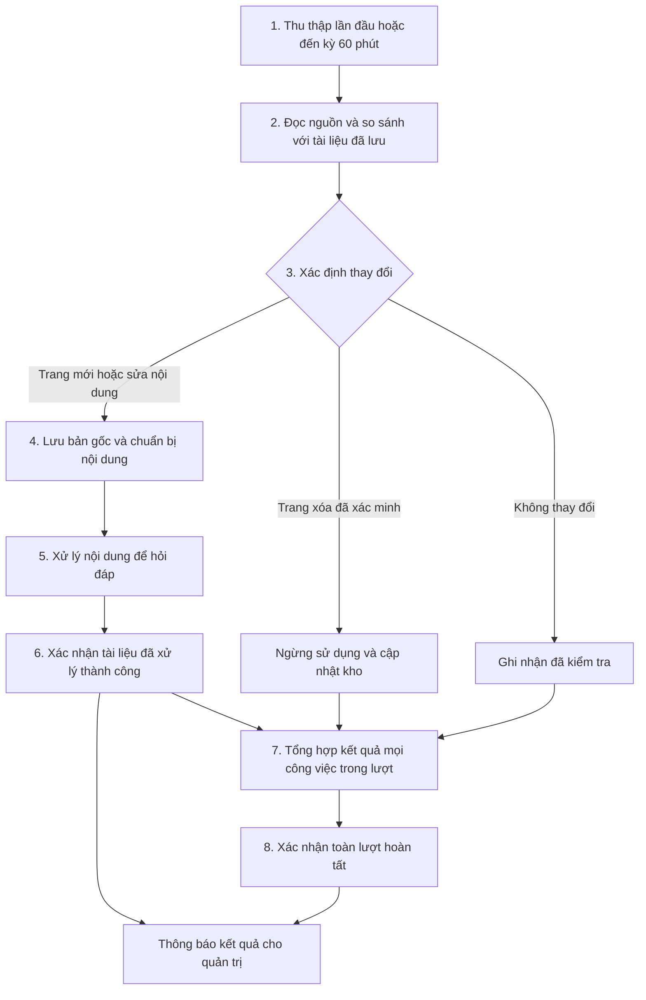

# Tài liệu đặc tả yêu cầu

| Thông tin | Nội dung |
| --- | --- |
| Đề tài | Nghiên cứu và xây dựng hệ thống kho tri thức doanh nghiệp thông minh từ Confluence |
| Học viên | Đặng Nam Cường |
| Loại tài liệu | Đặc tả yêu cầu phần mềm |
| Phiên bản | 2.0 |
| Ngày cập nhật | 17/11/2026 |
| Trạng thái | Dự thảo để thẩm định |
| Tài liệu liên quan | [Thiết kế chung](architecture.md), [Thiết kế chi tiết](detailed-design.md) |

- **Mục đích:** xác định hệ thống phục vụ ai, giải quyết việc gì, có những chức năng nào và cần trả kết quả gì.
- **Đối tượng đọc:** giảng viên hướng dẫn, người thực hiện đồ án và người kiểm thử.
- Tài liệu mô tả yêu cầu của sản phẩm. Cách tổ chức hệ thống và triển khai nằm trong tài liệu thiết kế.
- Kết quả đã thực hiện và kiểm chứng được ghi tại [báo cáo tiến độ](progress/README.md).

## Mục lục

1. [Bài toán và lý do hình thành](#1-bài-toán-và-lý-do-hình-thành)
2. [Sản phẩm đầu ra](#2-sản-phẩm-đầu-ra)
3. [Phạm vi và ràng buộc](#3-phạm-vi-và-ràng-buộc)
4. [Người sử dụng và phân quyền](#4-người-sử-dụng-và-phân-quyền)
5. [Danh mục yêu cầu chức năng](#5-danh-mục-yêu-cầu-chức-năng)
6. [Sơ đồ Use Case](#6-sơ-đồ-use-case)
7. [Mô tả chi tiết các chức năng](#7-mô-tả-chi-tiết-các-chức-năng)
8. [Yêu cầu xử lý tự động](#8-yêu-cầu-xử-lý-tự-động)

<!--
9. [Quy tắc nghiệp vụ](#9-quy-tắc-nghiệp-vụ)
10. [Yêu cầu phi chức năng](#10-yêu-cầu-phi-chức-năng)
11. [Tiêu chí và kịch bản nghiệm thu](#11-tiêu-chí-và-kịch-bản-nghiệm-thu)
12. [Ma trận truy vết](#12-ma-trận-truy-vết)
13. [Quyết định còn mở](#13-quyết-định-còn-mở)
-->

14. [Thuật ngữ và tài liệu liên quan](#14-thuật-ngữ-và-tài-liệu-liên-quan)

## 1. Bài toán và lý do hình thành

### 1.1. Bối cảnh

- Doanh nghiệp lưu các chính sách, quy trình và hướng dẫn trên Confluence.
- Trong bối cảnh ngân hàng, nhân viên cần tra cứu chính sách công ty và thông tin chương trình khuyến mãi để làm việc, hỗ trợ khách hàng.
- Khách hàng cần tìm hiểu ưu đãi, đối tượng áp dụng, điều kiện và thời gian của từng chương trình.
- Tài liệu được cập nhật thường xuyên; không phải người dùng nào cũng được đọc toàn bộ tài liệu.
- Đồ án sử dụng dữ liệu của một tổ chức ngân hàng giả lập, do người thực hiện chuẩn bị và kiểm soát.

### 1.2. Vấn đề cần giải quyết

| Vấn đề | Khó khăn hiện tại | Kết quả mong muốn |
| --- | --- | --- |
| Quyền sử dụng tài liệu | Nhân viên được đọc chính sách nội bộ; khách hàng chỉ được đọc thông tin khuyến mãi dành cho họ | Mỗi người chỉ hỏi đáp và xem tài liệu trong phạm vi được phép |
| Thời gian tra cứu | Người dùng phải tìm, đọc và tổng hợp nhiều trang; bộ phận hỗ trợ phải trả lời các câu hỏi lặp lại | Người dùng hỏi bằng tiếng Việt, nhận câu trả lời từ tài liệu và có nguồn để kiểm tra |

### 1.3. Phát biểu bài toán

- Xây dựng một kho tri thức được cập nhật tự động từ hai không gian tài liệu trên Confluence.
- Cung cấp một chatbot chung, trả lời dựa trên nội dung tài liệu mà tài khoản được phép đọc.
- Cho người dùng xem đoạn tài liệu làm căn cứ cho câu trả lời.
- Cho quản trị cấu hình nguồn, theo dõi cập nhật và nhận thông báo khi xử lý hoàn tất.

## 2. Sản phẩm đầu ra

| Sản phẩm | Nội dung cần có |
| --- | --- |
| Kho tri thức doanh nghiệp | Nội dung thu thập từ 100–300 trang thuộc hai Space, kèm nguồn, phiên bản và quyền đọc |
| Ứng dụng hỏi đáp | Hỏi đáp tiếng Việt theo role tài khoản, kèm trích dẫn và nguồn để kiểm chứng |
| Chức năng cập nhật tự động | Kiểm tra nguồn mỗi 60 phút, xử lý trang thêm/sửa/xóa và đưa nội dung đã xử lý vào kho hỏi đáp |
| Giao diện quản trị | Cấu hình nguồn, xem trạng thái và nhận thông báo kết quả |
| Mã nguồn và cấu hình chạy | Mã nguồn ứng dụng, cấu hình mẫu không chứa thông tin bí mật và hướng dẫn khởi động hệ thống |
| Tài liệu bàn giao | Đặc tả yêu cầu, thiết kế chung, thiết kế chi tiết và hướng dẫn sử dụng/vận hành |
| Bộ kiểm thử và báo cáo đánh giá | Dữ liệu thử, bộ câu hỏi, kết quả kiểm thử và đánh giá chất lượng câu trả lời, thời gian xử lý |

## 3. Phạm vi và ràng buộc

### 3.1. Phạm vi xác định

| Nội dung | Yêu cầu |
| --- | --- |
| Nguồn tài liệu | Một hệ thống Confluence Cloud Free |
| Không gian tài liệu | Hai Space: chính sách nội bộ và chương trình khuyến mãi |
| Chatbot | Một chatbot chung cho cả hai Space |
| Quy mô | Tổng 100–300 trang |
| Ngôn ngữ | Tài liệu, câu hỏi và giao diện bằng tiếng Việt |
| Định dạng tài liệu | Trang HTML đơn giản, gồm tiêu đề, đoạn văn, danh sách, bảng văn bản, liên kết và khối mã |
| Ảnh | Giữ tham chiếu ảnh trong nội dung; không đọc hoặc giải thích chữ/nội dung trong ảnh |
| Cập nhật | Thu thập lần đầu và tự kiểm tra thay đổi mỗi 60 phút |
| Phiên bản | Giữ các phiên bản mà hệ thống thực tế thu thập được |
| Khai thác | Hỏi đáp và xem nguồn theo role tài khoản |
| Vận hành | Cấu hình nguồn, theo dõi trạng thái và nhận thông báo |

### 3.2. Ràng buộc sử dụng và triển khai

- Hệ thống được thử nghiệm trên máy phát triển có 32 GB RAM, không có GPU.
- Việc cập nhật định kỳ được thực hiện khi hệ thống đang hoạt động và kết nối được với nguồn tài liệu.
- Dịch vụ AI sử dụng hạn mức miễn phí; hệ thống không tự chuyển sang gói trả phí khi hết hạn mức.
- Tài liệu thử nghiệm phải được phép thu thập và sử dụng với dịch vụ AI.
- Công nghệ, cơ sở dữ liệu và cấu hình triển khai được mô tả tại [thiết kế chung](architecture.md) và [thiết kế chi tiết](detailed-design.md).

## 4. Người sử dụng và phân quyền

### 4.1. Tác nhân

| Mã | Người sử dụng | Nhu cầu |
| --- | --- | --- |
| A01 | Nhân viên nội bộ | Tra cứu chính sách công ty và chương trình khuyến mãi |
| A02 | Khách hàng có tài khoản | Hỏi về chương trình khuyến mãi và xem tài liệu giải thích |
| A03 | Quản trị kho tri thức | Sử dụng kho tri thức và quản lý việc cập nhật tài liệu |

### 4.2. Ma trận quyền chức năng

| Chức năng | Nhân viên | Khách hàng | Quản trị |
| --- | --- | --- | --- |
| UC01 — Hỏi đáp chính sách công ty | Có | Không | Có |
| UC02 — Hỏi đáp chương trình khuyến mãi | Có | Có | Có |
| UC03 — Xem và kiểm chứng nguồn | Cả hai Space | Chỉ khuyến mãi | Cả hai Space |
| UC04 — Cấu hình nguồn và phạm vi | Không | Không | Có |
| UC05 — Theo dõi trạng thái xử lý | Không | Không | Có |

### 4.3. Quyền đọc theo Space

| Space | Người được phép đọc |
| --- | --- |
| Chính sách nội bộ | Nhân viên và quản trị |
| Chương trình khuyến mãi | Khách hàng, nhân viên và quản trị |

- Mỗi trang nhận quyền đọc từ Space chứa trang đó.
- Tài liệu chưa được xác định quyền đọc không được sử dụng để trả lời hoặc cung cấp nguồn.
- Khi trang chuyển Space hoặc quyền của Space thay đổi, quyền đọc tài liệu phải được cập nhật, kể cả khi nội dung không đổi.

### 4.4. Tài khoản và role

| Nhóm tài khoản | Mục đích |
| --- | --- |
| Tài khoản ứng dụng | Được lưu trong database, kèm role để xác định phạm vi tài liệu được dùng khi hỏi đáp |
| Tài khoản kết nối Confluence | Dùng trong cấu hình nguồn để hệ thống thu thập tài liệu; không đại diện cho người đang hỏi chatbot |

- Role của tài khoản ứng dụng được đọc từ database và dùng để lọc tài liệu trong luồng retrieve.
- Role nội bộ được đọc hai Space; role khách hàng chỉ được đọc Space khuyến mãi.
- Vai trò quản trị được dùng cho các chức năng vận hành tại mục 4.2.
- Tài liệu không quy định chức năng đăng nhập, đăng xuất hoặc quản lý phiên cho ứng dụng chatbot.
- Cách xác định tài khoản đang dùng trong yêu cầu chat cần được làm rõ khi thiết kế giao tiếp; không mặc định có cơ chế xác thực danh tính.
- Hệ thống xác định quyền từ tài khoản; nội dung câu hỏi không làm thay đổi quyền.
- Tài liệu ngoài quyền không được dùng để tạo câu trả lời hoặc hiển thị nguồn.
- Khách hàng không cần có tài khoản Confluence để xem nguồn khuyến mãi được phép trong ứng dụng.
- Thông tin đăng nhập nguồn và thông tin bí mật không được hiển thị cho người dùng.
- Chức năng và thông báo vận hành chỉ dành cho quản trị.

## 5. Danh mục yêu cầu chức năng

| Mã | Yêu cầu | Người sử dụng/đối tượng phục vụ | Kết quả cần có |
| --- | --- | --- | --- |
| FR01 | Cấu hình nguồn và quyền đọc | Quản trị | Lưu được nguồn Confluence, hai Space và nhóm người được đọc từng Space |
| FR02 | Thu thập tài liệu lần đầu | Quản trị; hệ thống thực hiện | Thu thập đủ các trang hợp lệ trong phạm vi đã chọn, kèm nguồn và phiên bản |
| FR03 | Đồng bộ định kỳ | Hệ thống thực hiện | Tự kiểm tra mỗi 60 phút; không có hai lượt cùng nguồn chạy đồng thời |
| FR04 | Nhận biết thay đổi tài liệu | Hệ thống thực hiện | Phân biệt trang mới, sửa, xóa và thay đổi thông tin/quyền; không xử lý lại nội dung không đổi khi không cần thiết |
| FR05 | Ghi nhận phiên bản và nguồn | Người đọc tài liệu; quản trị | Xác định được tài liệu, phiên bản đã thu thập và nguồn dùng cho kết quả |
| FR06 | Bắt đầu xử lý tài liệu đã chuẩn bị | Hệ thống thực hiện | Chỉ bắt đầu khi nội dung đã chuẩn bị xong; phân biệt yêu cầu được tiếp nhận với xử lý hoàn tất |
| FR07 | Chuẩn bị tài liệu để hỏi đáp | Hệ thống thực hiện | Nội dung được chuyển đổi, chia thành các đoạn và lưu để phục vụ hỏi đáp; chỉ sử dụng sau khi xử lý thành công |
| FR09 | Hỏi đáp từ tài liệu | Nhân viên, khách hàng, quản trị theo mục 4.2 | Kết quả đúng quyền, dựa trên tài liệu và có nguồn để kiểm tra |
| FR12 | Ghi nhận kết quả và số liệu xử lý | Quản trị; người đánh giá | Theo dõi được tài liệu/lượt cập nhật và có số liệu thời gian, kết quả phục vụ đánh giá |
| FR14 | Áp dụng quyền đọc tài liệu | Cả ba nhóm người dùng | Cùng một quyền đọc được áp dụng khi retrieve, tạo câu trả lời và xem nguồn |
| FR15 | Thông báo xử lý hoàn tất | Quản trị | Nhận được kết quả đúng tài liệu/lượt cập nhật sau khi xử lý thành công |

## 6. Sơ đồ Use Case

- Sơ đồ thể hiện những chức năng mỗi nhóm người dùng được sử dụng.
- Hình người biểu diễn người sử dụng; hình elip biểu diễn chức năng.
- Liên kết tác nhân–Use Case thể hiện quyền tham gia chức năng, không biểu diễn thứ tự xử lý.
- Mũi tên nét đứt `«extend»` hướng từ Use Case mở rộng đến Use Case gốc; điều kiện sử dụng được xác định tại mục 6.4 và mô tả chi tiết ở mục 7.

### 6.1. Nhân viên nội bộ

### 6.2. Khách hàng có tài khoản

### 6.3. Quản trị kho tri thức

- Mã nguồn và cách chỉnh sửa sơ đồ: [tài nguyên Use Case](use-cases/README.md).

### 6.4. Quan hệ mở rộng giữa các Use Case

| Use Case mở rộng | Use Case gốc | Điều kiện kích hoạt |
| --- | --- | --- |
| UC03 — Xem và kiểm chứng nguồn | UC01 — Hỏi đáp chính sách công ty | Câu trả lời có trích dẫn và người dùng chọn trích dẫn |
| UC03 — Xem và kiểm chứng nguồn | UC02 — Hỏi đáp chương trình khuyến mãi | Câu trả lời có trích dẫn và người dùng chọn nguồn |

- UC01 và UC02 hoàn thành mục tiêu ngay cả khi người dùng không thực hiện phần mở rộng.
- Hiển thị trích dẫn trong câu trả lời có căn cứ là hành vi của UC01/UC02; mở nội dung nguồn để kiểm chứng là hành vi mở rộng của UC03.

## 7. Mô tả chi tiết các chức năng

- Luồng chính mô tả các bước thực hiện chức năng.
- `«extend»` đi từ Use Case cung cấp hành vi mở rộng tới Use Case gốc. Use Case gốc vẫn đạt mục tiêu khi người dùng không chọn hành vi mở rộng.
- Phạm vi đọc được xác định từ role của tài khoản trong database. Quyền vận hành theo ma trận tại mục 4.2.

### 7.1. UC01 — Hỏi đáp chính sách công ty

| Nội dung | Mô tả |
| --- | --- |
| Mục tiêu | Giải thích chính sách, quy trình và hướng dẫn nội bộ dựa trên tài liệu được phép sử dụng |
| Tác nhân chính | Nhân viên, quản trị |
| Điều kiện | Tài khoản có role được đọc Space chính sách nội bộ |
| Đầu vào | Câu hỏi tiếng Việt về chính sách công ty |
| Kích hoạt | Người dùng gửi câu hỏi cho chatbot chung |
| Đầu ra | Câu trả lời dựa trên chính sách, kèm trích dẫn; thông báo khi chưa đủ thông tin hoặc chưa thể xử lý. |
| Quan hệ | UC03 `«extend»` UC01 khi người dùng chọn trích dẫn |

**Luồng chính**

| Bước | Người dùng | Hệ thống |
| --- | --- | --- |
| 1 | Mở chatbot và nhập câu hỏi về chính sách | Hiển thị nội dung đang nhập |
| 2 | Gửi câu hỏi | Đọc role từ database; kiểm tra phạm vi đọc và câu hỏi |
| 3 | — | Xác định phạm vi tài liệu chính sách mà tài khoản được phép đọc |
| 4 | — | Tìm các đoạn liên quan thuộc tài liệu đã xử lý xong; loại bỏ tài liệu đã xóa, chưa sẵn sàng hoặc không còn đúng quyền |
| 5 | — | Đánh giá nội dung tìm được có đủ căn cứ cho câu hỏi; chỉ đưa các đoạn hợp lệ vào bước tạo câu trả lời |
| 6 | — | Tổng hợp câu trả lời bám nội dung tài liệu; gắn các khẳng định với tham chiếu nguồn và phiên bản thực tế đã sử dụng |
| 7 | Đọc câu trả lời | Kiểm tra nguồn tham chiếu và hiển thị câu trả lời kèm trích dẫn |

- Người dùng hỏi trực tiếp; hệ thống retrieve các đoạn liên quan trong quá trình tạo câu trả lời.

### 7.2. UC02 — Hỏi đáp chương trình khuyến mãi

| Nội dung | Mô tả |
| --- | --- |
| Mục tiêu | Giải thích ưu đãi, đối tượng, điều kiện và thời gian áp dụng chương trình dựa trên tài liệu |
| Tác nhân chính | Khách hàng, nhân viên, quản trị |
| Điều kiện | Tài khoản có role được đọc Space chương trình khuyến mãi |
| Đầu vào | Câu hỏi tiếng Việt về chương trình khuyến mãi |
| Kích hoạt | Người dùng gửi câu hỏi cho chatbot chung |
| Đầu ra | Câu trả lời về khuyến mãi kèm nguồn, điều kiện và thời hạn theo tài liệu; thông báo khi chưa đủ thông tin hoặc chưa thể xử lý. |
| Quan hệ | UC03 `«extend»` UC02 khi người dùng chọn nguồn |

**Luồng chính**

| Bước | Người dùng | Hệ thống |
| --- | --- | --- |
| 1 | Mở chatbot và nhập câu hỏi về khuyến mãi | Hiển thị nội dung đang nhập |
| 2 | Gửi câu hỏi | Đọc role từ database; kiểm tra quyền đọc khuyến mãi và câu hỏi |
| 3 | — | Xác định phạm vi tài liệu khuyến mãi được phép; với khách hàng, không sử dụng Space chính sách nội bộ |
| 4 | — | Tìm các đoạn khuyến mãi liên quan, đã xử lý xong và còn được phép đọc |
| 5 | — | Đối chiếu bằng chứng về ưu đãi, đối tượng, điều kiện và thời gian áp dụng được hỏi; xác định phần có thể trả lời |
| 6 | — | Tạo câu trả lời từ bằng chứng, nêu thời hạn nếu có; gắn trích dẫn đúng tài liệu và phiên bản |
| 7 | Đọc câu trả lời | Kiểm tra nguồn tham chiếu và hiển thị câu trả lời kèm trích dẫn |

- Tài liệu tồn tại trong kho không có nghĩa chương trình vẫn đang áp dụng.

### 7.3. UC03 — Xem và kiểm chứng nguồn

| Nội dung | Mô tả |
| --- | --- |
| Mục tiêu | Cho người dùng kiểm tra nội dung làm căn cứ cho câu trả lời |
| Tác nhân chính | Nhân viên, khách hàng, quản trị trong phạm vi được đọc |
| Điều kiện | Tài khoản có quyền đọc tài liệu; có tham chiếu nguồn từ câu trả lời của UC01 hoặc UC02 |
| Đầu vào | Tham chiếu tài liệu/đoạn nội dung và phiên bản mà người dùng lựa chọn |
| Kích hoạt | Người dùng chọn trích dẫn hoặc liên kết Xem nguồn |
| Đầu ra | Đoạn nguồn đúng quyền và phiên bản, kèm tiêu đề và thời điểm thu thập; thông báo nếu nguồn chưa thể xem. |
| Quan hệ | Mở rộng UC01 và UC02; các UC gốc không bắt buộc thực hiện UC03 để hoàn thành |

**Luồng chính**

| Bước | Người dùng | Hệ thống |
| --- | --- | --- |
| 1 | Chọn một nguồn tại câu trả lời | Tiếp nhận tham chiếu nguồn và vị trí kết quả đang xem |
| 2 | — | Đối chiếu role tài khoản với quyền đọc hiện hành đối với tài liệu được tham chiếu |
| 3 | — | Xác định tài liệu, phiên bản và đoạn nội dung tương ứng; kiểm tra nguồn còn được phép sử dụng |
| 4 | Đọc nội dung nguồn | Hiển thị tiêu đề, đoạn nguồn, vị trí nếu có, phiên bản và thời điểm thu thập |
| 5 | Đóng phần xem nguồn | Trở lại câu trả lời đã kích hoạt UC03; kết thúc phần mở rộng |

- Khách hàng xem đoạn khuyến mãi trong ứng dụng mà không cần tài khoản Confluence.
- Chỉ hiển thị nguồn được tham chiếu khi phiên bản còn được ứng dụng phục vụ và role được phép đọc; nếu không, thông báo nguồn chưa thể xem. Không bổ sung màn hình đọc lịch sử phiên bản.

### 7.4. UC04 — Cấu hình nguồn và phạm vi

| Nội dung | Mô tả |
| --- | --- |
| Mục tiêu | Xác định kết nối Confluence, hai Space và nhóm được đọc từng Space |
| Tác nhân chính | Quản trị |
| Điều kiện | Tài khoản có vai trò quản trị; có thông tin kết nối và định danh hai Space |
| Đầu vào | Địa chỉ Confluence, thông tin kết nối, Space chính sách, Space khuyến mãi và quyền đọc tương ứng |
| Kích hoạt | Quản trị mở chức năng cấu hình và yêu cầu lưu thông tin |
| Đầu ra | Kết quả lưu cấu hình và áp dụng quyền cho tài liệu; thông báo phần chưa hoàn tất nếu có lỗi. |
| Quan hệ | Chức năng độc lập; cấu hình hợp lệ là điều kiện để hệ thống cập nhật nguồn tự động |

**Luồng chính**

| Bước | Quản trị | Hệ thống |
| --- | --- | --- |
| 1 | Mở chức năng Cấu hình nguồn | Kiểm tra quyền quản trị; hiển thị cấu hình hiện có và che thông tin bí mật |
| 2 | Nhập hoặc cập nhật kết nối Confluence | Tiếp nhận thông tin, không hiển thị lại giá trị bí mật đã lưu |
| 3 | Chọn Space chính sách và Space khuyến mãi | Ghi nhận hai Space cần quản lý |
| 4 | Xác định nhóm được đọc từng Space | Đối chiếu ma trận quyền tại mục 4.3: nhân viên/quản trị đọc cả hai Space; khách hàng chỉ đọc khuyến mãi |
| 5 | Chọn Lưu | Kiểm tra thông tin bắt buộc, đúng hai Space không trùng nhau, quyền hợp lệ và khả năng đọc nguồn |
| 6 | — | Lưu cấu hình hợp lệ; nếu quyền thay đổi, cập nhật quyền của các tài liệu liên quan trước khi tiếp tục cho đọc theo quyền mới |
| 7 | Xem kết quả | Thông báo lưu và áp dụng quyền đã hoàn tất; hiển thị cấu hình không chứa thông tin bí mật |

- Chu kỳ đồng bộ là 60 phút. UC này không bổ sung chức năng tùy chỉnh lịch hoặc tự đăng ký tài khoản.

### 7.5. UC05 — Theo dõi trạng thái xử lý

| Nội dung | Mô tả |
| --- | --- |
| Mục tiêu | Cho quản trị biết tiến độ, kết quả và lỗi của tài liệu/lượt cập nhật |
| Tác nhân chính | Quản trị |
| Điều kiện | Tài khoản có vai trò quản trị; hệ thống đọc được trạng thái các lượt cập nhật tự động |
| Đầu vào | Lượt cập nhật hoặc tài liệu được lựa chọn; thông báo kết quả được hệ thống chuyển tới |
| Kích hoạt | Quản trị mở màn hình trạng thái hoặc chọn một thông báo kết quả |
| Đầu ra | Trạng thái và kết quả xử lý của tài liệu/lượt cập nhật, kèm thời điểm ghi nhận; thông báo nếu chưa tải được trạng thái. |

**Luồng chính — xem trạng thái**

| Bước | Quản trị | Hệ thống |
| --- | --- | --- |
| 1 | Mở màn hình trạng thái | Kiểm tra vai trò quản trị để xem thông tin vận hành |
| 2 | Xem các lượt cập nhật | Hiển thị định danh lượt, thời gian và trạng thái tổng hợp đã ghi nhận |
| 3 | Chọn một lượt hoặc tài liệu | Đọc trạng thái và kết quả chi tiết tương ứng |
| 4 | Xem tiến độ/kết quả | Hiển thị giai đoạn, thời gian, số lượng và lỗi nếu có; phân biệt tài liệu hoàn tất với toàn lượt hoàn tất |
| 5 | Tiếp tục theo dõi hoặc rời màn hình | Cập nhật thông tin khi có trạng thái mới; việc rời màn hình không hủy công việc đang chạy |

- Nhân viên và khách hàng không được xem trạng thái hoặc nhận thông báo vận hành.

## 8. Yêu cầu xử lý tự động

### 8.1. Theo dõi thay đổi tài liệu

| Trường hợp | Yêu cầu |
| --- | --- |
| Trang mới | Thu thập nội dung, ghi nhận nguồn/phiên bản và chuẩn bị để sử dụng |
| Nội dung được sửa | So sánh với nội dung đã lưu và cập nhật phần phục vụ hỏi đáp |
| Chỉ thông tin hoặc quyền thay đổi | Cập nhật thông tin/quyền; không xử lý lại nội dung không đổi khi không cần thiết |
| Trang đã bị xóa | Xác minh việc xóa và ngừng sử dụng trang trong kho hỏi đáp |
| Không thay đổi | Ghi nhận đã kiểm tra; không tạo việc xử lý nội dung không cần thiết |

- Mỗi trang giữ nguyên định danh trong kho khi cập nhật, để liên hệ được nguồn và kết quả xử lý.
- Chỉ giữ các phiên bản thực tế đã thu thập; không coi kho lưu trữ là toàn bộ lịch sử chỉnh sửa trên Confluence.

### 8.2. Luồng cập nhật tổng thể

- Sơ đồ thể hiện các nhánh cập nhật chính. Quyền đọc được áp dụng xuyên suốt theo mục 4.
- Cách kết nối các thành phần và lưu dữ liệu được mô tả trong tài liệu thiết kế.

### 8.3. Chuẩn bị tài liệu để hỏi đáp

| Nội dung | Yêu cầu |
| --- | --- |
| Đầu vào | Bản gốc hợp lệ, nguồn, phiên bản và quyền đọc của trang |
| Chuyển đổi | Chuyển HTML đơn giản thành Markdown, giữ nội dung và tham chiếu ảnh |
| Chia nội dung | Tách thành các đoạn có thứ tự, vẫn xác định được đoạn thuộc tài liệu nào |
| Đưa vào kho hỏi đáp | Xử lý và lưu nội dung cần thiết để tìm các đoạn liên quan đến câu hỏi |
| Kết quả | Tài liệu chỉ được sử dụng khi các bước xử lý và lưu dữ liệu cần thiết đã thành công |

- Nếu không đọc được nội dung hoặc xử lý thất bại, phải ghi nhận lỗi thay vì báo hoàn tất.
- Nội dung đang xử lý dở không được dùng để trả lời.

### 8.4. Trạng thái và mốc hoàn thành

| Mốc | Ý nghĩa đối với người sử dụng |
| --- | --- |
| Đã tiếp nhận | Hệ thống nhận yêu cầu; chưa có nghĩa xử lý xong |
| Đã thu thập và so sánh | Đã xác định được thay đổi nguồn; chưa có nghĩa nội dung mới đã dùng được |
| Đã chuẩn bị nội dung | Nội dung đã chuyển đổi và chia đoạn, sẵn sàng cho bước xử lý tiếp theo |
| Đang xử lý để hỏi đáp | Hệ thống đang đưa nội dung vào kho phục vụ hỏi đáp |
| Tài liệu hoàn tất | Nội dung phục vụ tra cứu đã được xử lý và lưu thành công; chỉ được đọc nếu còn đúng quyền |
| Toàn lượt hoàn tất | Mọi công việc cập nhật, thay đổi quyền và xóa cần thiết của lượt đã xong |
| Đã thông báo | Kết quả được chuyển tới giao diện quản trị |
| Không thay đổi | Đã kiểm tra nguồn và không cần xử lý lại nội dung |
| Có lỗi | Bước xử lý chưa thành công, có thông tin để quản trị kiểm tra |

- Một tài liệu hoàn tất không có nghĩa toàn bộ lượt hoàn tất.
- Chỉ thông báo xử lý thành công sau khi kết quả đã được xác nhận.
- Việc hiển thị thông báo là bước riêng với việc xử lý xong tài liệu.

### 8.5. Xóa và thay đổi phạm vi đọc

- Trang đã xác minh bị xóa hoặc không còn thuộc phạm vi nguồn phải ngừng được dùng để hỏi đáp và xem nguồn.
- Lỗi kết nối hoặc chưa đọc hết danh sách trang không được coi là tài liệu đã bị xóa.
- Trang chuyển Space hoặc đổi quyền phải áp dụng quyền đọc hiện hành, dù nội dung không đổi.
- Bản gốc đã lưu vẫn phải được bảo vệ theo quyền đọc; việc lưu bản gốc không tự cho phép mọi người xem.

### 8.6. Thông báo kết quả

| Nội dung | Yêu cầu |
| --- | --- |
| Người nhận | Tài khoản có vai trò quản trị |
| Khi thông báo hoàn tất | Sau khi tài liệu hoặc toàn lượt đã xử lý thành công theo mục 8.4 |
| Thông tin hiển thị | Tài liệu/lượt cập nhật, kết quả, thời điểm và số lượng liên quan |
| Bảo mật | Không kèm toàn văn tài liệu hoặc thông tin đăng nhập nguồn |
| Không cần xử lý nội dung | Hiển thị kết quả kiểm tra tương ứng, không báo đã xử lý nội dung khi thực tế không chạy |

- Khi có lỗi, người vận hành kiểm tra và chạy lại task/DAG phù hợp trên Airflow. Việc chạy lại không là chức năng trên giao diện chatbot và không mặc định bảo đảm mọi tài liệu lỗi được xử lý lại.

### 8.7. Luồng hỏi đáp từ tài liệu

1. Lấy tài khoản và role tương ứng từ database để xác định phạm vi tài liệu được đọc.
2. Tìm các đoạn liên quan đến câu hỏi, thuộc tài liệu đã xử lý xong.
3. Chỉ dùng các đoạn đúng quyền để tạo câu trả lời.
4. Kiểm tra trích dẫn và trả câu trả lời kèm nguồn để người dùng đối chiếu.

- Không đủ thông tin từ tài liệu: nói rõ chưa có đủ căn cứ để trả lời.
- Dịch vụ hỏi đáp gặp lỗi: thông báo chưa thể xử lý; không kết luận là tài liệu không tồn tại.
- Các yêu cầu trong câu hỏi không được dùng để vượt quyền đọc hoặc thay đổi tài liệu.

<!--
## 9. Quy tắc nghiệp vụ

| Mã | Quy tắc |
| --- | --- |
| BR01 | Một bot, hai Space hợp lệ; thiếu ánh xạ quyền thì không phục vụ |
| BR02 | INTERNAL đọc cả hai Space; CUSTOMER chỉ khuyến mãi; quyền vận hành tách riêng |
| BR03 | Tài khoản nguồn tách danh tính người dùng; không tiết lộ secret |
| BR04 | Phiên bản gắn đúng nội dung thực tế thu thập |
| BR05 | Chỉ dữ liệu hoàn chỉnh và được phép đọc mới tham gia khai thác |
| BR06 | API trực tiếp kích hoạt train sau chunk; Kafka thông báo kết quả |
| BR07 | Xóa/thu hồi đã xác minh phải chặn retrieval và nguồn |
| BR08 | Lỗi đọc nguồn không tự biến thành xóa tài liệu hoặc thành công đồng bộ |
| BR09 | Thiếu bằng chứng không được bịa đáp án; lỗi dịch vụ khác thiếu dữ liệu |
| BR10 | Trích dẫn phải thực sự hỗ trợ câu trả lời và đúng phạm vi/phiên bản |
| BR11 | Nội dung câu hỏi không làm thay đổi role tài khoản hoặc phạm vi tài liệu được đọc |
| BR12 | Tài liệu khuyến mãi có trong index không chứng minh ưu đãi còn hiệu lực |
| BR13 | ACL kế thừa Space áp dụng xuyên suốt API, context, nguồn và cache |
| BR14 | Không tự nâng gói hoặc chuyển dịch vụ trả phí khi hết quota |
| BR15 | Tiếp nhận HTTP, kết thúc ingestion, hoàn tất train và thông báo là các mốc riêng |
| BR16 | Chỉ phát thành công sau embedding và ghi dữ liệu bắt buộc thành công |
| BR17 | Dữ liệu đối soát/lượt ingestion dùng PostgreSQL; tách metadata Airflow |
| BR18 | Chỉ metadata/quyền đổi không bắt buộc embedding lại nội dung |
| BR19 | Kết quả một tài liệu không thay thế kết quả toàn lượt |

## 10. Yêu cầu phi chức năng

| Mã | Nhóm | Yêu cầu | Cách kiểm chứng |
| --- | --- | --- | --- |
| NFR01 | Nhất quán phục vụ | Không dùng nội dung đang xử lý dở hoặc ngoài quyền | Kiểm tra truy xuất trong chuỗi cập nhật tuần tự |
| NFR02 | Kiểm soát chạy chồng | Không có hai lượt cùng nguồn chạy đồng thời | Gửi yêu cầu khi một lượt đang chạy |
| NFR03 | Chẩn đoán | Hiển thị được giai đoạn và thông tin lỗi để người vận hành kiểm tra | Đối chiếu lỗi đã ghi nhận với trạng thái hiển thị |
| NFR04 | Lưu bền vững | Dữ liệu đã ghi xác nhận còn sau restart có volume | Đối chiếu dữ liệu trước/sau restart |
| NFR05 | Minh bạch độ mới | Có phiên bản, thời điểm thu thập và trạng thái xử lý | Đối chiếu nguồn, dữ liệu và UI |
| NFR06 | Tài nguyên | Hoạt động trong môi trường 32 GB RAM, không GPU | Đo RAM/CPU toàn stack dưới tải thử |
| NFR07 | Quota | Giới hạn tải phù hợp gói miễn phí, không thành công giả hoặc tăng phí | Kiểm tra cấu hình và phản hồi quota |
| NFR08 | Bảo mật | Authorization phía server; không lộ secret; chỉ context hợp lệ gửi AI | Kiểm thử quyền và kiểm tra log/response |
| NFR09 | Quan sát | Truy vết ingestion, tài liệu, train và thông báo | Theo định danh qua các giai đoạn |
| NFR10 | Tái lập | Ghi phần mềm/model/cấu hình, snapshot và điều kiện thử | Thực hiện lại trên cấu hình đã ghi nhận |
| NFR11 | Dễ sử dụng | UI tiếng Việt; trạng thái rõ; không yêu cầu hiểu hạ tầng | Review chức năng và thử tác vụ người dùng |
| NFR12 | Hiệu năng | Đo độ trễ RAG, xử lý và thông báo; công bố tải/mạng/quota | Bộ đo theo mục 11.3 |
| NFR13 | Chất lượng AI | Đánh giá đúng/đủ, grounding, citation và thiếu dữ liệu | Bộ chuẩn và chấm thủ công |

- NFR04 không cam kết chống hỏng ổ đĩa hoặc tự tiếp tục công việc đang chạy.
- Ngưỡng hiệu năng và chất lượng cần chốt tại Q04 trước nghiệm thu định lượng.

## 11. Tiêu chí và kịch bản nghiệm thu

### 11.1. Nguyên tắc

- Dùng dữ liệu được phép sử dụng, đủ hai Space và tài khoản đại diện ba vai trò.
- Mỗi ca có đầu vào, điều kiện, kết quả mong đợi/thực tế, định danh và minh chứng.
- Phân biệt kiểm thử giả lập với kiểm thử Confluence/AI/Kafka thực.
- Hoàn thành setup hạ tầng không thay bằng chứng chạy chức năng.
- Phản hồi input sai/lỗi dịch vụ vẫn phải được kiểm tra.

### 11.2. Ma trận nghiệm thu

| Mã | Tình huống | Điều kiện đạt |
| --- | --- | --- |
| AC01 | Tài khoản có role nội bộ hoặc khách hàng trong database | Luồng retrieve lấy đúng role và giới hạn tài liệu theo Space |
| AC02 | Không tìm thấy tài khoản hoặc không xác định được role | Không tự cấp quyền đọc tài liệu |
| AC03 | Tài khoản nhân viên/khách hàng sử dụng chức năng vận hành | Không được phép; tài khoản quản trị được sử dụng theo điều kiện chức năng |
| AC04 | Retrieve nội dung khi hỏi đáp bằng role nội bộ và khách hàng | Chỉ những đoạn thuộc tài liệu đúng role được dùng để tạo câu trả lời |
| AC05 | Hỏi chính sách có bằng chứng | Đáp án bám nguồn từ luồng retrieve nội bộ |
| AC06 | Ba vai trò hỏi khuyến mãi | Đúng phạm vi; nêu điều kiện/thời hạn; không suy diễn ưu đãi cá nhân |
| AC07 | Xem nguồn; sửa ID sang nguồn ngoài quyền | Chỉ nguồn được phép được hiển thị; khách hàng không cần tài khoản Confluence |
| AC08 | Câu hỏi ngoài dữ liệu, chưa rõ nội dung hoặc ngoài phạm vi role | Phản hồi phù hợp với dữ liệu và quyền đọc; không tạo nguồn không có trong tài liệu |
| AC09 | Cấu hình bot/Space/quyền hợp lệ và không hợp lệ | Ánh xạ đúng; secret không lộ; quyền thiếu/rỗng/khác bot không cấp quyền |
| AC10 | Thu thập lần đầu và cập nhật tự động mỗi 60 phút | Đủ phạm vi; lịch đúng điều kiện; không chạy chồng |
| AC11 | Trang mới, body đổi, chỉ metadata/parent đổi, không đổi | Đối soát đúng; chỉ nội dung cần thiết được train |
| AC12 | Train trước chunk, input sai hoặc đang chạy | Phản hồi/từ chối đúng; không tạo xử lý chồng hoặc thành công giả |
| AC13 | Dịch vụ trả lỗi hoặc thiếu quota | Không công bố thành công; lỗi rõ; không tự chuyển trả phí |
| AC14 | API tiếp nhận, job còn chạy, sau đó train thành công | Không thông báo thành công sớm; chỉ hoàn tất sau các bước ghi bắt buộc |
| AC15 | Train thành công khi broker/backend hoạt động | Kafka có kết quả; backend/FE quản trị hiển thị đúng định danh và kết quả |
| AC16 | Xóa, chuyển Space, đổi quyền khi body không đổi | Tài liệu xóa bị chặn; quyền hiện hành có hiệu lực ở mọi đường đọc |
| AC17 | Tài khoản có role khách hàng hỏi hoặc chọn nguồn chính sách nội bộ | Không dùng hoặc hiển thị tài liệu nội bộ; tài khoản nhân viên đọc được hai Space |
| AC18 | Xem trạng thái xử lý | Tài khoản quản trị xem được kết quả, giai đoạn và lỗi của lượt cập nhật |
| AC19 | Restart kho sau công việc hoàn tất | Snapshot, nội dung, raw và vector đã xác nhận vẫn tồn tại |
| AC20 | Thu thập thiếu do lỗi phân trang/kết nối | Không xóa hàng loạt hoặc báo hoàn tất sai; có lỗi phù hợp |
| AC21 | Lượt nhiều tài liệu hoặc chỉ metadata/quyền/xóa/không đổi | Tổng hợp đúng mọi tác vụ; không nhầm một tài liệu xong với toàn lượt hoặc giả lập embedding |

### 11.3. Đánh giá chất lượng và hiệu quả — đề xuất

| Hạng mục | Kế hoạch đề xuất |
| --- | --- |
| Kho dữ liệu | 100–300 trang thuộc hai Space |
| Bộ câu hỏi | Câu trực tiếp, tổng hợp nhiều đoạn, thiếu dữ liệu và thay đổi theo phiên bản; số lượng cần thống nhất |
| Chia tập | Tách câu dùng điều chỉnh hệ thống với câu đánh giá; quy mô cần thống nhất |
| Dữ liệu chuẩn | Câu hỏi, quyền, phạm vi, đáp án/khả năng trả lời, tài liệu/phiên bản và đoạn bằng chứng |
| Thay đổi kiểm soát | Trang thử có sửa nội dung, xóa và chuyển phạm vi; số lượng cần thống nhất |
| Chấm thủ công | Đúng nội dung, đủ điều kiện, grounding và trích dẫn hỗ trợ khẳng định |
| Hiệu quả tác vụ | So thời gian/tỷ lệ hoàn thành với tra cứu thủ công; ghi người tham gia và kinh nghiệm |
| Tải pilot | Số người truy vấn đồng thời cần thống nhất theo hạn mức AI và tài nguyên máy |
| Hiệu năng | Độ trễ truy xuất/đáp án, thời gian đồng bộ/lập chỉ mục/thông báo, RAM/CPU và điều kiện mạng/quota |

- Chỉ số báo cáo: truy xuất bằng chứng top-k, tỷ lệ trả lời đúng/đủ, độ chính xác trích dẫn, xử lý thiếu dữ liệu và độ trễ.
- Cố định snapshot, công thức, thang chấm và ngưỡng sau pilot, trước khi chạy tập đánh giá độc lập.
- Không điều chỉnh tham số dựa vào tập đánh giá độc lập.
- Không dùng điểm LLM tự chấm làm bằng chứng duy nhất.
- Hạn chế hiệu ứng người tham gia đã biết đáp án khi so sánh hai cách tra cứu.

### 11.4. Điều kiện bàn giao

- Các ca AC01–AC21 đạt trên bộ kiểm thử được thẩm định.
- Ngưỡng chất lượng/hiệu năng được duyệt trước đánh giá và có kết quả thực tế.
- Mã nguồn, cấu hình mẫu, hướng dẫn và bộ minh chứng đầy đủ.
- Giới hạn chưa được kiểm chứng được nêu trong báo cáo thực nghiệm.

## 12. Ma trận truy vết

| Yêu cầu | Chức năng/xử lý | Nghiệm thu |
| --- | --- | --- |
| FR01 | UC04 | AC09, AC16 |
| FR02 | Thu thập ban đầu, mục 8 | AC10 |
| FR03 | Lịch cập nhật tự động, mục 8 | AC03, AC10 |
| FR04 | Đối soát, mục 8.1 | AC11, AC20 |
| FR05 | UC03, UC05; cập nhật tự động mục 8 | AC07, AC11, AC19 |
| FR06 | Cập nhật tự động, mục 8 | AC12, AC14 |
| FR07 | Chuẩn hóa/lập chỉ mục, mục 8.3 | AC11, AC13, AC14 |
| FR09 | UC01, UC03, UC02 | AC04–AC08 |
| FR12 | Định danh và đo lường | AC14, AC15, AC18, AC21; mục 11.3 |
| FR14 | Ma trận quyền và RAG | AC03, AC07, AC09, AC16, AC17 |
| FR15 | Thông báo tự động, mục 8.6 | AC03, AC14, AC15, AC21 |
| NFR01–NFR05 | Nhất quán/trạng thái/lưu bền vững | AC10–AC14, AC18–AC21 |
| NFR06, NFR12 | Tài nguyên/hiệu năng | Mục 11.3 |
| NFR07–NFR09 | Quota/bảo mật/quan sát | AC02, AC03, AC09, AC13–AC18 |
| NFR10, NFR13 | Tái lập/chất lượng | Mục 11.1, 11.3 |
| NFR11 | UI và thông báo | Review Use Case; AC14, AC15, AC21 |

## 13. Quyết định còn mở

| Mã | Nội dung cần quyết định | Phương án đề xuất | Tiêu chí lựa chọn |
| --- | --- | --- | --- |
| Q01 | Cách xác định tài khoản đang dùng trong luồng chat | Cần làm rõ cách truyền định danh tài khoản khi tích hợp giao diện | Role được lấy từ database; không bổ sung chức năng xác thực danh tính |
| Q02 | ID hai Space và dữ liệu cloud | Dùng dữ liệu giả lập được phép | Kiểm soát quyền nguồn và phạm vi dữ liệu gửi cloud |
| Q03 | Hình thức UI quản trị | Streamlit hiển thị cấu hình nguồn, trạng thái và kết quả cập nhật tự động | Đủ chức năng, kiểm tra quyền phía backend |
| Q04 | Ngưỡng chất lượng/hiệu năng | Chốt sau pilot, trước đánh giá độc lập | Có thang chấm, workload và ngưỡng nghiệm thu xác định |
| Q05 | Giới hạn query/đáp án/số nguồn | Chọn theo model, context và quota | Kiểm tra input, độ trễ và chi phí |
| Q06 | Thời hạn lưu raw/log/trace | Giữ raw thu thập trong kỳ đánh giá; chọn retention log/trace riêng | Dung lượng, truy vết và bảo mật |
| Q07 | Phạm vi trace Langfuse | Ưu tiên ID, thời gian, trạng thái và số đo | Chỉ gửi nội dung khi đã được cho phép |

- Các mục Q là đề xuất/chưa xác định, không tự thành cam kết nghiệm thu định lượng.
- Quyết định về schema, API, profile AI và kênh thông báo cụ thể được trình bày tại tài liệu thiết kế.
- Mọi lựa chọn phải tuân phạm vi, quyền và luồng tại mục 3–8.

-->

## 14. Thuật ngữ và tài liệu liên quan

### 14.1. Thuật ngữ

| Thuật ngữ | Giải thích |
| --- | --- |
| Kho tri thức | Tập tài liệu được thu thập, tổ chức và chuẩn bị để tra cứu, hỏi đáp |
| Chatbot | Ứng dụng nhận câu hỏi và trả lời người dùng qua giao diện trò chuyện |
| Confluence | Nền tảng lưu trữ và quản lý tài liệu được chọn làm nguồn cho đồ án |
| Space | Không gian nhóm các trang tài liệu trên Confluence |
| Use Case | Chức năng được mô tả theo mục tiêu của người sử dụng |
| Role | Vai trò gắn với tài khoản trong database, dùng xác định phạm vi tài liệu khi retrieve |
| Retrieve | Tìm các đoạn liên quan trong phạm vi tài liệu role được phép đọc |
| Quyền truy cập tài liệu | Quy định nhóm người dùng nào được phép đọc và hỏi đáp từ tài liệu |
| Đồng bộ | Kiểm tra nguồn và cập nhật kho theo các thay đổi được phát hiện |
| Phiên bản thu thập | Phiên bản của trang tại thời điểm hệ thống lấy nội dung về |
| Trích dẫn nguồn | Tham chiếu đến tài liệu hoặc đoạn nội dung làm căn cứ cho câu trả lời |
| HTML / Markdown | Định dạng trang nguồn và định dạng văn bản dùng sau chuyển đổi |
| RAG | Cách tạo câu trả lời bằng việc tìm nội dung liên quan trong tài liệu rồi dùng nội dung đó làm căn cứ |

### 14.2. Tài liệu liên quan

- [Thiết kế chung](architecture.md): tổ chức hệ thống, thành phần và các luồng kết nối.
- [Thiết kế chi tiết](detailed-design.md): dữ liệu, API, xử lý nội dung và trạng thái triển khai.
- [Tài nguyên Use Case](use-cases/README.md): sơ đồ và mã chỉnh sửa.
- [Báo cáo tiến độ](progress/README.md): kết quả thực hiện và kiểm chứng.
