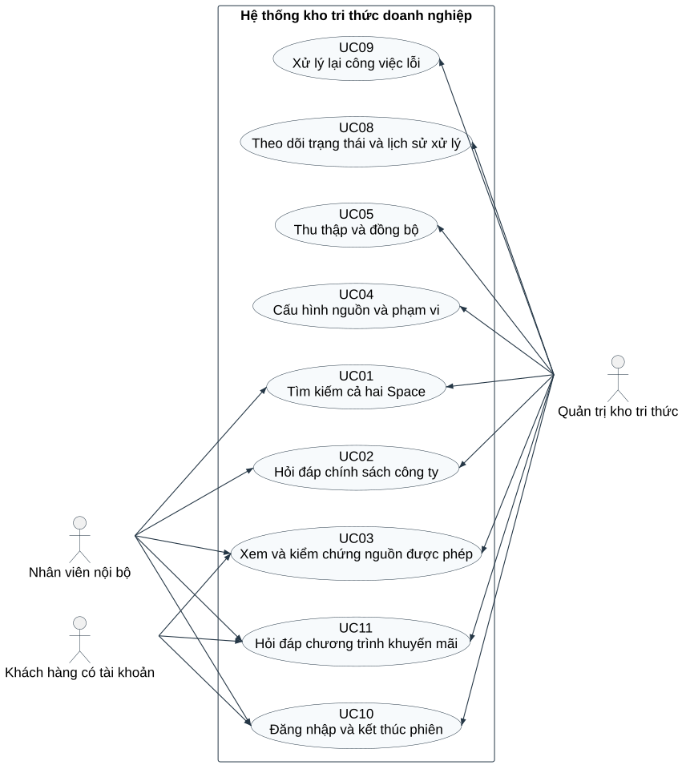
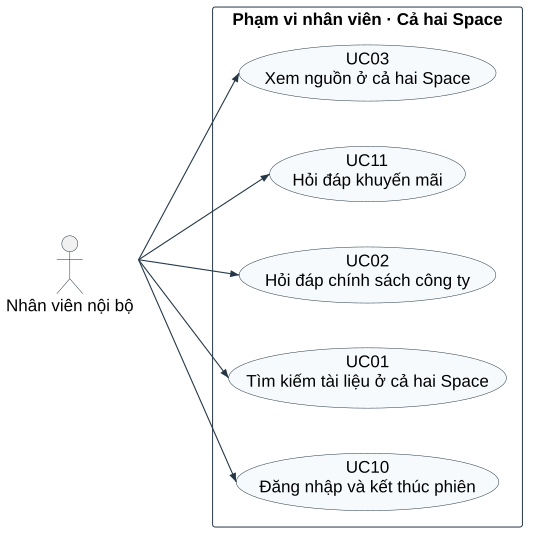
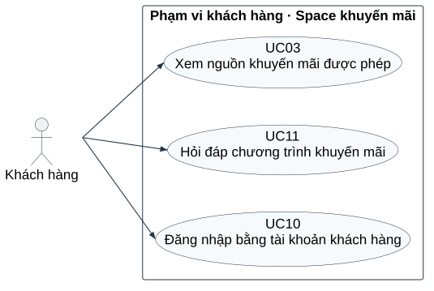
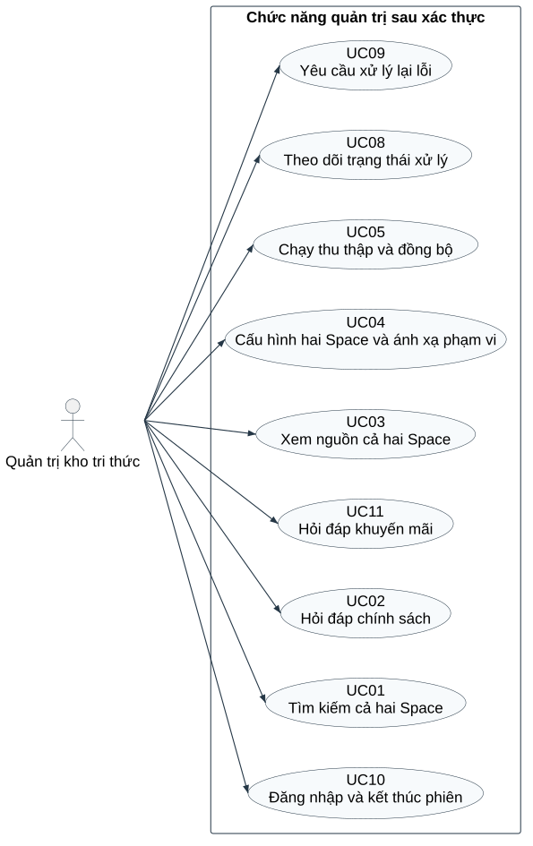
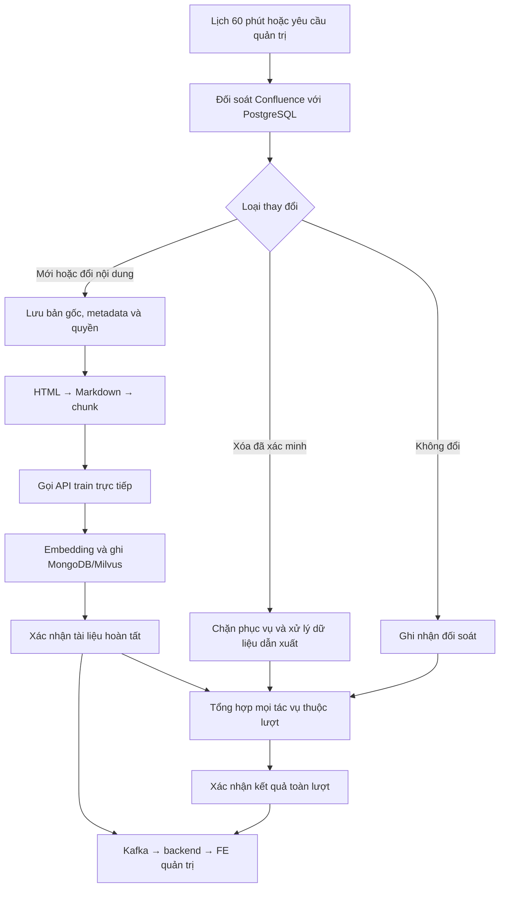

# Tài liệu đặc tả yêu cầu

| Thông tin | Nội dung |
| --- | --- |
| Đề tài | Nghiên cứu và xây dựng hệ thống kho tri thức doanh nghiệp thông minh từ Confluence |
| Học viên | Đặng Nam Cường |
| Loại tài liệu | Đặc tả yêu cầu phần mềm — Software Requirements Specification (SRS) |
| Phiên bản | 2.0 |
| Ngày cập nhật | 10/11/2026 |
| Trạng thái | Dự thảo để thẩm định |
| Tài liệu liên quan | [Thiết kế chung](../architecture/README.md), [Thiết kế chi tiết](../detailed-design/README.md) |

- **Mục đích:** xác định bài toán, phạm vi, quyền sử dụng, hành vi hệ thống và điều kiện nghiệm thu.
- **Đối tượng đọc:** giảng viên hướng dẫn, người thực hiện, người kiểm thử và người thẩm định.
- **Mức mô tả:** yêu cầu nghiệp vụ và phần mềm; schema, endpoint và thuật toán nằm trong tài liệu thiết kế.
- **Trạng thái triển khai:** theo [báo cáo tiến độ](../progress/README.md); yêu cầu trong SRS không tự xác nhận chức năng đã hoạt động.

## Mục lục

1. [Bài toán và lý do hình thành](#1-bài-toán-và-lý-do-hình-thành)
2. [Sản phẩm đầu ra](#2-sản-phẩm-đầu-ra)
3. [Phạm vi và ràng buộc](#3-phạm-vi-và-ràng-buộc)
4. [Người sử dụng và phân quyền](#4-người-sử-dụng-và-phân-quyền)
5. [Danh mục yêu cầu chức năng](#5-danh-mục-yêu-cầu-chức-năng)
6. [Sơ đồ Use Case](#6-sơ-đồ-use-case)
7. [Mô tả chi tiết các chức năng](#7-mô-tả-chi-tiết-các-chức-năng)
8. [Yêu cầu xử lý tự động](#8-yêu-cầu-xử-lý-tự-động)

<!--
9. [Quy tắc nghiệp vụ](#9-quy-tắc-nghiệp-vụ)
10. [Yêu cầu phi chức năng](#10-yêu-cầu-phi-chức-năng)
11. [Tiêu chí và kịch bản nghiệm thu](#11-tiêu-chí-và-kịch-bản-nghiệm-thu)
12. [Ma trận truy vết](#12-ma-trận-truy-vết)
13. [Quyết định còn mở](#13-quyết-định-còn-mở)
-->

14. [Thuật ngữ và tài liệu liên quan](#14-thuật-ngữ-và-tài-liệu-liên-quan)

## 1. Bài toán và lý do hình thành

### 1.1. Bối cảnh

- Doanh nghiệp lưu chính sách, quy trình và hướng dẫn trên Confluence.
- Nhân viên cần tra cứu quy định nội bộ và chương trình khuyến mãi.
- Khách hàng cần tìm hiểu ưu đãi, điều kiện và thời gian áp dụng.
- Tài liệu có phạm vi đọc khác nhau và được cập nhật thường xuyên.
- Môi trường thử nghiệm: tổ chức ngân hàng giả lập, dữ liệu do người thực hiện kiểm soát.

### 1.2. Vấn đề cần giải quyết

| Vấn đề | Khó khăn hiện tại | Kết quả mong muốn |
| --- | --- | --- |
| Quyền sử dụng tài liệu | Chính sách nội bộ chỉ dành cho nhân viên; thông tin khuyến mãi có thể cung cấp cho khách hàng | Mỗi người chỉ tìm kiếm, hỏi đáp và xem nguồn trong phạm vi được phép |
| Thời gian tra cứu | Người dùng phải tìm, đọc và tổng hợp nhiều trang; bộ phận hỗ trợ phải trả lời nhiều câu hỏi lặp lại | Hỏi đáp bằng tiếng Việt, giúp tìm thông tin nhanh và có nguồn để kiểm tra |

### 1.3. Phát biểu bài toán

- Xây dựng kho tri thức tự động cập nhật từ hai Space Confluence.
- Phát hiện và xử lý tài liệu thêm, sửa, xóa hoặc thay đổi phạm vi đọc.
- Cung cấp tìm kiếm và hỏi đáp RAG theo quyền tài khoản.
- Trả câu trả lời có bằng chứng và nguồn đối chiếu.
- Cho quản trị theo dõi tiến độ và nhận thông báo khi xử lý hoàn tất.

## 2. Sản phẩm đầu ra

| Sản phẩm | Nội dung cần có |
| --- | --- |
| Kho tri thức từ Confluence | Thu thập 100–300 trang thuộc hai Space; lưu bản gốc, thông tin nguồn, phiên bản và quyền đọc |
| Luồng cập nhật tự động | Kiểm tra thay đổi mỗi 60 phút; xử lý tài liệu thêm, sửa, xóa; chuyển HTML thành Markdown, chia đoạn và tạo vector để tra cứu |
| Ứng dụng hỏi đáp và tra cứu | Nhận câu hỏi tiếng Việt; trả lời theo quyền tài khoản, kèm trích dẫn và nguồn; hỗ trợ tìm kiếm cho nhân viên và quản trị |
| Giao diện quản trị | Cấu hình nguồn, chạy đồng bộ, xem trạng thái, xử lý lại và nhận thông báo hoàn tất |
| Mã nguồn và cấu hình chạy | FastAPI, Streamlit, pipeline xử lý, Docker Compose và cấu hình mẫu không chứa thông tin bí mật |
| Tài liệu bàn giao | Đặc tả yêu cầu, thiết kế chung, thiết kế chi tiết và hướng dẫn vận hành |
| Bộ kiểm thử và báo cáo đánh giá | Dữ liệu thử, bộ câu hỏi, kết quả kiểm thử, đánh giá chất lượng câu trả lời và thời gian xử lý |

## 3. Phạm vi và ràng buộc

### 3.1. Phạm vi xác định

| Nội dung | Yêu cầu |
| --- | --- |
| Nguồn | Một hệ thống Confluence Cloud Free |
| Không gian tài liệu | Hai Space: chính sách nội bộ và chương trình khuyến mãi |
| Bot | Một bot chung cho cả hai Space |
| Quy mô | Tổng 100–300 trang |
| Ngôn ngữ | Tài liệu và câu hỏi tiếng Việt |
| Định dạng | HTML đơn giản: tiêu đề, đoạn văn, heading, danh sách, bảng văn bản, liên kết, code block |
| Ảnh | Giữ tham chiếu ảnh; không trích xuất nội dung ảnh |
| Đồng bộ | Thu thập ban đầu; AUTO mỗi 60 phút; quản trị được kích hoạt thủ công |
| Phiên bản | Giữ các phiên bản hệ thống thực tế thu thập được |
| Khai thác | Hỏi đáp theo quyền; tìm kiếm độc lập cho nhân viên/quản trị; xem nguồn trong ứng dụng |
| Vận hành | Cấu hình nguồn, xem trạng thái, nhận thông báo và xử lý lại thủ công |

### 3.2. Ràng buộc kỹ thuật

| Nhóm | Thành phần và ràng buộc |
| --- | --- |
| Hạ tầng | Docker Compose; máy 32 GB RAM; không GPU |
| Lập lịch | Airflow; lịch 60 phút khi hệ thống hoạt động |
| Đối soát | PostgreSQL nghiệp vụ; tách PostgreSQL metadata Airflow |
| Lưu trữ | MongoDB, MinIO local, Milvus Standalone local và Attu |
| Điều phối train | Gọi API trực tiếp sau chuẩn bị/chunk |
| Thông báo | Kafka → backend → Frontend quản trị |
| AI | Cloudflare Workers AI cho embedding/LLM; quota miễn phí; không tự chuyển trả phí |
| Ứng dụng | FastAPI, Streamlit, chunking tùy chỉnh |
| Hỗ trợ runtime | Redis theo dependency sử dụng; Langfuse theo chính sách dữ liệu được phép |

- MongoDB thử nghiệm dùng Atlas theo cấu hình môi trường.
- Thu thập và đối soát sử dụng PostgreSQL; dữ liệu phục vụ ứng dụng/RAG sử dụng MongoDB và Milvus.
- Schema, contract và cấu hình vật lý được quy định trong [thiết kế chi tiết](../detailed-design/README.md).

## 4. Người sử dụng và phân quyền

### 4.1. Tác nhân

| Mã | Tác nhân | Mục tiêu |
| --- | --- | --- |
| A01 | Nhân viên nội bộ | Tìm kiếm, hỏi đáp và kiểm chứng cả hai Space |
| A02 | Khách hàng có tài khoản | Hỏi đáp và xem nguồn khuyến mãi |
| A03 | Quản trị kho tri thức | Khai thác tri thức và vận hành hệ thống |

- Tài khoản dịch vụ nguồn tách biệt với danh tính người dùng ứng dụng.

### 4.2. Ma trận quyền chức năng

| Chức năng | Nhân viên | Khách hàng | Quản trị |
| --- | --- | --- | --- |
| UC10 — Đăng nhập/đăng xuất | Có | Có | Có |
| UC01 — Tìm kiếm tài liệu | Cả hai Space | Không | Cả hai Space |
| UC02 — Hỏi đáp chính sách | Có | Không | Có |
| UC11 — Hỏi đáp khuyến mãi | Có | Có | Có |
| UC03 — Xem nguồn | Cả hai Space | Chỉ khuyến mãi | Cả hai Space |
| UC04 — Cấu hình nguồn | Không | Không | Có |
| UC05 — Đồng bộ thủ công | Không | Không | Có |
| UC08 — Trạng thái/thông báo vận hành | Không | Không | Có |
| UC09 — Xử lý lại thủ công | Không | Không | Có |

### 4.3. Quyền đọc theo Space

| Vai trò ứng dụng | Quyền đọc | Phạm vi |
| --- | --- | --- |
| Nhân viên | INTERNAL | Chính sách và khuyến mãi |
| Khách hàng | CUSTOMER | Khuyến mãi |
| Quản trị | Được cấp quyền đọc cả kho | Cả hai Space, kèm quyền vận hành riêng |

- Space chính sách: cấp INTERNAL.
- Space khuyến mãi: cấp INTERNAL và CUSTOMER.
- Mỗi trang nhận danh sách quyền của Space chứa trang đó.
- Cho phép đọc khi quyền người dùng giao với quyền tài liệu và chính sách Space hiện hành.
- Thiếu ánh xạ hoặc danh sách quyền rỗng: không cấp quyền đọc.
- Chuyển Space hoặc đổi ánh xạ quyền: cập nhật quyền tài liệu, kể cả khi nội dung không đổi.

### 4.4. Nguyên tắc kiểm soát truy cập

- Backend xác định vai trò từ tài khoản đã xác thực.
- Role/Space gửi trong request hoặc câu hỏi không tự cấp quyền.
- Kiểm tra quyền tại API, retrieval, context AI, nguồn và cache nếu dùng.
- Nội dung ngoài quyền không được gửi tới LLM hoặc reranker.
- Trạng thái/thông báo vận hành chỉ dành cho quản trị.
- Không trả token nguồn hoặc URL lưu trữ có thể bỏ qua authorization.

## 5. Danh mục yêu cầu chức năng

| Mã | Yêu cầu | Kết quả quan sát được |
| --- | --- | --- |
| FR01 | Cấu hình nguồn và quyền Space | Một bot, hai Space hợp lệ, ánh xạ quyền rõ ràng |
| FR02 | Thu thập ban đầu | Trang hợp lệ có bản gốc, định danh nguồn và phiên bản |
| FR03 | Đồng bộ định kỳ/thủ công | Lịch 60 phút; quản trị được chạy thủ công; không chạy chồng cùng nguồn |
| FR04 | Đối soát gia tăng bằng PostgreSQL | Phân loại nội dung/metadata/parent/quyền/xóa; không embedding lại khi body không đổi |
| FR05 | Truy vết phiên bản và nguồn | Xác định được phiên bản thu thập, nội dung được xử lý và nguồn câu trả lời |
| FR06 | Kích hoạt train bằng API trực tiếp | Tài liệu chunk-ready được gửi train; phân biệt tiếp nhận với hoàn tất job |
| FR07 | Chuẩn hóa và lập chỉ mục | HTML → Markdown → chunk → embedding → ghi MongoDB/Milvus thành công |
| FR09 | Tìm kiếm/hỏi đáp có căn cứ | Kết quả đúng phạm vi, có bằng chứng và trích dẫn kiểm chứng được |
| FR12 | Truy vết và đo lường | Liên hệ lượt ingestion, tài liệu, job train và thông báo; có số đo phục vụ đánh giá |
| FR14 | Phân quyền xuyên suốt dữ liệu | Quyền từ Space được áp dụng tại tài liệu, retrieval, context và nguồn |
| FR15 | Thông báo hoàn tất qua Kafka | Sau train thành công, backend nhận kết quả và cập nhật FE quản trị |

## 6. Sơ đồ Use Case

- Use Case mô tả mục tiêu thao tác của người sử dụng.
- Tác nhân dùng hình người; chức năng dùng hình elip trong ranh giới hệ thống.
- Mũi tên thể hiện quan hệ sử dụng; thứ tự xử lý nằm trong bảng luồng.
- Chuẩn hóa, lập chỉ mục và vô hiệu hóa là xử lý nội bộ tại mục 8.

### 6.1. Tổng quan tác nhân và các chức năng

### 6.2. Nhân viên nội bộ

### 6.3. Khách hàng có tài khoản

### 6.4. Quản trị kho tri thức

- Mã nguồn sơ đồ và cách xuất hình: [tài nguyên Use Case](use-cases/README.md).

## 7. Mô tả chi tiết các chức năng

### 7.1. UC10 — Đăng nhập và đăng xuất

| Thuộc tính | Đặc tả |
| --- | --- |
| Mục tiêu | Xác định danh tính, quyền sử dụng và kết thúc phiên |
| Tác nhân | Nhân viên, khách hàng, quản trị |
| Tiền điều kiện | Có tài khoản được cấp; cơ chế xác thực đã cấu hình |
| Đầu vào | Thông tin đăng nhập theo cơ chế xác thực được chọn |
| Kích hoạt | Chọn Đăng nhập hoặc Đăng xuất |
| Hậu điều kiện | Có phiên đúng vai trò hoặc phiên đã kết thúc |

| Bước | Người dùng | Hệ thống |
| --- | --- | --- |
| 1 | Cung cấp thông tin đăng nhập | Xác minh tài khoản và tình trạng được phép sử dụng |
| 2 | Truy cập ứng dụng | Xác định vai trò và cho phép đúng chức năng |
| 3 | Chọn Đăng xuất | Kết thúc phiên, xóa trạng thái đăng nhập UI và từ chối dùng lại phiên đã kết thúc |

### 7.2. UC01 — Tìm kiếm tài liệu

| Thuộc tính | Đặc tả |
| --- | --- |
| Mục tiêu | Tìm tài liệu/đoạn liên quan, không bắt buộc sinh đáp án tổng hợp |
| Tác nhân | Nhân viên, quản trị |
| Tiền điều kiện | Phiên hợp lệ; được khai thác kho tri thức |
| Đầu vào | Truy vấn tiếng Việt |
| Kích hoạt | Chọn Tìm kiếm |
| Đầu ra | Kết quả gồm tiêu đề, đoạn trích, phiên bản và tham chiếu nguồn |

| Bước | Hệ thống |
| --- | --- |
| 1 | Kiểm tra phiên, quyền chức năng và truy vấn |
| 2 | Tìm nội dung liên quan và lọc tài liệu theo quyền/trạng thái |
| 3 | Hiển thị danh sách kết quả hợp lệ |
| 4 | Thực hiện UC03 khi người dùng chọn nguồn |

### 7.3. UC02 — Hỏi đáp chính sách công ty

| Thuộc tính | Đặc tả |
| --- | --- |
| Mục tiêu | Giải thích chính sách/quy trình bằng bằng chứng trong kho |
| Tác nhân | Nhân viên, quản trị |
| Tiền điều kiện | Phiên hợp lệ và quyền đọc chính sách |
| Đầu vào | Câu hỏi tiếng Việt |
| Kích hoạt | Gửi câu hỏi |
| Đầu ra | Câu trả lời kèm trích dẫn hoặc trạng thái thiếu căn cứ/lỗi phù hợp |

| Bước | Hệ thống |
| --- | --- |
| 1 | Kiểm tra phiên, quyền và câu hỏi |
| 2 | Truy xuất bằng chứng hợp lệ theo phạm vi được cấp |
| 3 | Tạo context và sinh đáp án từ bằng chứng |
| 4 | Kiểm tra nguồn, trả câu trả lời và trích dẫn |
| 5 | Thực hiện UC03 khi người dùng xem nguồn |

- Không bắt buộc thực hiện UC01 trước khi hỏi.
- Không thêm điều kiện, số liệu hoặc ngoại lệ không có nguồn hỗ trợ.

### 7.4. UC11 — Hỏi đáp chương trình khuyến mãi

| Thuộc tính | Đặc tả |
| --- | --- |
| Mục tiêu | Giải thích ưu đãi, điều kiện, ngoại lệ và thời gian áp dụng |
| Tác nhân | Khách hàng, nhân viên, quản trị |
| Tiền điều kiện | Phiên hợp lệ và quyền đọc khuyến mãi |
| Đầu vào | Câu hỏi về chương trình khuyến mãi |
| Kích hoạt | Gửi câu hỏi |
| Đầu ra | Đáp án/nguồn thuộc phạm vi khuyến mãi hoặc phản hồi giới hạn |

| Bước | Hệ thống |
| --- | --- |
| 1 | Xác thực và xác định quyền tài khoản |
| 2 | Truy xuất bằng chứng khuyến mãi được phép |
| 3 | Sinh đáp án, nêu thời hạn/điều kiện khi nguồn có |
| 4 | Trả lời kèm nguồn kiểm chứng |

- Không xác nhận ưu đãi cá nhân khi thiếu dữ liệu/logic nghiệp vụ.
- Tài liệu đang trong index không tự chứng minh chương trình còn hiệu lực.

### 7.5. UC03 — Xem và kiểm chứng nguồn

| Thuộc tính | Đặc tả |
| --- | --- |
| Mục tiêu | Đối chiếu kết quả với đoạn tài liệu được sử dụng |
| Tác nhân | Cả ba vai trò, trong phạm vi được cấp |
| Tiền điều kiện | Phiên hợp lệ; có tham chiếu nguồn |
| Đầu vào | Tham chiếu tài liệu/đoạn và phiên bản từ kết quả |
| Kích hoạt | Chọn nguồn |
| Đầu ra | Tiêu đề, đoạn nguồn/vị trí, phiên bản và thời điểm thu thập |

| Bước | Hệ thống |
| --- | --- |
| 1 | Kiểm tra lại phiên, quyền và trạng thái nguồn |
| 2 | Xác minh tài liệu/đoạn/phiên bản tương ứng |
| 3 | Hiển thị đoạn nguồn và metadata được phép |
| 4 | Cung cấp liên kết ngoài nếu phù hợp quyền |

- URL Confluence có thể mở phiên bản khác với phiên bản đã dùng; UI phải phân biệt.
- Không yêu cầu UI xem mọi bản HTML lịch sử.
- Độ đúng của trích dẫn được đánh giá theo mục 11.

### 7.6. UC04 — Cấu hình nguồn và phạm vi

| Thuộc tính | Đặc tả |
| --- | --- |
| Mục tiêu | Xác định nguồn Confluence, hai Space và quyền khai thác |
| Tác nhân | Quản trị; Confluence hỗ trợ kiểm tra nguồn |
| Tiền điều kiện | Phiên quản trị; có thông tin nguồn và Space thử nghiệm |
| Đầu vào | Địa chỉ nguồn, tham chiếu xác thực, hai Space và ánh xạ quyền |
| Kích hoạt | Tạo/cập nhật cấu hình |
| Hậu điều kiện | Cấu hình có kết quả validation và phạm vi quyền rõ ràng |

| Bước | Hệ thống |
| --- | --- |
| 1 | Kiểm tra quyền quản trị và thông tin cấu hình |
| 2 | Kiểm tra kết nối, khả năng đọc nguồn và hai Space |
| 3 | Kiểm tra ánh xạ quyền của từng Space |
| 4 | Lưu cấu hình hợp lệ; cập nhật quyền tài liệu bị ảnh hưởng |
| 5 | Trả kết quả và tình trạng áp dụng |

- Không hiển thị nguyên văn secret khi đọc cấu hình hoặc trong log.
- Lịch cốt lõi là 60 phút; không yêu cầu tùy chỉnh mọi biểu thức lịch.
- Hình thức giao diện quản trị được xác định tại Q03.

### 7.7. UC05 — Yêu cầu đồng bộ và cập nhật kho tri thức

| Thuộc tính | Đặc tả |
| --- | --- |
| Mục tiêu | Cập nhật tri thức theo thay đổi nguồn và xác định dữ liệu sẵn sàng hỏi đáp |
| Tác nhân | Quản trị khi chạy thủ công; lịch hệ thống khi chạy tự động |
| Tiền điều kiện | Nguồn, quyền và kho dữ liệu hợp lệ; các dịch vụ cần thiết sẵn sàng |
| Đầu vào | Phạm vi nguồn đã cấu hình và loại khởi chạy |
| Kích hoạt | Đến kỳ 60 phút hoặc quản trị chọn Đồng bộ |
| Hậu điều kiện | Có kết quả đối soát, xử lý và thông báo gắn đúng lượt |

| Bước | Hệ thống |
| --- | --- |
| 1 | Kiểm tra điều kiện và mở lượt xử lý |
| 2 | Đối soát Confluence với dữ liệu đã lưu trong PostgreSQL |
| 3 | Phân loại trang mới, đổi nội dung, metadata/quyền, xóa hoặc không đổi |
| 4 | Lưu bản gốc, cập nhật metadata/quyền; chuẩn bị/chunk nội dung cần xử lý |
| 5 | Gọi API train trực tiếp khi tài liệu đủ điều kiện |
| 6 | Xác nhận embedding và ghi MongoDB/Milvus thành công |
| 7 | Phát kết quả qua Kafka, backend cập nhật FE quản trị |

- Thu thập ban đầu phải được thực hiện trước khi vận hành AUTO định kỳ.
- Mốc hoàn thành được quy định tập trung tại mục 8.4.

### 7.8. UC08 — Theo dõi trạng thái và nhận thông báo

| Thuộc tính | Đặc tả |
| --- | --- |
| Mục tiêu | Biết tiến độ và kết quả thực tế của tài liệu/lượt đồng bộ |
| Tác nhân | Quản trị |
| Tiền điều kiện | Quản trị đã đăng nhập; hệ thống đọc được trạng thái; broker và backend thông báo đang hoạt động |
| Đầu vào | Tham chiếu lượt/tài liệu hoặc kết quả được backend tiếp nhận |
| Kích hoạt | Mở màn hình trạng thái hoặc nhận kết quả xử lý |
| Đầu ra | Giai đoạn, định danh, thời gian, phiên bản, số lượng và lỗi được ghi nhận |

| Bước | Hệ thống |
| --- | --- |
| 1 | Kiểm tra quyền quản trị |
| 2 | Hiển thị trạng thái lượt/tài liệu theo từng giai đoạn |
| 3 | Nhận kết quả Kafka tại backend và xác minh phạm vi người nhận |
| 4 | Cập nhật trạng thái/thông báo trên giao diện |

- Phân biệt kết quả từng tài liệu và toàn lượt theo mục 8.4.
- Nhân viên/khách hàng không được đăng ký hoặc xem kênh thông báo vận hành.

### 7.9. UC09 — Yêu cầu xử lý lại thủ công

| Thuộc tính | Đặc tả |
| --- | --- |
| Mục tiêu | Chủ động xử lý lại công việc đủ điều kiện |
| Tác nhân | Quản trị |
| Tiền điều kiện | Công việc tồn tại; không có xử lý trùng đang chạy; nguồn/quyền/đầu vào hợp lệ |
| Đầu vào | Tham chiếu công việc/tài liệu cần xử lý lại |
| Kích hoạt | Chọn Xử lý lại |
| Hậu điều kiện | Có kết quả tiếp nhận hoặc lý do từ chối, gắn đúng công việc |

| Bước | Hệ thống |
| --- | --- |
| 1 | Kiểm tra quyền và điều kiện xử lý lại |
| 2 | Tiếp nhận công việc hợp lệ |
| 3 | Thực hiện các bước cần thiết theo đầu vào hiện hành |
| 4 | Ghi kết quả và thông báo theo điều kiện hoàn thành |

- UC09 là thao tác thủ công, không cam kết tự phục hồi transaction ghi dở hoặc rollback nhiều kho.

## 8. Yêu cầu xử lý tự động

### 8.1. Đối soát và trách nhiệm dữ liệu

| Nhóm dữ liệu | Yêu cầu |
| --- | --- |
| Snapshot PostgreSQL | Giữ nội dung/hash/phiên bản và metadata làm căn cứ so sánh với Confluence |
| Lượt ingestion PostgreSQL | Ghi nhận trạng thái, thời điểm và kết quả thu thập |
| MongoDB | Giữ cấu hình, quyền, metadata/trạng thái tài liệu và nội dung phục vụ truy xuất |
| MinIO | Giữ bản gốc theo phiên bản thực tế thu thập |
| Milvus | Giữ vector và liên kết về đoạn/tài liệu |
| Metadata Airflow | Theo dõi DAG/task/runtime, tách dữ liệu nghiệp vụ |

- Đối soát nội dung bằng hash; metadata, parent, Space và quyền kiểm tra riêng.
- Hash không thay thế nội dung văn bản hoặc thể hiện mức tương đồng ngữ nghĩa.
- Snapshot hiện hành không tự đại diện cho lịch sử mọi phiên bản.
- Nội dung không đổi: không embedding lại chỉ vì metadata/quyền thay đổi.

### 8.2. Luồng cập nhật tổng thể

| Bước | Yêu cầu |
| --- | --- |
| 1 | Kiểm tra nguồn, phạm vi và quyền trước khi thu thập |
| 2 | Đối soát trang/metadata/nội dung với snapshot PostgreSQL |
| 3 | Ghi nguồn và thực hiện tác vụ tương ứng với loại thay đổi |
| 4 | Chuẩn bị/chunk tài liệu cần xử lý nội dung |
| 5 | Gọi API train trực tiếp và theo dõi kết quả job thực tế |
| 6 | Xác nhận hoàn tất và phát thông báo theo đúng phạm vi tài liệu/lượt |

### 8.3. Chuẩn hóa và lập chỉ mục

| Thuộc tính | Yêu cầu |
| --- | --- |
| Đầu vào | Bản gốc, định danh/phiên bản nguồn và quyền Space hợp lệ |
| Chuẩn hóa | HTML đơn giản → Markdown; giữ tham chiếu ảnh |
| Chunking | Đoạn có thứ tự, ngữ cảnh và liên kết về tài liệu |
| Train/index | Tạo embedding, ghi nội dung truy xuất và vector |
| Quyền | Bảo toàn quyền tài liệu qua các bước xử lý |
| Sẵn sàng | Các dữ liệu bắt buộc đã ghi thành công; không dùng tập đoạn đang xử lý dở |
| Ngoại lệ | Đầu vào/xử lý không hợp lệ có lỗi rõ ràng; không công bố thành công |

- Không cam kết thay chỉ mục nguyên tử nhiều kho hoặc luôn phục vụ phiên bản trước trong thời gian cập nhật.
- “Train” trong đặc tả là embedding/lập chỉ mục, không huấn luyện lại trọng số LLM.

### 8.4. Trạng thái nghiệp vụ và mốc hoàn thành

| Mốc | Điều kiện xác nhận | Ý nghĩa |
| --- | --- | --- |
| Tiếp nhận | Yêu cầu hợp lệ có định danh | Chưa xác nhận xử lý hoàn tất |
| Thu thập/đối soát xong | Dữ liệu nguồn và kết quả thay đổi đã ghi nhận | Chưa xác nhận có chỉ mục mới |
| Chuẩn bị xong | Markdown/chunk cần thiết đã ghi hợp lệ | Đủ điều kiện yêu cầu train |
| Đang train | Job đang tạo embedding/ghi dữ liệu | Chưa được thông báo thành công |
| Tài liệu hoàn tất | Embedding và dữ liệu MongoDB/Milvus cần thiết đã ghi thành công; kết quả train được xác nhận | Tài liệu đủ điều kiện phục vụ nếu quyền/trạng thái nguồn hợp lệ |
| Toàn lượt hoàn tất | Mọi tài liệu và tác vụ metadata/quyền/xóa cần thiết đã xong | Được công bố hoàn tất lượt |
| Đã thông báo | Backend tiếp nhận kết quả và cập nhật FE khi broker và backend đang hoạt động | Kết quả đã được hiển thị, tách mốc ghi dữ liệu |
| Không thay đổi | Đối soát xong, không cần train | Không phải một job embedding đã chạy |
| Lỗi được ghi nhận | Xác định được giai đoạn/nguyên nhân phù hợp | Không công bố thành công sai |

- Các nhãn trên là trạng thái nghiệp vụ; ánh xạ vật lý thuộc thiết kế chi tiết.
- HTTP tiếp nhận API không chứng minh train đã hoàn tất.
- Một tài liệu hoàn tất không chứng minh toàn bộ lượt hoàn tất.
- Trạng thái thông báo không thay thế điều kiện dữ liệu sẵn sàng.

### 8.5. Xóa và thay đổi phạm vi

- Chỉ kết luận xóa/thu hồi khi có đủ căn cứ nguồn.
- Trang đã xác minh xóa/ra ngoài phạm vi: chặn khai thác trước khi dọn chỉ mục.
- Lỗi mạng hoặc phân trang chưa đầy đủ: không suy thành xóa hàng loạt.
- Chuyển Space/đổi quyền: áp quyền hiện hành dù hash nội dung không đổi.
- Bản gốc lưu lịch sử vẫn phải được kiểm soát truy cập.

### 8.6. Thông báo kết quả

| Thuộc tính | Yêu cầu |
| --- | --- |
| Điều kiện phát thành công | Kết quả train hoặc toàn lượt đã được xác nhận theo mục 8.4 |
| Giao tiếp | Kafka → backend → FE; trình duyệt không kết nối broker trực tiếp |
| Nội dung | Định danh lượt/tài liệu/job, loại kết quả, thời điểm và metadata vận hành cần thiết |
| Người nhận | Quản trị đã xác thực và có quyền |
| Bảo mật | Không gửi toàn văn tài liệu, token hoặc secret trong thông báo |
| Không có nội dung cần train | Thông báo kết quả đối soát phù hợp; không giả lập embedding thành công |

### 8.7. Luồng hỏi đáp RAG

1. Xác thực tài khoản và xác định quyền đọc phía backend.
2. Truy xuất các đoạn/node liên quan.
3. Kiểm tra tài liệu nguồn: bot, Space, quyền và trạng thái được phép dùng.
4. Tạo context chỉ từ bằng chứng hợp lệ.
5. Gọi LLM sinh câu trả lời có căn cứ.
6. Kiểm tra nguồn và trả đáp án/trích dẫn.

- Mọi đường truy xuất, tool đọc tài liệu và cache nếu dùng phải tuân cùng quyền.
- Câu hỏi không làm thay đổi trạng thái train của tài liệu.
- Không đủ bằng chứng: trả giới hạn phù hợp; lỗi AI/truy xuất: trả tình trạng chưa thể xử lý.

<!--
## 9. Quy tắc nghiệp vụ

| Mã | Quy tắc |
| --- | --- |
| BR01 | Một bot, hai Space hợp lệ; thiếu ánh xạ quyền thì không phục vụ |
| BR02 | INTERNAL đọc cả hai Space; CUSTOMER chỉ khuyến mãi; quyền vận hành tách riêng |
| BR03 | Tài khoản nguồn tách danh tính người dùng; không tiết lộ secret |
| BR04 | Phiên bản gắn đúng nội dung thực tế thu thập |
| BR05 | Chỉ dữ liệu hoàn chỉnh và được phép đọc mới tham gia khai thác |
| BR06 | API trực tiếp kích hoạt train sau chunk; Kafka thông báo kết quả |
| BR07 | Xóa/thu hồi đã xác minh phải chặn retrieval và nguồn |
| BR08 | Lỗi đọc nguồn không tự biến thành xóa tài liệu hoặc thành công đồng bộ |
| BR09 | Thiếu bằng chứng không được bịa đáp án; lỗi dịch vụ khác thiếu dữ liệu |
| BR10 | Trích dẫn phải thực sự hỗ trợ câu trả lời và đúng phạm vi/phiên bản |
| BR11 | Prompt injection không thay đổi quyền, secret hoặc quy tắc hệ thống |
| BR12 | Tài liệu khuyến mãi có trong index không chứng minh ưu đãi còn hiệu lực |
| BR13 | ACL kế thừa Space áp dụng xuyên suốt API, context, nguồn và cache |
| BR14 | Không tự nâng gói hoặc chuyển dịch vụ trả phí khi hết quota |
| BR15 | Tiếp nhận HTTP, kết thúc ingestion, hoàn tất train và thông báo là các mốc riêng |
| BR16 | Chỉ phát thành công sau embedding và ghi dữ liệu bắt buộc thành công |
| BR17 | Dữ liệu đối soát/lượt ingestion dùng PostgreSQL; tách metadata Airflow |
| BR18 | Chỉ metadata/quyền đổi không bắt buộc embedding lại nội dung |
| BR19 | Kết quả một tài liệu không thay thế kết quả toàn lượt |

## 10. Yêu cầu phi chức năng

| Mã | Nhóm | Yêu cầu | Cách kiểm chứng |
| --- | --- | --- | --- |
| NFR01 | Nhất quán phục vụ | Không dùng nội dung đang xử lý dở hoặc ngoài quyền | Kiểm tra truy xuất trong chuỗi cập nhật tuần tự |
| NFR02 | Kiểm soát chạy chồng | Không có hai lượt cùng nguồn chạy đồng thời | Gửi yêu cầu khi một lượt đang chạy |
| NFR03 | Chẩn đoán | Lỗi có thông tin phù hợp; hỗ trợ thao tác thủ công UC09 | Kiểm tra lỗi và yêu cầu xử lý lại hợp lệ |
| NFR04 | Lưu bền vững | Dữ liệu đã ghi xác nhận còn sau restart có volume | Đối chiếu dữ liệu trước/sau restart |
| NFR05 | Minh bạch độ mới | Có phiên bản, thời điểm thu thập và trạng thái xử lý | Đối chiếu nguồn, dữ liệu và UI |
| NFR06 | Tài nguyên | Hoạt động trong môi trường 32 GB RAM, không GPU | Đo RAM/CPU toàn stack dưới tải thử |
| NFR07 | Quota | Giới hạn tải phù hợp gói miễn phí, không thành công giả hoặc tăng phí | Kiểm tra cấu hình và phản hồi quota |
| NFR08 | Bảo mật | Authorization phía server; không lộ secret; chỉ context hợp lệ gửi AI | Kiểm thử quyền và kiểm tra log/response |
| NFR09 | Quan sát | Truy vết ingestion, tài liệu, train và thông báo | Theo định danh qua các giai đoạn |
| NFR10 | Tái lập | Ghi phần mềm/model/cấu hình, snapshot và điều kiện thử | Thực hiện lại trên cấu hình đã ghi nhận |
| NFR11 | Dễ sử dụng | UI tiếng Việt; trạng thái rõ; không yêu cầu hiểu hạ tầng | Review chức năng và thử tác vụ người dùng |
| NFR12 | Hiệu năng | Đo độ trễ RAG, xử lý và thông báo; công bố tải/mạng/quota | Bộ đo theo mục 11.3 |
| NFR13 | Chất lượng AI | Đánh giá đúng/đủ, grounding, citation và thiếu dữ liệu | Bộ chuẩn và chấm thủ công |

- NFR04 không cam kết chống hỏng ổ đĩa hoặc tự tiếp tục công việc đang chạy.
- Ngưỡng hiệu năng và chất lượng cần chốt tại Q04 trước nghiệm thu định lượng.

## 11. Tiêu chí và kịch bản nghiệm thu

### 11.1. Nguyên tắc

- Dùng dữ liệu được phép sử dụng, đủ hai Space và tài khoản đại diện ba vai trò.
- Mỗi ca có đầu vào, điều kiện, kết quả mong đợi/thực tế, định danh và minh chứng.
- Phân biệt kiểm thử giả lập với kiểm thử Confluence/AI/Kafka thực.
- Hoàn thành setup hạ tầng không thay bằng chứng chạy chức năng.
- Phản hồi input sai/lỗi dịch vụ vẫn phải được kiểm tra.

### 11.2. Ma trận nghiệm thu

| Mã | Tình huống | Điều kiện đạt |
| --- | --- | --- |
| AC01 | Đăng nhập hợp lệ, sai và lỗi xác thực | Tài khoản hợp lệ có đúng quyền; sai/lỗi không được cấp quyền mặc định |
| AC02 | Chưa đăng nhập, hết hạn, đăng xuất, gọi API/nguồn trực tiếp | Không truy cập được chức năng/dữ liệu cần xác thực |
| AC03 | Nhân viên/khách hàng gọi vận hành hoặc đăng ký thông báo quản trị | Bị từ chối; quản trị được phép đúng điều kiện |
| AC04 | Nhân viên/quản trị tìm kiếm cả hai Space | Kết quả đúng quyền và có nguồn hợp lệ |
| AC05 | Hỏi chính sách có bằng chứng | Đáp án bám nguồn; không bắt buộc tìm kiếm trước |
| AC06 | Ba vai trò hỏi khuyến mãi | Đúng phạm vi; nêu điều kiện/thời hạn; không suy diễn ưu đãi cá nhân |
| AC07 | Xem nguồn; sửa ID sang nguồn ngoài quyền | Chỉ nguồn được phép được hiển thị; khách hàng không cần tài khoản Confluence |
| AC08 | Câu ngoài dữ liệu, mơ hồ hoặc prompt injection | Phản hồi giới hạn phù hợp; không bịa nguồn/vượt quyền |
| AC09 | Cấu hình bot/Space/quyền hợp lệ và không hợp lệ | Ánh xạ đúng; secret không lộ; quyền thiếu/rỗng/khác bot không cấp quyền |
| AC10 | Thu thập đầu, AUTO 60 phút, chạy thủ công khi đang xử lý | Đủ phạm vi; lịch đúng điều kiện; không chạy chồng |
| AC11 | Trang mới, body đổi, chỉ metadata/parent đổi, không đổi | Đối soát đúng; chỉ nội dung cần thiết được train |
| AC12 | Train trước chunk, input sai hoặc đang chạy | Phản hồi/từ chối đúng; không tạo xử lý chồng hoặc thành công giả |
| AC13 | Dịch vụ trả lỗi hoặc thiếu quota | Không công bố thành công; lỗi rõ; không tự chuyển trả phí |
| AC14 | API tiếp nhận, job còn chạy, sau đó train thành công | Không thông báo thành công sớm; chỉ hoàn tất sau các bước ghi bắt buộc |
| AC15 | Train thành công khi broker/backend hoạt động | Kafka có kết quả; backend/FE quản trị hiển thị đúng định danh và kết quả |
| AC16 | Xóa, chuyển Space, đổi quyền khi body không đổi | Tài liệu xóa bị chặn; quyền hiện hành có hiệu lực ở mọi đường đọc |
| AC17 | Khách hàng tự gửi role/Space hoặc đoán ID | Không có nội bộ trong context/đáp án/metadata/nguồn; nhân viên đọc được hai Space |
| AC18 | Xem trạng thái và xử lý lại thủ công | Đúng quyền; thấy kết quả/giai đoạn; yêu cầu đủ điều kiện được xử lý |
| AC19 | Restart kho sau công việc hoàn tất | Snapshot, nội dung, raw và vector đã xác nhận vẫn tồn tại |
| AC20 | Thu thập thiếu do lỗi phân trang/kết nối | Không xóa hàng loạt hoặc báo hoàn tất sai; có lỗi phù hợp |
| AC21 | Lượt nhiều tài liệu hoặc chỉ metadata/quyền/xóa/không đổi | Tổng hợp đúng mọi tác vụ; không nhầm một tài liệu xong với toàn lượt hoặc giả lập embedding |

### 11.3. Đánh giá chất lượng và hiệu quả — đề xuất

| Hạng mục | Kế hoạch đề xuất |
| --- | --- |
| Kho dữ liệu | 100–300 trang thuộc hai Space |
| Bộ câu hỏi | 80 câu: 40 trực tiếp, 15 tổng hợp nhiều đoạn/trang, 15 thiếu dữ liệu, 10 đổi đáp án theo phiên bản |
| Chia tập | 20 câu phát triển/pilot, 60 câu đánh giá độc lập; phân bổ đại diện các nhóm và vai trò |
| Dữ liệu chuẩn | Câu hỏi, quyền, phạm vi, đáp án/khả năng trả lời, tài liệu/phiên bản và đoạn bằng chứng |
| Thay đổi kiểm soát | 20 trang có lịch sửa tuần tự, xóa, khôi phục hợp lệ và chuyển phạm vi |
| Chấm thủ công | Đúng nội dung, đủ điều kiện, grounding và trích dẫn hỗ trợ khẳng định |
| Hiệu quả tác vụ | So thời gian/tỷ lệ hoàn thành với tra cứu thủ công; ghi người tham gia và kinh nghiệm |
| Tải pilot | 1–3 người truy vấn đồng thời; concurrency lập chỉ mục phù hợp quota/RAM |
| Ngân sách RAM container | Đề xuất 20 GiB; xác nhận bằng đo thực tế trên máy 32 GB RAM |
| Hiệu năng | Độ trễ truy xuất/đáp án, thời gian đồng bộ/lập chỉ mục/thông báo, RAM/CPU và điều kiện mạng/quota |

- Chỉ số báo cáo: truy xuất bằng chứng top-k, tỷ lệ trả lời đúng/đủ, độ chính xác trích dẫn, xử lý thiếu dữ liệu và độ trễ.
- Cố định snapshot, công thức, thang chấm và ngưỡng sau pilot, trước khi chạy tập đánh giá độc lập.
- Không điều chỉnh tham số dựa vào tập đánh giá độc lập.
- Không dùng điểm LLM tự chấm làm bằng chứng duy nhất.
- Hạn chế hiệu ứng người tham gia đã biết đáp án khi so sánh hai cách tra cứu.

### 11.4. Điều kiện bàn giao

- Các ca AC01–AC21 đạt trên bộ kiểm thử được thẩm định.
- Ngưỡng chất lượng/hiệu năng được duyệt trước đánh giá và có kết quả thực tế.
- Mã nguồn, cấu hình mẫu, hướng dẫn và bộ minh chứng đầy đủ.
- Giới hạn chưa được kiểm chứng được nêu trong báo cáo thực nghiệm.

## 12. Ma trận truy vết

| Yêu cầu | Chức năng/xử lý | Nghiệm thu |
| --- | --- | --- |
| FR01 | UC04 | AC09, AC16 |
| FR02 | UC05, thu thập ban đầu | AC10 |
| FR03 | UC05, lịch AUTO | AC03, AC10 |
| FR04 | Đối soát, mục 8.1 | AC11, AC20 |
| FR05 | UC03, UC05, UC08 | AC07, AC11, AC19 |
| FR06 | UC05, UC09 | AC12, AC14, AC18 |
| FR07 | Chuẩn hóa/lập chỉ mục, mục 8.3 | AC11, AC13, AC14 |
| FR09 | UC01, UC02, UC03, UC11 | AC04–AC08 |
| FR12 | Định danh và đo lường | AC14, AC15, AC18, AC21; mục 11.3 |
| FR14 | Ma trận quyền và RAG | AC03, AC07, AC09, AC16, AC17 |
| FR15 | UC08, thông báo mục 8.6 | AC03, AC14, AC15, AC21 |
| NFR01–NFR05 | Nhất quán/trạng thái/lưu bền vững | AC10–AC14, AC18–AC21 |
| NFR06, NFR12 | Tài nguyên/hiệu năng | Mục 11.3 |
| NFR07–NFR09 | Quota/bảo mật/quan sát | AC02, AC03, AC09, AC13–AC18 |
| NFR10, NFR13 | Tái lập/chất lượng | Mục 11.1, 11.3 |
| NFR11 | UI và thông báo | Review Use Case; AC14, AC15, AC21 |

## 13. Quyết định còn mở

| Mã | Nội dung cần quyết định | Phương án đề xuất | Tiêu chí lựa chọn |
| --- | --- | --- | --- |
| Q01 | Cơ chế xác thực/phiên | Cấp sẵn tài khoản demo; chọn auth local hoặc IdP | Đáp ứng UC10 và ba vai trò; không thêm tự đăng ký |
| Q02 | ID hai Space và dữ liệu cloud | Dùng dữ liệu giả lập được phép | Kiểm soát quyền nguồn và phạm vi dữ liệu gửi cloud |
| Q03 | Hình thức UI quản trị | Streamlit gọi API cấu hình/sync/status/retry | Đủ chức năng, kiểm tra quyền phía backend |
| Q04 | Ngưỡng chất lượng/hiệu năng | Chốt sau pilot, trước đánh giá độc lập | Có thang chấm, workload và ngưỡng nghiệm thu xác định |
| Q05 | Giới hạn query/đáp án/số nguồn | Chọn theo model, context và quota | Kiểm tra input, độ trễ và chi phí |
| Q06 | Thời hạn lưu raw/log/trace | Giữ raw thu thập trong kỳ đánh giá; chọn retention log/trace riêng | Dung lượng, truy vết và bảo mật |
| Q07 | Phạm vi trace Langfuse | Ưu tiên ID, thời gian, trạng thái và số đo | Chỉ gửi nội dung khi đã được cho phép |

- Các mục Q là đề xuất/chưa xác định, không tự thành cam kết nghiệm thu định lượng.
- Quyết định về schema, API, profile AI và kênh thông báo cụ thể được trình bày tại tài liệu thiết kế.
- Mọi lựa chọn phải tuân phạm vi, quyền và luồng tại mục 3–8.

-->

## 14. Thuật ngữ và tài liệu liên quan

### 14.1. Thuật ngữ

| Thuật ngữ | Định nghĩa |
| --- | --- |
| Use Case | Chức năng theo mục tiêu người sử dụng |
| Space | Không gian tài liệu Confluence |
| Metadata | Thông tin mô tả trang: ID, tiêu đề, Space, nguồn, phiên bản |
| ACL | Danh sách/quy tắc xác định quyền truy cập dữ liệu |
| Ingestion | Thu thập và ghi nhận dữ liệu nguồn |
| Snapshot | Nội dung/metadata đã lưu để đối soát |
| Content hash | Giá trị băm chuỗi nội dung để phát hiện thay đổi |
| Chunk | Đoạn nội dung phục vụ truy xuất và tạo bằng chứng |
| Embedding | Biểu diễn vector của nội dung |
| Train/index | Tạo embedding và dữ liệu truy xuất; không fine-tune LLM |
| RAG | Sinh câu trả lời dựa trên bằng chứng được truy xuất |
| Grounding | Mức độ đáp án được nội dung nguồn hỗ trợ |
| Citation | Tham chiếu nguồn dùng để kiểm chứng câu trả lời |
| Retry | Yêu cầu xử lý lại theo điều kiện UC09 |
| Quota | Hạn mức sử dụng dịch vụ |

### 14.2. Tài liệu liên quan

- [Thiết kế chung](../architecture/README.md): kiến trúc và trách nhiệm thành phần.
- [Thiết kế chi tiết](../detailed-design/README.md): schema, API, module, trạng thái và hợp đồng triển khai.
- [Tài nguyên Use Case](use-cases/README.md): sơ đồ và mã chỉnh sửa.
- [Báo cáo tiến độ](../progress/README.md): các phần đã kiểm chứng và kết quả thực hiện.
