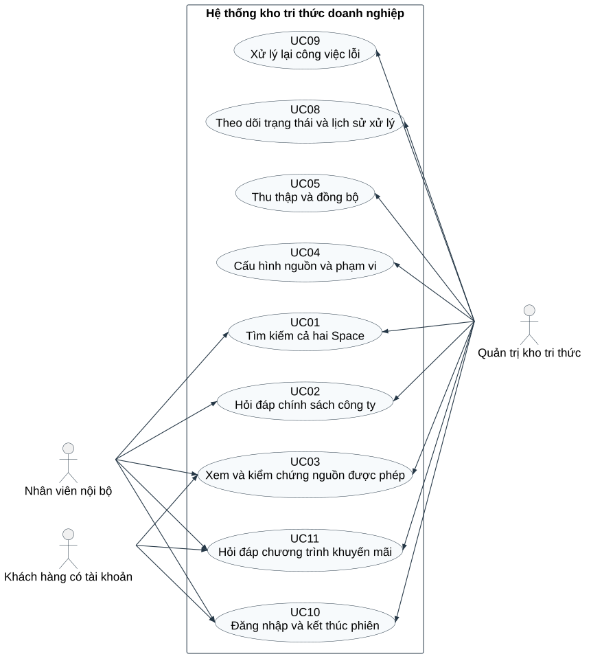
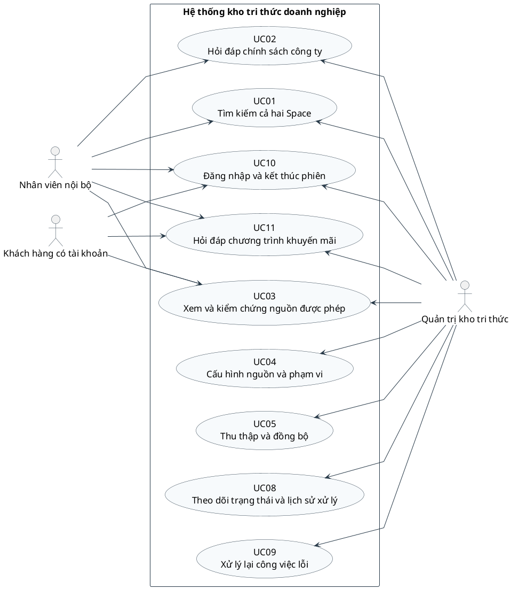
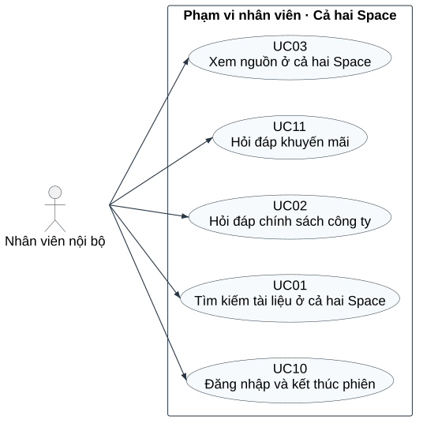
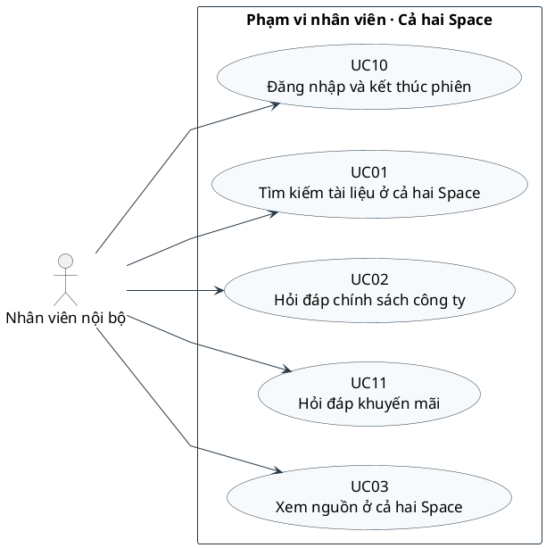
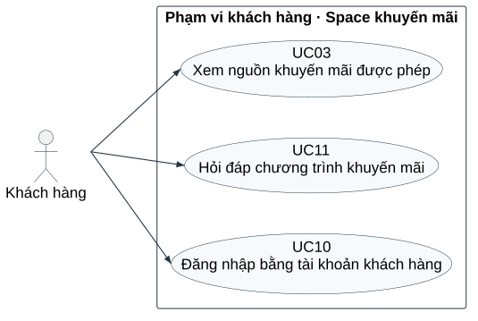
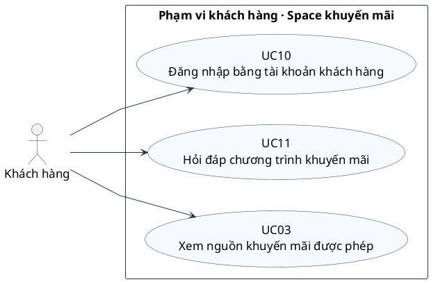
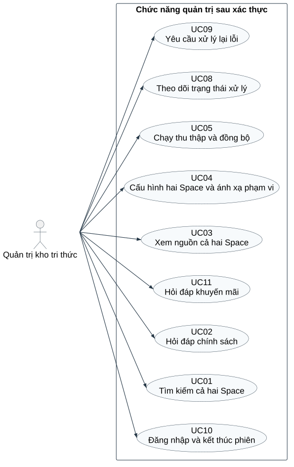
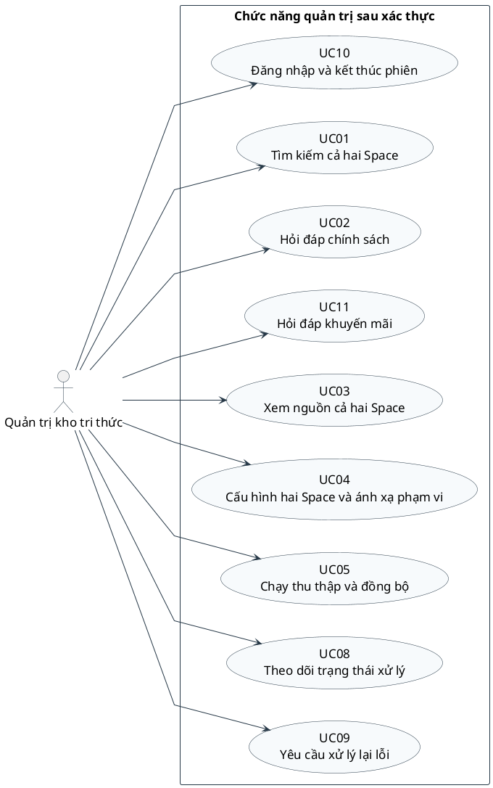

# Sơ đồ Use Case và hướng dẫn chỉnh sửa

[← Đặc tả yêu cầu](../README.md)

- Bộ sơ đồ gồm tổng quan, nhân viên, khách hàng và quản trị.
- Tác nhân dùng hình người; quan hệ sử dụng dùng mũi tên thẳng.
- Hình tổng quan đặt nhân viên/khách hàng bên trái, quản trị bên phải.
- UC05: đồng bộ và cập nhật kho; UC08: trạng thái/thông báo; UC09: xử lý lại thủ công.
- Đặc tả chức năng và luồng nghiệp vụ nằm trong [SRS](../README.md), mục 7–8.
- Sửa mã PlantUML trong tài liệu này rồi xuất SVG; `.puml` được script sinh từ Markdown.

```powershell
python docs/requirements/use-cases/render_usecases.py
```

Tiện ích cần PlantUML `1.2026.9` trong cache hoặc truyền `--jar <path>`. Mặc định là `%USERPROFILE%/.codex/tmp/usecase-plantuml/plantuml-1.2026.9.jar`. Có thể tải jar từ [release chính thức](https://github.com/plantuml/plantuml/releases/tag/v1.2026.9).

Cần Java + Graphviz local hoặc Docker Desktop. Nếu dùng Docker, tiện ích dựng image renderer từ [Dockerfile](renderer/Dockerfile) khi chưa có, rồi xuất hình trong container tạm. Lần build đầu cần mạng tải dependency; không khởi động Kafka broker. Font Arial Windows được sao vào cache để chữ tiếng Việt nhất quán. Jar/font không đưa vào repo.

- Script giữ bố cục PlantUML/Graphviz và dựng liên kết SVG thành mũi tên thẳng tới cạnh elip.
- Dùng script để tái tạo sơ đồ nhất quán với mã nguồn.

## Tổng quan



<details>
<summary>Mã PlantUML</summary>



</details>

## Nhân viên nội bộ



<details>
<summary>Mã PlantUML</summary>



</details>

## Khách hàng có tài khoản



<details>
<summary>Mã PlantUML</summary>



</details>

## Quản trị kho tri thức



<details>
<summary>Mã PlantUML</summary>



</details>
