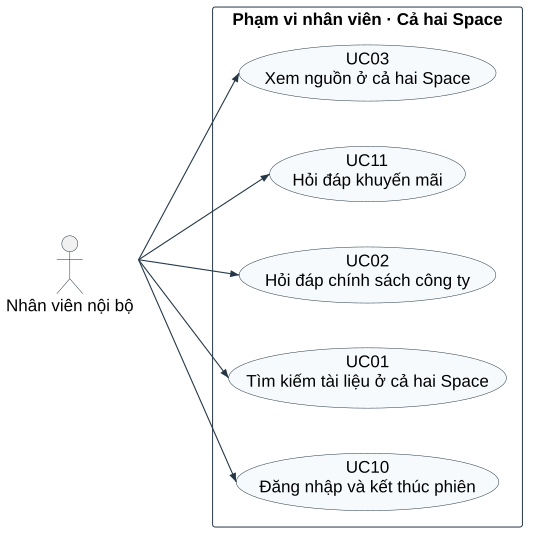
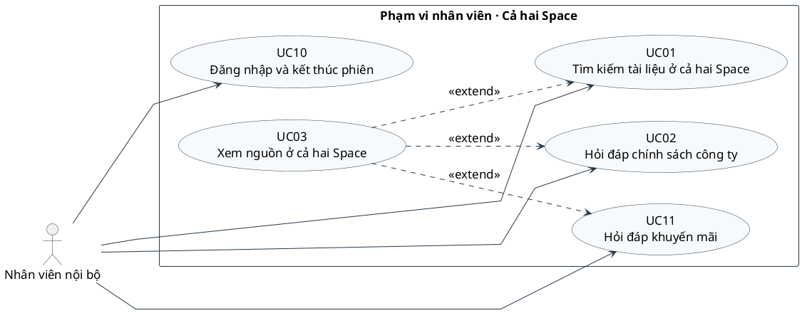
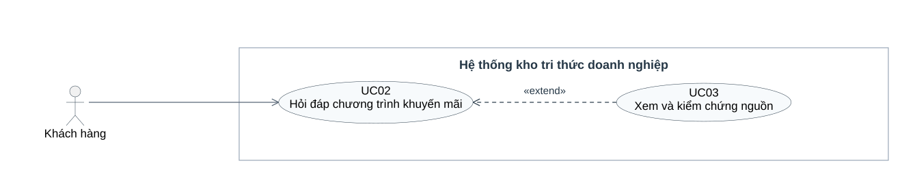
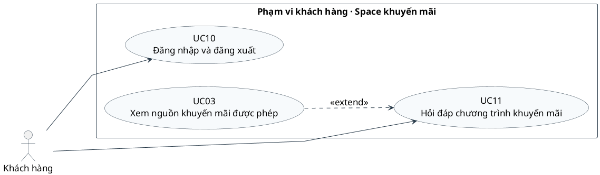
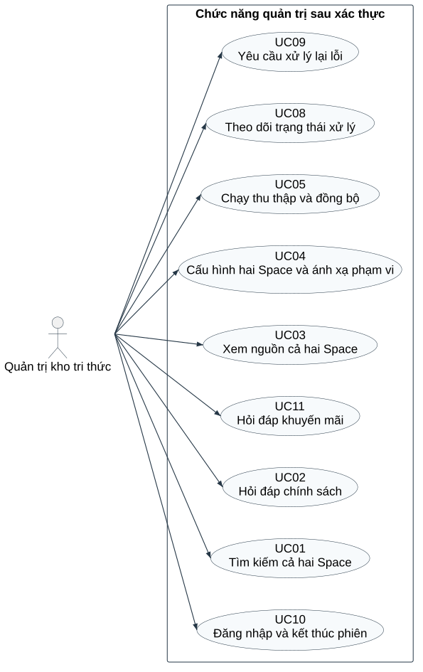
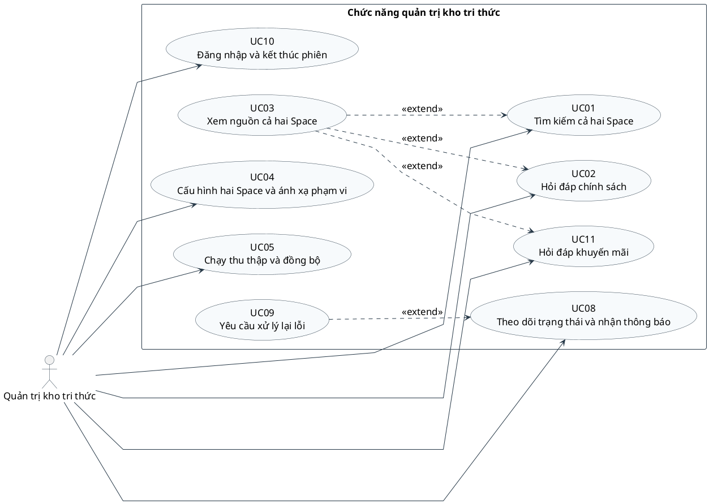

# Sơ đồ Use Case và hướng dẫn chỉnh sửa

[← Đặc tả yêu cầu](../requirements.md)

- Bộ sơ đồ gồm ba góc nhìn theo tác nhân: nhân viên, khách hàng và quản trị.
- Tác nhân dùng hình người; liên kết tác nhân–Use Case thể hiện quyền tham gia chức năng.
- Mỗi quan hệ `«extend»` được vẽ bằng một mũi tên nét đứt riêng nối trực tiếp hai elip; không dùng đoạn đường chung hoặc điểm rẽ nhánh. Sơ đồ chỉ ghi `«extend»`; điểm mở rộng (Extension Point, viết tắt EP) và điều kiện kích hoạt được mô tả tại mục 6.4 và 7 của đặc tả.
- UC03 mở rộng UC01, UC02 và UC11 khi người dùng chọn nguồn; UC09 mở rộng UC08 khi quản trị chọn xử lý lại công việc lỗi đủ điều kiện.
- UC05: đồng bộ và cập nhật kho; UC08: trạng thái/thông báo; UC09: xử lý lại thủ công.
- Đặc tả chức năng và luồng nghiệp vụ nằm trong [SRS](../requirements.md), mục 7–8.
- Sửa mã PlantUML trong tài liệu này rồi xuất SVG; `.puml` được script sinh từ Markdown.

```powershell
python docs/use-cases/render_usecases.py
```

Tiện ích cần PlantUML `1.2026.9` trong cache hoặc truyền `--jar <path>`. Mặc định là `%USERPROFILE%/.codex/tmp/usecase-plantuml/plantuml-1.2026.9.jar`. Có thể tải jar từ [release chính thức](https://github.com/plantuml/plantuml/releases/tag/v1.2026.9).

Cần Java + Graphviz local hoặc Docker Desktop. Nếu dùng Docker, tiện ích dựng image renderer từ [Dockerfile](renderer/Dockerfile) khi chưa có, rồi xuất hình trong container tạm. Lần build đầu cần mạng tải dependency; không khởi động Kafka broker. Font Arial Windows được sao vào cache để chữ tiếng Việt nhất quán. Jar/font không đưa vào repo.

Nếu có Java nhưng không có Graphviz, dùng bộ bố trí Smetana tích hợp trong PlantUML. Java phải có trong `PATH`; có thể truyền vị trí jar bằng `--jar`:

```powershell
python docs/use-cases/render_usecases.py --smetana --jar <path-to-plantuml.jar>
```

- Tác nhân ở bên trái; chức năng chính xếp thành cột; UC03 và UC09 nằm ở cột bên phải. Đường tham gia dùng mũi tên nét liền từ tác nhân tới chức năng; quan hệ `«extend»` dùng nét đứt và đầu mũi tên mở.
- Tiện ích giữ tác nhân, elip và nhãn từ PlantUML, sắp lại vị trí và định tuyến đường nối theo từng tác nhân; không kéo đường xuyên qua elip. UC03 và UC09 được kích hoạt qua điểm mở rộng của UC gốc; không lặp lại liên kết trực tiếp từ tác nhân tới hai UC này. Quyền sử dụng vẫn theo ma trận tại mục 4 của SRS.
- Dùng script để tái tạo sơ đồ nhất quán với mã nguồn.

## Nhân viên nội bộ



<details>
<summary>Mã PlantUML</summary>



</details>

## Khách hàng có tài khoản



<details>
<summary>Mã PlantUML</summary>



</details>

## Quản trị kho tri thức



<details>
<summary>Mã PlantUML</summary>



</details>
