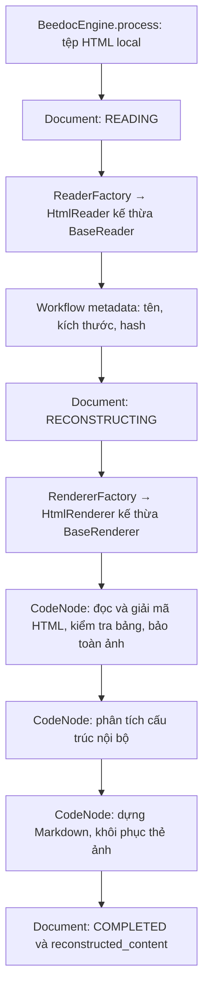

# Beedoc — nhánh HTML → Markdown kế thừa cấu trúc gốc

- Tách nhánh HTML từ Beedoc hiện có, giữ engine, model, interface, lớp nền, reader, renderer, factory và tiện ích liên quan.
- Phạm vi chức năng theo [thiết kế Beedoc](../../docs/design/modules/beedoc.md): chuyển HTML bài viết Confluence sang Markdown và giữ nguyên thẻ ảnh.
- Đây là bản kế thừa có điều chỉnh theo phạm vi đồ án; không chỉ là một hàm chuyển đổi và không phải bản sao nguyên trạng toàn bộ repo cũ.

## Cấu trúc

```text
replica/beedoc/
├── pyproject.toml
├── README.md
├── src/
│   ├── beedoc_v3/
│   │   ├── __init__.py
│   │   ├── engine.py
│   │   ├── core/
│   │   │   ├── constants.py
│   │   │   ├── exceptions.py
│   │   │   └── interfaces.py
│   │   ├── models/
│   │   │   └── document.py
│   │   ├── readers/
│   │   │   ├── base.py
│   │   │   ├── factory.py
│   │   │   └── document_reader/
│   │   │       └── html_reader.py
│   │   ├── renders/
│   │   │   ├── base.py
│   │   │   ├── factory.py
│   │   │   └── document_render/html_render/
│   │   │       ├── render.py
│   │   │       └── utils/
│   │   │           ├── processor.py
│   │   │           ├── converter.py
│   │   │           └── pipeline.py
│   │   └── utils/
│   │       ├── hashing.py
│   │       └── encoding.py
│   └── beedoc/
│       ├── __init__.py
│       ├── converter.py
│       └── _processor.py
└── tests/
    ├── test_converter.py
    └── test_pipeline.py
```

Các thư mục package còn có `__init__.py`. Namespace chính giữ tên `beedoc_v3` như mã nguồn gốc. Các tệp trong `src/beedoc/` chỉ chuyển tiếp đến tiện ích trong nhánh HTML, để giữ cách gọi đã tạo ở lượt trước; không có bộ xử lý trùng lặp.

## Các lớp và trách nhiệm

| Lớp/thành phần | Trách nhiệm | Cách kế thừa |
| --- | --- | --- |
| `BeedocEngine` | Điều phối đọc → dựng Markdown, cập nhật trạng thái/thời gian, trả `Document` | Giữ pipeline `process(file_path)`, sửa kiểu trả về thành `Document`; bỏ pipeline xuất HTML từ PDF/DOCX |
| `BaseInterface`, `IReader`, `IRenderer` | Hợp đồng chung và phương thức đọc/render bất đồng bộ | Giữ hệ thống interface, sửa mô tả cho phạm vi HTML |
| `Document`, `Page`, `Zone` | Model truyền qua pipeline, kết quả, metadata, trạng thái và cấu trúc nội dung | Giữ model gốc; các trường ảnh/AI được giữ về cấu trúc nhưng nhánh HTML không sử dụng để gọi model |
| `DocumentStatus`, `DocumentCategory` | Trạng thái xử lý và kiểu phân loại | Giữ enum; ánh xạ định dạng chỉ đăng ký HTML |
| Các lớp lỗi trong `core/exceptions.py` | Hệ thống lỗi gốc của reader/renderer/workflow | Giữ phân cấp lỗi; việc có lớp lỗi AI/storage không có nghĩa nhánh HTML thực hiện những tác vụ đó |
| `BaseReader` | Hash tệp local, lấy tên/kích thước và cập nhật `Document`; cung cấp workflow mặc định | Giữ lớp nền, bỏ import S3/Beegen không dùng |
| `HtmlReader` | Kế thừa `BaseReader`, xây graph metadata cho tệp HTML | Giữ workflow dùng `CodeNode` và `WorkflowEngine` |
| `ReaderFactory` | Chọn reader theo đuôi tệp | Giữ factory, chỉ đăng ký `html` |
| `BaseRenderer` | Quản lý cấu hình và workflow render, cung cấp hợp đồng thực thi cho lớp con | Giữ lớp nền và điểm mở rộng `_build_workflow` |
| `HtmlRenderer` | Chuẩn bị HTML → phân tích → dựng Markdown; cập nhật `Document` | Giữ graph Beeflow; bỏ image gate, LLM và cấu hình Langfuse cố định |
| `RendererFactory` | Chọn renderer theo đuôi tệp | Giữ factory, chỉ đăng ký `html` |
| Tiện ích hash/encoding/chuyển đổi | Hash file, giải mã HTML, xử lý cấu trúc và bảo toàn thẻ ảnh | Hash/nhận diện encoding kế thừa gốc; phần chuyển đổi được điều chỉnh theo thiết kế |

`file_hash` kế thừa mặc định MD5 của tiện ích gốc, chỉ là metadata tệp trong module này. Việc chọn khóa/hash phiên bản cho pipeline đồng bộ thuộc worker, không được suy ra từ trường này.

## Luồng xử lý



- Giữ cách điều phối bằng Beeflow của mã nguồn gốc. Import Beeflow được thực hiện khi dựng workflow; import model/factory hoặc gọi tiện ích chuyển đổi không khởi tạo các dịch vụ của Beeflow.
- Các cấu trúc block chỉ dùng nội bộ, không phải đầu ra bắt buộc của worker.
- Worker cung cấp tệp HTML local cho giao diện engine kế thừa. Nếu đã có chuỗi HTML, có thể gọi tiện ích `convert_html` trực tiếp; tiện ích này không chạy reader/renderer workflow.
- Engine giữ hành vi gốc: lỗi đọc/render trả `Document` có `status=FAILED` và `error_message`. Caller bắt buộc kiểm tra trạng thái; không coi kết quả thất bại là tài liệu rỗng. Định dạng không hỗ trợ bị từ chối trước khi chạy pipeline.

## Sử dụng

Python từ 3.10. Cài package từ thư mục gốc workspace:

```powershell
python -m pip install -e ./replica/beedoc
```

Ví dụ giao diện engine kế thừa, chạy trong hàm bất đồng bộ khi môi trường Beeflow đã được chuẩn bị:

```python
from beedoc_v3 import BeedocEngine
from beedoc_v3.core.constants import DocumentStatus

document = await BeedocEngine().process("page.html")
if document.status != DocumentStatus.COMPLETED:
    raise RuntimeError(document.error_message)
markdown = document.reconstructed_content
```

Tiện ích nhận chuỗi HTML, dùng độc lập với workflow:

```python
from beedoc import convert_html

markdown = convert_html('<h1>Quy định</h1><p>100 đồng.</p>')
```

## Phụ thuộc và phạm vi

- Tiện ích chuyển đổi cần `beautifulsoup4`, được khai báo trong `pyproject.toml`.
- Engine/reader/renderer cần thêm môi trường Beeflow tương thích các import/API gốc. Package Beeflow chưa được tách vào `replica` trong lượt này; lệnh cài Beedoc ở trên không tự cung cấp Beeflow.
- Bản Beeflow tham khảo hiện còn liên quan Beegen, ResourceHub và streaming. Việc trì hoãn import không loại bỏ các phụ thuộc đó khi thực thi workflow. Cần kiểm chứng với bản Beeflow được tách sau này; chưa khẳng định graph chạy độc lập chỉ với Beautiful Soup.
- Hỗ trợ heading, đoạn văn, danh sách, liên kết, `<br>` và bảng chữ nhật đơn giản. Giữ nguyên từng thẻ `` và thuộc tính, không tải ảnh hoặc bóc tách nội dung ảnh.
- Từ chối bảng gộp ô, bảng lồng và bảng có số cột không đều. HTML sai nhẹ có thể được `html.parser` phục hồi; đây không phải bộ kiểm định cú pháp hay bộ làm sạch HTML để hiển thị trực tiếp trên trình duyệt.
- Không đưa vào các nhánh PDF/DOCX/Excel, OCR/VLM, image gate, lưu trữ S3, chunking hoặc đồng bộ Confluence. Các tác vụ này không thuộc trách nhiệm HTML → Markdown đã chốt.
- `process_html()` của engine cũ là xuất HTML từ các định dạng khác, không phải đọc HTML; vì thế không được đưa vào nhánh này.

## Nguồn gốc để review

- Thư mục nguồn: [beedoc_v3 gốc](../../beedoc/beedoc/beedoc_v3/).
- Các đường dẫn `engine.py`, `core/*`, `models/document.py`, `readers/*`, `renders/base.py`, `renders/factory.py` và `utils/hashing.py` trong bản tách bám theo cấu trúc tương ứng của nguồn gốc.
- `HtmlRenderer` bám theo [renderer HTML gốc](../../beedoc/beedoc/beedoc_v3/renders/document_render/html_render/render.py), thu graph về ba bước chuyển đổi.
- `processor.py` kế thừa [processor gốc](../../beedoc/beedoc/beedoc_v3/renders/document_render/html_render/utils/processor.py); thu gọn xử lý bảng, sửa xử lý liên kết ngoài cùng/comment/văn bản mã hóa.
- `utils/encoding.py` tách hàm nhận diện encoding từ processor gốc.
- `converter.py` và `pipeline.py` trong tiện ích HTML là phần bổ sung để bảo toàn nguyên văn ảnh, báo lỗi và nối các bước với graph.
- Mã nguồn ở thư mục Beedoc tham khảo không bị chỉnh sửa.

## Kiểm tra đã thực hiện

Chạy từ thư mục gốc workspace:

```powershell
$env:PYTHONPATH = (Resolve-Path ./replica/beedoc/src).Path
python -m unittest discover -s ./replica/beedoc/tests -v
```

- Đạt 25 ca: 18 ca chuyển đổi và 7 ca cho metadata tệp, model, factory, chuỗi xử lý HTML và vòng đời engine.
- Các ca vòng đời engine dùng reader/renderer giả lập để kiểm tra điều phối và trạng thái. Các hàm chuẩn bị/phân tích/kết xuất HTML được chạy thật với tệp tạm.
- Import engine, model và factory đã được kiểm tra mà không khởi tạo Beeflow.
- Chưa chạy graph với Beeflow thật, chưa kiểm thử tích hợp worker hoặc Confluence. Kết quả 25 ca không thay thế kiểm thử tích hợp workflow.
